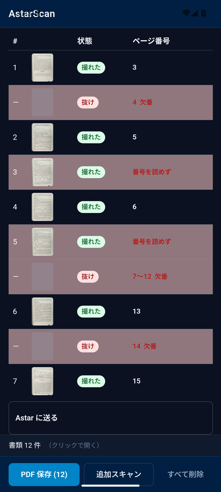
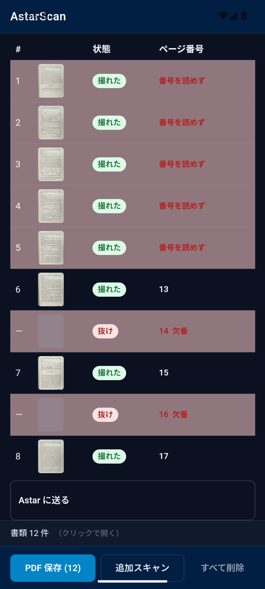
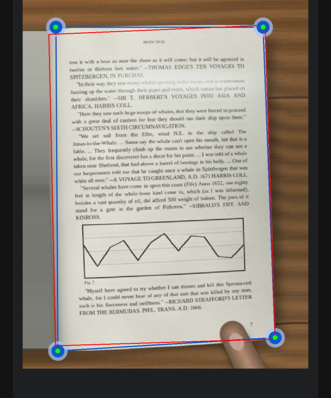
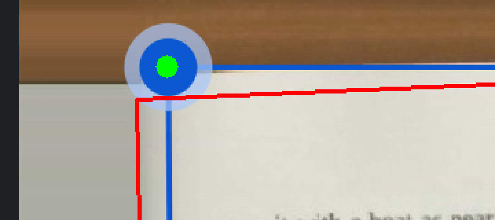
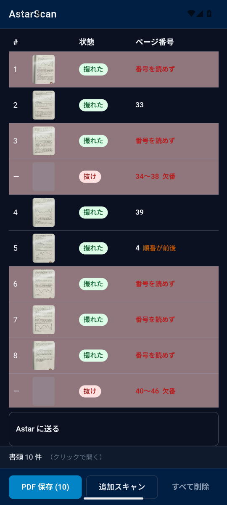
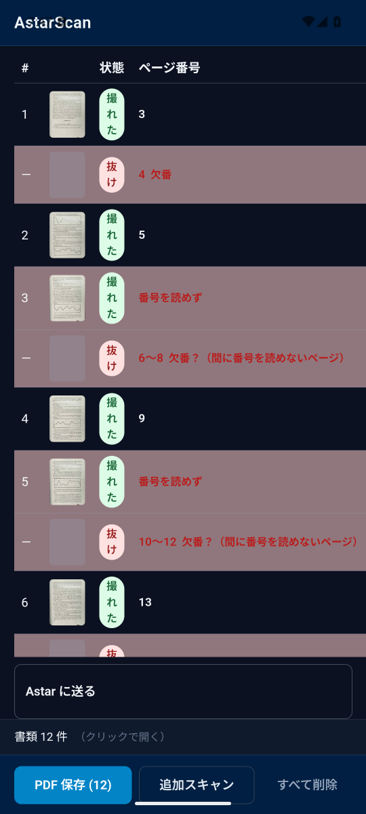

# Android (ML Kit scanner) — book clips on the emulator camera

The CI job `android-emulator` plays the five synthetic book clips of
`scripts/eval/book-clips/clips` (60 target pages, ground truth in the
`*.gt.json` next to them) on the Android emulator's back camera and
scans them with the AstarScan app (Google ML Kit Document Scanner).

## How the book reaches the camera

`v4l2loopback` + `ffmpeg`: `scripts/android/camera-feed.py` writes the
clip frames to `/dev/video0` (a loopback webcam, label `BookCam`), and
the emulator is started with `-camera-back webcam0`. The check script
(`scripts/android/emulator-check.sh`) tells the feed which spread to
hold, and turns the page after each capture.

Why not virtualscene with a replaced poster: the poster is a small
texture far away in the virtual room and the camera there moves with
the device sensors; the book would never fill the frame like a phone
held over it, and the corner ground truth could not be mapped to the
frame. The loopback webcam gives the exact clip frame (fitted to
1280×960), so `book-measure.py` can map the ground-truth corners onto
what ML Kit saw. GitHub's `ubuntu-latest` runner loads `v4l2loopback`
(run 1 log: `Camera 'BookCam' can be specified by label as 'webcam0'`).

## Runs

| Run | Commit  | What changed                                                                                                                                                                                                                                                                                      | Pages captured / 60                                                                                                                                                                                                                                                                                                                                                                                                                      | Corner error (clip px)                                                                                                                                                                                                                                                                                 | Silent misses (無表示)                                                                                                                                                                                                                                                                                                                                              |
| --- | ------- | ------------------------------------------------------------------------------------------------------------------------------------------------------------------------------------------------------------------------------------------------------------------------------------------------- | ---------------------------------------------------------------------------------------------------------------------------------------------------------------------------------------------------------------------------------------------------------------------------------------------------------------------------------------------------------------------------------------------------------------------------------------- | ------------------------------------------------------------------------------------------------------------------------------------------------------------------------------------------------------------------------------------------------------------------------------------------------------ | ------------------------------------------------------------------------------------------------------------------------------------------------------------------------------------------------------------------------------------------------------------------------------------------------------------------------------------------------------------------- |
| 1   | a1b5917 | first run with the loopback webcam                                                                                                                                                                                                                                                                | 0 (ML Kit never auto-captured; the blind shutter tap at 540,2005 did not capture; 2 pages appeared later in the review of clip 2, origin unknown)                                                                                                                                                                                                                                                                                        | 未確認 (no adjust-corners screen)                                                                                                                                                                                                                                                                      | 60 (no page reached the list)                                                                                                                                                                                                                                                                                                                                       |
| 2   | 66df62f | shutter found from the UI dump; a clip is given up after 3 presses; camera diagnostics in the job log; screenshot zip reaches the release                                                                                                                                                         | 1 (ML Kit auto-captured p2 of spread-land-wood within ~10 s; the check then mistook the new "Crop and rotate" screen for the camera and pressed its Apply as the shutter, and kept that one page through every clip via "Keep editing")                                                                                                                                                                                                  | not scored (the screen was not recognised); by eye: the frame is on the left page, its two right handles sit on the right edge of the visible image, not the gutter — the right page was cut off                                                                                                       | 59 (nothing saved to the list)                                                                                                                                                                                                                                                                                                                                      |
| 3   | d9d0485 | the clip is fitted into the 3:4 window the scanner sees; the "Crop and rotate" screen is recognised; leftovers are discarded                                                                                                                                                                      | 40 taken in the scanner, 29 reached the list (single-port-wood: 11 taken, never saved — the clip ran out of its 10 min, 12 holds × ~60 s with the manual shutter)                                                                                                                                                                                                                                                                        | spreads: mean 14.6 / 13.8 / 18.5, max 49; single-port-wood: 28.6 (max 109, a corner under the thumb); single-land-white: 64.0 (max 135 — ML Kit framed the whole spread, not the target page)                                                                                                          | 13 (single-port-wood 12, p37 of single-land-white 1)                                                                                                                                                                                                                                                                                                                |
| 4   | f3baa1a | the feed zooms onto the target pages (`clip_box()`); manual shutter after 15 s; ~75 s per page and save-on-timeout                                                                                                                                                                                | 40 taken; 38 reached the list (single-port-wood: ML Kit crashed at its 12th page and the 11 pages of that scan were lost; the check re-opened the scanner and saved 9)                                                                                                                                                                                                                                                                   | spreads: mean 13.4 / 11.0 / 14.3, max 27; single-port-wood: 21.7 (max 57); single-land-white: 17.0 (max 116, two captures where the left frame edge sat on the facing page) — frames now on the target page                                                                                            | 7 by the scorer (single-port-wood 5, its row-to-hold mapping is off after the crash; single-land-white p31, p37)                                                                                                                                                                                                                                                    |
| 5   | 500bf80 | NDLOCR reads page-number (block_folio) boxes; sessions of ≤ 10 pages                                                                                                                                                                                                                              | 48 taken, 41 reached the list (7 of spread-land-wood lost to an ML Kit crash after the 7th page's Apply, then re-taken: all 60 target pages are on a list row)                                                                                                                                                                                                                                                                           | spreads: mean 14.3 / 11.8 / 12.5, max 27; single-port-wood: 20.1 (max 49); single-land-white: 13.4 (max 115)                                                                                                                                                                                           | 1 (p37, the page skipped on purpose: its neighbours were misread, so no red 欠番 covered it); scorer of run 5 counted 10 because it took misread rows as silent — rescored with the fixed parser                                                                                                                                                                    |
| 6   | 99b8323 | 一 next to digits is a dash; page-number boxes widened to 6× height; lost scans at the start screen marked                                                                                                                                                                                        | 41 taken, 41 reached the list — every hold of every clip, no crash; PDF saved (`astarscan-20261102-094707.pdf`)                                                                                                                                                                                                                                                                                                                          | spreads: mean 14.7 / 10.7 / 13.7, max 37; single-port-wood: 20.3 (max 50); single-land-white: 13.3 (max 103)                                                                                                                                                                                           | 1 (p37, skipped on purpose; its neighbours are 番号を読めず, so no red 欠番 covers it)                                                                                                                                                                                                                                                                              |
| 7   | 0c02b71 | page numbers read with ML Kit Text Recognition v2 (Japanese, on the device, full-size scan, bands enlarged to 1600 px wide) instead of NDLOCR                                                                                                                                                     | 47 taken, 39 reached the list (single-port-wood: ML Kit closed with 8 pages of the first session, lost and re-taken; holds 8–9 (p19, p21) not taken in time — shown inside the red 抜け 18〜22)                                                                                                                                                                                                                                          | spreads: mean 15.4 / 10.8 / 14.2, max 25; single-port-wood: 20.7 (max 62); single-land-white: 10.4 (max 30)                                                                                                                                                                                            | 1 (p37); numbers 6 right / 0 wrong of 39 rows (single-port-wood 3, 13, 15, 17, 23, 25); false 抜け 0                                                                                                                                                                                                                                                                |
| 8   | 9ce5fd3 | a second ML Kit pass on the outer 10 % of the page in three tiles enlarged up to 6×, lines of both passes used                                                                                                                                                                                    | 41 taken, 41 reached the list, no crash                                                                                                                                                                                                                                                                                                                                                                                                  | spreads: mean 14.2 / 11.2 / 14.2, max 39; single-port-wood: 20.7 (max 42); single-land-white: 16.0 (max 105)                                                                                                                                                                                           | 1 (p37); numbers 9 right / 1 wrong of 41 rows (band pass alone 8 / 0, tile pass 9 / 1); false 抜け 0                                                                                                                                                                                                                                                                |
| 9   | 68c6d09 | band pass only again (run 7 reading); scorer reads the full logcat                                                                                                                                                                                                                                | 41 taken, 41 reached the list, no crash; PDF saved                                                                                                                                                                                                                                                                                                                                                                                       | spreads: mean 14.8 / 10.4 / 12.2, max 38; single-port-wood: 19.9 (max 67); single-land-white: 47.3 (max 649 — c3 was taken while the feed still showed p35, registration failed; by eye the frame is on the page; without c3 the mean is ~13)                                                          | 1 (p37); numbers 7 right / 0 wrong of 41 rows; false 抜け 0; 抜け spanning a captured page 0                                                                                                                                                                                                                                                                        |
| 10  | 825bc35 | ML Kit probe on page images (emulator size / clip size); webcam feed 1920×1440                                                                                                                                                                                                                    | 0 — with a 1920×1440 webcam the emulator offers the back camera only at 1920×1440 and the scanner preview stayed black (centre mean 2), every clip given up after 3 shutter presses                                                                                                                                                                                                                                                      | not scored (no capture)                                                                                                                                                                                                                                                                                | not scored; probe: ML Kit 22 right / 0 wrong at clip size vs 9 / 0 at emulator size                                                                                                                                                                                                                                                                                 |
| 11  | 752b042 | folio pass (isolated margin print read enlarged), used when the band pass reads no number; feed back to 1280×960                                                                                                                                                                                  | 41 taken, 41 reached the list, no crash                                                                                                                                                                                                                                                                                                                                                                                                  | spreads: mean 14.7 / 10.3 / 12.2, max 26; single-port-wood: 20.7 (max 45, the spine curl); single-land-white: 14.1 (max 119)                                                                                                                                                                           | **0** (p37 is inside the red 34〜38 欠番); numbers 11 right / 1 wrong of 41 rows (p41 read "4" by the band pass, shown as 順番が前後); false 抜け 0; 4 抜け rows also span a captured but unread page                                                                                                                                                               |
| 12  | fcb9918 | a gap with unread captures inside is shown as 欠番？; probe gets 30 min                                                                                                                                                                                                                           | 41 taken, 41 reached the list, no crash                                                                                                                                                                                                                                                                                                                                                                                                  | spreads: mean 16.4 / 12.0 / 11.6, max 29; single-port-wood: 18.5 (max 41); single-land-white: 11.8 (max 95)                                                                                                                                                                                            | 1 (p37 — single-land-white read only p43 this time, so no 欠番 covers p37); numbers **11 right / 0 wrong**; false 抜け 0; plain 抜け spanning a captured page 0 (6〜8 and 10〜12 shown as 欠番？)                                                                                                                                                                   |
| 13  | 194b33e | folio crops enlarged to 64 px with stretched levels                                                                                                                                                                                                                                               | 41 taken, 41 reached the list, no crash; PDF saved                                                                                                                                                                                                                                                                                                                                                                                       | spreads: mean 13.3 / 11.4 / 14.2, max 26; single-port-wood: 19.4 (max 53); single-land-white: 17.2 (max 117)                                                                                                                                                                                           | 1 (p37); numbers 8 right / 0 wrong; false 抜け 0; plain 抜け spanning a captured page 0 (8〜12 shown as 欠番？)                                                                                                                                                                                                                                                     |
| 13b | bdd0f91 | run 13 reverted to the run 12 folio pass (the push's own CI run, no new change)                                                                                                                                                                                                                   | 41 taken, 41 reached the list, no crash                                                                                                                                                                                                                                                                                                                                                                                                  | spreads: mean 14.9 / 11.0 / 15.2, max 35; single-port-wood: 17.7 (max 46); single-land-white: 8.5 (max 21)                                                                                                                                                                                             | 1 (p37); numbers 11 right / 0 wrong; false 抜け 0; plain 抜け spanning a captured page 0                                                                                                                                                                                                                                                                            |
| 13c | 2b2c3e7 | docs-only push; same app code as 13b (run 41544015513)                                                                                                                                                                                                                                            | 41 taken, 21 reached the list — Play services' scanner process (26.43.30) died 10 times in single-port-wood and single-land-white: 1 Java NullPointerException in its `CarouselLayoutManager`, 9 native SIGSEGVs in its glide thumbnail thread (tombstones; logcat has no "FATAL EXCEPTION" line for these); every page of the scan it held was lost                                                                                     | spreads: mean 14.9 / 12.3 / 13.7, max 31                                                                                                                                                                                                                                                               | 20 (all pages of the two lost clips; the 3 spread clips: 0); numbers 0 / 0 — no single-page row reached the list, and the numbers of runs 11–13b were all read on the single-page clips (the spreads read 0 in every run), so this is the lost pages, not a reading change                                                                                          |
| 14  | ea4b5c5 | app scans in sessions of 5 pages (ML Kit page limit) and reopens the scanner after each full one; check: sessions of 5, no shutter press on the review, lost later sessions caught with a fresh budget (run 41557577279)                                                                          | 41 taken, **41 reached the list**; no scanner crash (logcat: no tombstone, no FATAL EXCEPTION, no "scan closed without pages"); the app reopened the scanner 7 times, once after each full session                                                                                                                                                                                                                                       | spreads: mean 14.3 / 11.0 / 13.8, max 33; single-port-wood: 61.2 (max 990 — c5's registration failed, 5 inliers, scorer assumed the mapping; by eye the frame is on the page; without c5 18.8, max 43); single-land-white: 13.5 (max 117, c0: left edge past the gutter)                               | **1** (p37, skipped on purpose; its neighbours p35 / p39 unread, so no 欠番 covers it); numbers **9 right / 0 wrong** of 41 rows (single-port-wood 8, single-land-white 1); false 抜け 0; plain 抜け spanning a captured page 0                                                                                                                                     |
| 15  | 9fd5da4 | check: Crop and rotate left with Close → Discard (no Apply at all) (run 41568654338)                                                                                                                                                                                                              | 56 taken, 41 kept and on the list; Play services' scanner died again (5 deaths in the 20 min of logcat kept: native SIGSEGV in TFLiteClient-0 ×2, glide-source ×2, main thread ×1 — without any Apply); 8 sessions lost (1–4 pages each) and taken again from their first hold; every clip saved all its holds                                                                                                                           | spreads: mean 14.6 / 11.2 / 12.9, max 34; single-port-wood: 17.9 (max 42); single-land-white: 12.4 (max 97, c7: left edge past the gutter)                                                                                                                                                             | **1** (p37); numbers 8 right / 0 wrong (single-port-wood 8; single-land-white 0 of 10 this time); false 抜け 0; plain 抜け spanning a captured page 0                                                                                                                                                                                                               |
| 17  | eab1152 | app: ModuleInstallClient check/install before the scanner (no own retry loop), gutter trim of portrait pages framed past the spine (GutterTrim.kt, one place in scanResult), red notice + スキャン when the scanner returns no pages; check: Cancel on the failed module screen (run 41601986645) | 74 taken, 36 kept. Play services' scanner died 55 times (Java AIOOBE in `lowpool`, `gms.ui` main thread, native SIGSEGV); 37 sessions lost and retaken. spread-land-white-thick and single-port-wood kept nothing (the check gave up after its retake budget), single-land-white stopped after p41. The app's ModuleInstallClient installed the scanner module at 09:06 (10 s); Play services' failed-module screen did not appear       | spreads: mean 14.8 / 13.2 / 13.6, max 39; single-port-wood: 22.5 (max 43, tl at the spine curl, not trimmed — no kept page); single-land-white: ML Kit 18.3 (max 117); kept pages after the gutter trim 17.6 / 116.6 → **8.6 / 16.6** (1 page trimmed: c0 L 0.147 / 0.100 → err [8.3, 8.3, 10.5, 4.0]) | 29 (spread-land-white-thick 12, single-port-wood 12, single-land-white 5 incl. p37) — all after scanner crashes, 25 of the 37 lost-session screens showed the app's red notice (shots 010, 238, 431), 12 were the app still waiting on a scan call that never returned (no notice); scorer counts only module-screen notices, so 0 shown; numbers 1 right / 0 wrong |
| 16  | 78a74c4 | check: waits for 取り込み中 before the list, logs scanner deaths for the whole run; app (another session, 78a74c4): unread numbers grey 番号なし (run 41584764649)                                                                                                                                | 60 taken, 34 rows on the list. spread-land-wood: 0 — Play services was updating the scanner module when the scanner opened, the update failed ("Something went wrong / Try again later / Cancel") and the check stood on that screen for the whole 10 min budget. The other 4 clips: every hold saved, although the scanner died 19 times (native SIGSEGV: glide ×14, main thread ×5); 17 sessions lost (1–4 pages each) and taken again | spreads: mean 12.0 / 13.9, max 29; single-port-wood: 19.8 (max 42); single-land-white: 19.7 (max 113)                                                                                                                                                                                                  | 15 (spread-land-wood 14 — the check fault above; p37 1); numbers 9 right / 0 wrong; false 抜け 0                                                                                                                                                                                                                                                                    |

Run 2 finding: the portrait scanner shows only a 3:4 window at the left
of the 1280×960 webcam frame (columns 0–719), upright. The feed had
centred the spread in the full 4:3 frame, so the right page fell
outside. 

Run 3 findings (run 41393953610, opened every screenshot):

- The frame sits on the paper: on the spreads ML Kit's four handles are
  on the outer corners of the open book (mean 14–19 clip px off the
  ground truth, i.e. < 1.5 % of the spread width).
  
- Every list row of the three spread clips and of single-land-white
  says 撮れた + 番号を読めず: nothing silent there, but no page number
  was read, so the deliberately skipped p37 could not be shown as a red
  欠番. The whole 16:9 clip was squeezed into the 720 px wide window,
  and the page numbers were 4–6 px tall.
  
- single-land-white (target: the right page): ML Kit framed the whole
  open book, whose left page ran off the clip edge.
  
- ML Kit never auto-captured single-port-wood (stays at "Scanning… hold
  steady"); every page needed the manual shutter after the 25 s wait, so
  the clip used up its 10 min at 11 / 12 and the scan was dropped
  unsaved: 12 silent misses.

Run 4 changes: the feed shows the part of the clip around the target
pages (like holding the phone so the book fills the screen —
`clip_box()` in camera-feed.py, also used by book-measure.py); the
manual shutter comes after 15 s; a clip gets ~75 s per page (min 10
min), and when that runs out or the clip is given up, the pages taken so
far are saved instead of dropped.

After run 4 (in the APK from run 5 on): 番号を読めず and 読み取りできず
are drawn in red like 欠番 / 重複 (`CaptureReport.vue`) — a page whose
number cannot be read cannot be checked for gaps or repeats, so the user
has to look at it.

Run 4 findings (run 41399391353):

- With the zoom the single-page clips are framed on the target page
  (single-land-white mean error 64 → 17 clip px).
  
- Page numbers are still not read (35 of 38 rows 番号を読めず, the other
  3 misread: 198, 10, 4) although "— 49 —" is plainly printed on the
  scanned page. Cause: the app's NDLOCR layout step passes only the
  `line_*` classes to recognition; NDLOCR labels a page number
  `block_folio` (class 9, ndl.yaml), so it was dropped before it was ever
  read. 
- ML Kit crashed when the 12th page of one scan was taken
  (`NullPointerException` in `CarouselLayoutManager`, Play services
  26.42.31, logcat 07:12:36) and the app received nothing — the 11 pages
  of that scan vanished without a row. A user with a long book would
  lose pages the same way.

Run 5 changes: the app's OCR now recognises `block_folio` (page number)
and `block_pillar` (running head) boxes too, a short page-number box is
widened so it is not read as vertical text (layout-detector.ts); the
check scans a clip in sessions of at most 10 pages (next session via
追加スキャン) and records the pages of a scan the scanner lost as
`kept=0` in captures.tsv.

Run 5 findings (run 41407726651):

- Page numbers are read now. single-port-wood (English, "5" in the
  corner): 15, 19, 21, 23 read right, 5 / 7 / 9 right but flagged
  順番が前後 because the first page read 10; 11, 13, 17, 25 番号を読めず.
  
- single-land-white (Japanese "— 33 —"): read as 1, 6, 8, 5 — the dashes
  come back as the kanji 一, which parsed as page 1; the wrong numbers
  then produce false red 欠番 rows (2〜5, 7) and the real gap (p37) is
  not shown. Every page still has a row (撮れた / red 番号を読めず).
  
- The ML Kit crash came back on spread-land-wood right after the 7th
  page's Apply (same `CarouselLayoutManager` NPE): it is not a page-count
  limit. The app fell back to its start screen; the check started the
  clip again, but did not mark the lost captures (fixed for run 6).
- The scorer joined texts wrongly (`5順番が前後`, `2〜5欠番`,
  `重複候補 = 1` are single texts in the dump) and counted rows with a
  wrong number as silent; fixed, run 5 rescored above.

Run 6 changes: `parsePageNumberToken` treats 一 next to Arabic digits as
a dash and rejects a lone 一 (unit test added); a page-number box is
widened to 6× its height before recognition (the recognizer stretches
every crop to 16:1); the check marks a scan lost to a crash at the start
screen as `kept=0`.

Run 6 findings (run 41415695993, final; recording:
[book-eval-recording.mp4](https://github.com/AstarWorks/AstarScan/releases/download/android-android-mlkit-scanner/book-eval-recording.mp4),
screenshots: [emulator-check.zip](https://github.com/AstarWorks/AstarScan/releases/download/android-android-mlkit-scanner/emulator-check.zip)):

- All 41 captures (60 target pages) reached the list; every page has a
  row: 撮れた with a number, or red 番号を読めず / 重複 / 順番が前後, and
  red 抜け rows for the gaps the numbers imply. Silent (無表示): only
  p37 — the page the last clip skips on purpose. The app can only flag a
  skipped page from the numbers on either side, and p35 / p39 were
  番号を読めず.
  
- The "1" reads from the dashes are gone, but the Japanese "— NN —"
  numbers are still mostly not read (1 of 10 read, as 10), and the
  spreads (4–8 px digits): 2 of 19 rows got a number, both a wrong "1". single-port-wood: 13, 15, 17
  right; 10, 5, 20, 1, 3 wrong, giving false 抜け rows (11〜12, 14, 16,
  18〜19). Widening the page-number box did not clearly help.
  
- Corner frames: ML Kit's handles are 11–20 clip px (mean) off the
  ground-truth corners on every clip; the worst single corners (≈ 100 px)
  are on single-land-white where the left edge sat on the facing page.

Run 7 changes: the Android app reads page numbers with ML Kit Text
Recognition v2 (`readMargins` in ScannerPlugin.kt; bundled Japanese
model, also reads Latin) on the full-size scan, top / bottom 15 % bands
enlarged to 1600 px wide, then the same `pickPageNumbers` /
`checkPageSequence`. NDLOCR (still used by the web app) keeps repeated
characters and no longer widens page-number boxes (see the offline
section). Each page's ML Kit lines are logged (`pageno.log`) and scored
per pass (`mlkit-lines.jsonl`).

Run 7 findings (run 41434186488):

- ML Kit read 6 page numbers, all right (3, 13, 15, 17, 23, 25 of
  single-port-wood); 0 wrong, so no 抜け row comes from a misread (run 6:
  4 right / 8 wrong). The other 33 rows are red 番号を読めず.
  
- Nothing on the spreads and nothing Japanese: ML Kit reads the body
  lines in the bands but not the page number. On the emulator the
  Japanese "— 33 —" is ~10 px tall in a 720×1040 capture.
  
  
- p37 is still the one silent miss: p35 and p39 are not read, so no
  red 欠番 can cover it.
- Same-resolution comparison: NDLOCR on the simulated emulator-size pages
  (offline, run 7 NDLOCR) is 9 right / 4 wrong / 28 none; ML Kit 6 / 0 / 33. ML Kit stays: a wrong number makes a false 抜け row (or hides a real
  one), an unread number only a red 番号を読めず row.

Run 8 findings (run 41445033401):

- Per pass (41 pages): band 8 right / 0 wrong / 33 none, tile 9 / 1 / 31. The tile pass adds p5 but reads p9 as "6" at confidence 0.91 —
  a confidence threshold cannot drop it — and the list shows "6" as an
  ordinary number, which makes the 抜け row start at 7 instead of 6
  (7〜12, spanning the captured p9 and p11). The tile pass is removed
  again (run 9): a wrong number costs more than an unread one.
  
- Neither pass reads anything on the spreads or on the Japanese pages
  at emulator size, so p37 stays silent.
- The filtered `pageno.log` stream stopped after the third clip; the
  scorer now falls back to the full logcat dump.

Run 9 findings (run 41457259556):

- Page numbers read by ML Kit: 7 right, 0 wrong (single-port-wood 3, 5,
  13, 15, 17, 23, 25 — the corner numbers in English); every other row
  is a red 番号を読めず. The 抜け rows (14, 16, …, 24) are the left pages
  this clip never shows — really not captured.
  
- Spreads (19 rows) and Japanese "— NN —" (10 rows): still no number
  read at emulator size, so p37 (skipped on purpose) has no row and no
  欠番 — the one silent miss, as in runs 6–8.
- The check took single-land-white c3 while the feed still showed p35
  (screenshot shows "— 35 —"; planned p39): a timing slip of the check,
  not of the app; the corner scorer could not register that capture.
- The CI scoring step crashed writing measure.json (a float32 from the
  registration fallback); fixed, run 9 scored locally with the fix.

Top-left corner of single-port-wood (19–45 clip px in every run), checked
on run 9 c2 (p7) — ground truth mapped onto the Adjust-corners screenshot
(red), ML Kit's handles (green on blue):

- ML Kit's frame lies on the paper: its top edge is on the flat top edge
  of the page, its left edge on the page's left edge; the other three
  corners are 1–25 clip px off.
- The ground-truth tl is the paper's real corner at the spine, where the
  page curls down and to the left (it is 0–27 px left of the clip's edge
  on 5 of the 12 holds; the feed fills that strip by repeating the edge
  pixels, so nothing can see it). ML Kit's straight quad cannot follow
  the curl and leaves a thin strip at the spine out of the crop (no text
  in it).
- So it is neither a ground-truth error nor a scorer mismatch nor an app
  bug: it is ML Kit's four-point frame on a curled page. Nothing changed
  in the app. The scorer now scores a corner that lies outside the clip
  against the point where the page edge leaves the clip
  (`visible_quad()`, `out_of_clip` in measure.json): run 9
  single-port-wood rescored 19.9 → 18.2 mean (max 44.6, still the curl).

Run 10 changes:

- ML Kit page-number probe (step 1, clip quality vs reader): the check
  pushes 123 page images (41 holds × emulator-size with a 1280×960 feed,
  emulator-size with a 1920×1440 feed, the clip's own pixels;
  `probe-pages.py`) into the app's external files dir; on start the app
  reads each with the same band pass as a scan (`ScannerPlugin.load`,
  "probe" log lines) and the CI scores them with `page-number-score.ts`
  (Step Summary, `probe-detail.txt`).
- The webcam feed is 1920×1440 instead of 1280×960 (`FEED_SIZE` in the
  CI job; book-measure maps with the same size), and the whole
  `dumpsys media.camera` is kept (`media-camera.txt`): run 9 logcat shows
  the scanner configuring 1280×960 streams, so whether a bigger feed
  reaches ML Kit is measured, not assumed.

Run 10 findings (run 41476003616):

- Probe — the same ML Kit band pass the app runs, on the same 41 page
  images at three sizes (right / wrong / none):

  | clip                    | emulator size (1280×960 feed) | 1920×1440-feed size | clip size   |
  | ----------------------- | ----------------------------- | ------------------- | ----------- |
  | single-port-wood        | 9 / 0 / 3                     | 10 / 0 / 2          | 10 / 0 / 2  |
  | single-land-white       | 0 / 0 / 10                    | 6 / 0 / 4           | 3 / 0 / 7   |
  | spread-land-wood        | 0 / 0 / 7                     | 0 / 0 / 7           | 4 / 0 / 3   |
  | spread-land-white-thick | 0 / 0 / 6                     | 0 / 0 / 6           | 5 / 0 / 1   |
  | spread-port-white       | 0 / 0 / 6                     | 0 / 0 / 6           | 0 / 0 / 6   |
  | all                     | 9 / 0 / 32                    | 16 / 0 / 25         | 22 / 0 / 19 |

  ML Kit never gave a wrong number. The camera size is the main cause on
  the spreads (0 → 9 of 19 at clip size), but not all of it: the Japanese
  "— NN —" stays mostly unread even at clip size (single-land-white 3 of
  10, spread-port-white 0 of 6), read at confidence 0.25–0.39 when read.
  The number is a lone ~12 px item in a wide empty band; reading the whole
  band (1600 px wide) skips it. That part is the reader.

- 1920×1440 feed: the emulator's back camera then lists only 1920×1440
  streams (`media-camera.txt`) and the scanner's preview stayed black —
  nothing captured on any clip. A bigger camera image cannot reach ML Kit
  on this emulator; the feed is back to 1280×960.

Run 11 changes (reader side): a "folio" pass in `readMargins` finds short,
isolated pieces of print in each margin band (connected ink blobs darker
than 0.75× the paper, character-sized, joined into row pieces at most 12×
as wide as tall, ranked by the gap to the nearest other piece) and reads
the 4 most isolated per band cut out tightly and enlarged to ~48 px text
height. The app takes the band pass's number and uses the folio pass only
when the band pass gives none (`pickNativePageNumbers`), so a folio misread
cannot replace a band read. Offline on the probe images the number box is
the first bottom-band piece on every single-land-white page and among the
first four on the English spreads. The probe and the list are scored per
pass and for that rule (`mlkit-band→folio`).

Run 11 findings (run 41486406611, attempt 2 — attempt 1 failed before
the emulator started: the runner's SDK download of the emulator ended
with "Premature EOF"):

- Silent misses 0 for the first time: p33 and p39 of single-land-white
  are read now, so the deliberately skipped p37 is inside the red
  "34〜38 欠番" row.
  
- Page numbers 11 right / 1 wrong of 41 rows (run 9: 7 / 0). The wrong
  one is p41 read "ー4ー" (confidence 0.24) by the **band** pass; the
  folio pass found nothing there. The list shows it as orange 順番が前後,
  so it is not silent, but it is a misread. Right reads go down to 0.21,
  so a confidence floor cannot drop it.
- Per pass on the live captures: band 8 / 1 / 32, folio 10 / 0 / 31,
  band→folio (the app) 11 / 1. Probe (same images as run 10): clip size
  band 22 / 0 / 19 → band→folio 28 / 0 / 13; emulator size (first 26 of
  41, the probe ran out of its 15 min with two passes) band 9 / 0 / 18 →
  14 / 0 / 12. The folio pass gave no wrong number anywhere.
- Spreads: still no number at emulator size (corner digits 4–5 px tall);
  at clip size the folio pass reads them (probe).
- 4 抜け rows span a captured page whose number was not read (6〜12,
  14〜16, 34〜38, 40〜46): the sequence check put 33 → 39 down as a plain
  欠番 34〜38 although an unread capture (p35) lies between. p37 really
  is missing, so the row is needed, but it claims too much.
- Frames by eye: single-land-white c3 (p39) — the four handles are on the
  paper's corners, the left edge on the target page's edge, not on the
  facing page. 

Run 12 changes: `checkPageSequence` counts unread captures inside a gap
(`unreadBetween`); such a gap is shown as red
「欠番？（間に番号を読めないページ）」 (missing, or one of the unread pages)
instead of a plain 欠番 (unit test added); the scorer counts it apart from
the plain 欠番 rows that span a captured page. The probe gets 30 min.

Run 12 findings (run 41501340713):

- Page numbers 11 right / 0 wrong (band 9, folio 10 of the 41 rows; the
  app's band→folio 10 right on its own reads). No misread in the list.
- The two gaps of single-port-wood with an unread capture inside are
  shown as red 欠番？ (6〜8, 10〜12), the single-page gaps (4, 14, …, 24 —
  left pages the clip never shows) as plain 欠番: no 抜け row claims a
  captured page any more. The long label squeezed the 状態 column (撮れた
  wrapped one character per line); shortened to 「欠番？（未読を挟む）」
  for run 13.
  
- p37 is silent again: single-land-white read only p43 (run 11: p33,
  p39, a misread p41). The Japanese "— NN —" at emulator size is read
  1–3 times in 10 and varies run to run.
- Probe complete this time (246 reads, same images as run 10), right /
  wrong / none for band → band→folio: clip size 22/0/19 → 28/0/13;
  emulator size 9/0/32 → 14/0/27; 1920×1440-feed size 16/0/25 → 20/0/21.
  single-land-white at emulator size: band 0/10, folio 3/10.

Run 13 changes: each folio crop is enlarged to ~64 px text (was 48) and
its levels are stretched (paper → white, darkest ink → black) before ML
Kit reads it — at emulator size the "— NN —" digits are faint grey on
grey. The probe measures it on the same images as runs 10–12.

Run 13 findings (run 41515622322):

- The 64 px, level-stretched folio crops read **less** than run 12's
  48 px plain crops on the same probe images: folio clip size 26 → 24,
  emulator size 13 → 12, single-land-white at emulator size 3 → 1 of 10.
  Live: 8 right / 0 wrong (folio 8), single-land-white 0 of 10, so p37
  silent. The change is reverted to the run 12 folio pass (48 px, no
  stretch) — the best measured; not re-run on the emulator (4-run limit).
- No misread, no false 抜け, no plain 抜け over a captured page; the
  single-port-wood gap 8〜12 with unread captures inside shows as 欠番？.
- Frames: means 11–19 clip px as in every run; single-port-wood max 53 is
  the tl corner at the curled spine (see the run 9 check),
  single-land-white max 117 a capture whose left edge sat on the facing
  page (as in runs 4–8).

Run 13c findings (run 41544015513, logcat + steps.log + every adjust screenshot opened):

- Why the scanner closed, all 10 times: `com.google.android.gms.ui` (the
  scanner's process) died. 00:28:00 Java `NullPointerException` in
  `CarouselLayoutManager` right after Add page; the other 9 (00:29:48,
  00:34:36, 00:37:54, 00:38:54, 00:41:05, 00:42:03, 00:43:14, 00:45:37,
  00:46:44) are native `SIGSEGV` in thread `glide-source-th` of
  `dl-MlkitDocscanUi.optional_264330100800.apk`, all at fault address
  0x4ab9f000/8, followed by `GmsDocScanDelAct: Failed to handle scanning
result` in the app. No low-memory kill. Not the check's Back, not a
  time-out: the activity result was a cancel because the process was gone.
  6 of the 9 native crashes came within 1 s of the check pressing
  **Apply** on the Crop & rotate screen it opens only to record ML Kit's
  frame (the review then reloads the re-cropped page), 2 within 3–5 s of
  Add page, 1 after a shutter press. Run 13b (same APK, same Play services
  26.43.30) had none, so the crash is intermittent.
- Check script faults found on the way: (1) the third try of
  single-port-wood started with 20 s of the session budget left (the budget
  was not renewed after a lost scan), so the clip saved nothing; (2) at
  00:27:34 the "shutter" pressed was the review carousel's "Page 4 of 6"
  (the dump showed the review, not the camera); (3) a later session lost
  on the list screen would not have been recorded as lost.
- Frames (adjust screenshots): spreads on the outer corners of the open
  book as before. single-land-white 137 (also 129 and 160, tl 92 / 108 px): top, right and
  bottom edges on p31; the left edge is at the left border of the image,
  past the gutter shadow, so a strip of the facing page (text fragments
  and a figure edge) is inside the frame (tl error 118 px). ML Kit's own
  detection; the other 5 tries of the same page (133, 141, 145, 150, 154)
  put the left edge on the gutter (tl 4–21 px; 150 opened: on the gutter).

Fixes after 13c (run 14):

- App: the ML Kit scanner is opened with a page limit of 5
  (`NATIVE_PAGES_PER_SCAN`, `setPageLimit`); each full session is saved
  into the list and the app opens the scanner again by itself, until a
  session ends with fewer pages (Back or save). A scanner crash now loses
  at most the pages of one short session.
- Check: sessions of 5 pages to match; the record-only Crop & rotate
  screen is left with **Close**, not Apply (the page is not re-cropped);
  no shutter press when the fresh dump shows the review; a lost session is
  detected on the list screen too and gets a fresh time budget; the
  shutter finder skips carousel / edit-menu nodes.

Run 14 findings (run 41557577279, every adjust screenshot opened on a contact sheet, logcat read):

- All 41 captures reached the page list; ML Kit's scanner did not crash
  this time, so the session limit was not put to the test by a crash. It
  worked as a flow: every clip of 6–12 pages was scanned as sessions of
  5 + the rest, the app opening the scanner by itself after each full one
  (7 times), and the check leaving the last reopened scanner with Back.
- Silent misses 1 (p37, the page skipped on purpose; p35 and p39 unread,
  so the app cannot show a 欠番 there) — back to the run 12 level.
- Numbers 9 right / 0 wrong: single-port-wood 8 of 12, single-land-white
  1 of 10, spreads 0 of 19 — the same picture as runs 11–13b (the
  spreads never read at the emulator size). The 13c "regression" was the
  lost single-page rows, not the reader (the APK of 13b and 13c was the
  same build; the reads come back with the pages).
- Frames, by eye: the 19 spread frames sit on the four outer corners of
  the open book (thumbs on the bottom edge included). The 12
  single-port-wood frames sit on the page outline; the tl corner lies
  ~30 px off on all of them at the curled spine, as in earlier runs, and
  c5 (shot 117) is on the page although the scorer's registration failed
  (990 px is a scoring artefact). single-land-white: 9 of 10 on the page;
  c0 (shot 154) again has its left edge at the image border past the
  gutter, taking in a strip of the facing page (tl 117 px), as in 13c's
  129 / 137 / 160.
- The check's Close on Crop and rotate did not leave the screen: ML Kit
  always asks "Discard changes?" (even with nothing changed), the check
  answered Keep editing and then applied the crop unchanged, so Apply was
  still pressed on every page. Fixed after the run: the check answers
  that dialog with Discard (run 15: it did, and the scanner still
  crashed — see below).
- Recording `book-eval-recording.mp4` (single-land-white) and the zip are
  on the prerelease.

Run 15 findings (run 41568654338, contact sheets of the 41 kept adjust screenshots opened, pageno.log + logcat read):

- The scanner crashed this time even though the check never pressed
  Apply (Close → "Discard changes?" → Discard on every page): the crashes
  are not caused by the Apply. The logcat kept by the final `logcat -d`
  covers only 03:37–03:56 (ring buffer); in it: native SIGSEGV in
  `TFLiteClient-0` (03:37:49, 03:43:19), `glide-source-th` (03:43:03,
  03:53:29) and the main thread (03:46:18). The app's own line
  "scan closed without pages" (pageno.log, whole run) shows 13 closes:
  the 8 lost sessions, 2 with no page taken yet, 2 the check's own Back
  at the end of a clip, and 1 at 04:10:37: right after a full session of
  spread-land-white-thick was saved (its 5 pages reached the list), the
  app's automatic reopen came back closed at once with no page, so the
  app showed the list and the check went on with 追加スキャン. No page was
  lost there; why that reopen closed is not known (its logcat was not kept).
- This is the case the 5-page sessions are for: 8 sessions were lost
  (spread-land-wood 1 page, spread-land-white-thick 1 + 4 + 2 + 4,
  single-port-wood 1 + 1, single-land-white 1). Each loss was at most the
  pages of the session being taken (the earlier full sessions were already
  on the list), and the check took that session again; every clip ended
  with all its holds saved. With one scan per clip (runs ≤ 13c) the same
  crashes would have dropped the whole clip, as in 13c.
- Silent misses 1 (p37), numbers 8 right / 0 wrong, false 抜け 0.
- Frames, by eye: spreads on the outer corners; single-port-wood on the
  page (tl at the spine curl ~30 px); single-land-white 9 of 10 on the
  page, c7 (p45) left edge at the image border past the gutter (97 px).
- Check fault found: the list of spread-port-white was shot while the
  app was still taking in the last session (取り込み中 on its start
  screen) — 3 of the 7 list screens show no list, so the scorer saw 4 of
  its 6 rows. Fixed for the next run: the check waits for 取り込み中 too,
  and logs the scanner's crashes for the whole run (scanner-deaths.log).
- Recording and zip on the prerelease (34.6 MB recording).

Run 16 findings (run 41584764649 — the push of 78a74c4, which carries 2e27a74; logcat.txt complete this time):

- spread-land-wood captured nothing: the first scanner open met Play
  services updating the scanner module ("Downloading updates to Google
  Play services…", then "Something went wrong / Try again later /
  Cancel"). The check, which since run 14 never presses a "shutter" on a
  screen that is not the camera, waited on that dialog until the session
  budget ran out. Fixed for run 17: the check presses Cancel there, the app
  gets the scan back closed, and the scanner is opened again.
- The other four clips: every hold reached the list although Play
  services' scanner process died 19 times (glide-source / glide-disk-cache
  ×14, main thread ×5; all native SIGSEGV). 17 sessions were lost (1–4
  pages each) and taken again; with one scan per clip, single-port-wood
  (10 losses) would have kept nothing.
- The check's two background `adb logcat` streams stopped at 06:52 (adb
  dropped the device for a moment); they now restart from the newest line.
- Frames, by eye (contact sheet of the 34 kept adjust screenshots): the
  12 spread frames on the outer corners of the open book; the 12
  single-port-wood frames on the page (tl at the spine curl); single-land-white
  8 of 10 on the page, p43 (second take, shot 432) and p45 (436) with the
  left edge past the gutter, a strip of the facing page's text inside
  (tl 95 / 69 px) — ML Kit's own detection, as in runs 13c–15.

Run 17 findings (run 41601986645 — the push of eab1152):

- Scanner failure notice: when the scanner came back closed without pages
  the app showed the red 「スキャナーを開けませんでした（ページを受け取れませんでした）。
  下の「スキャン」でもう一度開いてください。」 with the スキャン button
  (full-screen on the start screen, shot 010; as a banner above the list,
  shot 431): 25 of the 37 lost-session screens. The other 12
  (`app-waiting-scanner`, e.g. shot 057) are the app still on
  「スキャナー起動中…」 with もう一度スキャンを開く and no red text: the
  scanner process died and the scan call never came back, so the app had
  nothing to react to. Still open: tell the user in red when the app is
  in front again while that call is pending.
- ModuleInstallClient: the app's own check ran at 09:06:30 ("scanner
  module missing; requesting install"), Play services reported its
  progress and "scanner module installed" at 09:06:40, then the scanner
  opened. Play services' failed-module screen did not come up, so the
  check's Cancel on it (and `notices.tsv`) were not exercised.
- Play services' scanner died 55 times (worse than 19 in run 16; Java
  `ArrayIndexOutOfBoundsException length=32768` in its `lowpool`, `gms.ui`
  main-thread crashes, native SIGSEGVs) — all in `com.google.android.gms`,
  none in the app. 37 sessions lost; the check gave up on
  spread-land-white-thick and single-port-wood after its retake budget,
  so silent misses rose 15 → 29. Most of these sessions ended behind the
  red notice (above), but `book-measure.py` counts a notice only from
  `notices.tsv` (module screen), so it still reports them as silent.
- Gutter trim: the one kept single-land-white page whose ML Kit frame ran
  past the spine (c0, err tl 116.6 / bl 75.9) was cut at 0.147 / 0.100 of
  the width, err after trim [8.3, 8.3, 10.5, 4.0]; kept-page max 116.6 →
  16.6. The other past-the-gutter frames (c5–c8, 69–108 px) were in lost
  sessions, so the trim on them is not measured. Spreads untouched (0
  kept spread pages trimmed; the 44 spread captures matched the outer
  corners, max 39 px). The list thumbnails
  of single-land-white (shot 431) show single pages without the facing
  page's strip. single-port-wood's tl at the spine curl (35–43 px) is not
  measured (no page kept).
- p37: not reached (single-land-white stopped after p41 in the crashes).
- Offline check of the same detector (Python port of `GutterTrim.find`,
  run on each capture's adjust screenshot warped by ML Kit's handles) on
  run 16's 60 frames: it cuts exactly the 5 past-the-gutter captures of
  single-land-white (c0, c5 ×2, c6, c7; left 0.089–0.145 at the top,
  0.037–0.110 at the bottom) and none of the other 55 (20 spreads — all
  landscape, skipped; 27 single-port-wood; 8 single-land-white frames on
  the page). single-port-wood's tl error (28–42 px) is the spine curl with
  no bright facing page beyond it, so it is left as ML Kit framed it.
- Spreads per clip against run 16: spread-port-white mean 13.2 / max 25.7
  (16: 12.0 / 26.6), spread-land-white-thick 13.6 / 39.0 (16: 13.9 /
  29.0; ML Kit's own frames — no spread page is cut, and none of this
  clip's was kept), spread-land-wood 14.8 / 36.6 (not scored in run 16;
  run 15 max 34).
- Module check: logcat has `scanner module missing; requesting install`
  at the first scan (09:06:30) and `scanner module installed` 10 s later,
  then the scanner opened — the ModuleInstallClient path did run, only
  Play services' "Something went wrong" screen (the check's Cancel) did
  not come up.

Runs 10–13 summary (the 4 runs of this round):

| Run                                          | Silent misses                       | Numbers right / wrong (of 41) | False 抜け | 抜け over a captured page |
| -------------------------------------------- | ----------------------------------- | ----------------------------- | ---------- | ------------------------- |
| 9 (before)                                   | 1 (p37)                             | 7 / 0                         | 0          | 0                         |
| 10                                           | — (1920×1440 feed: no capture)      | —                             | —          | —                         |
| 11                                           | **0**                               | 11 / 1 (band pass: p41 → 4)   | 0          | 4                         |
| 12                                           | 1 (p37)                             | 11 / 0                        | 0          | 0 (2 shown as 欠番？)     |
| 13                                           | 1 (p37)                             | 8 / 0                         | 0          | 0 (1 shown as 欠番？)     |
| 13b (run 12 code again)                      | 1 (p37)                             | 11 / 0                        | 0          | 0                         |
| 13c (same code, Play services scanner crash) | 20 (pages lost in ML Kit's scanner) | 0 / 0                         | 0          | 0                         |
| 14 (sessions of 5 pages)                     | 1 (p37)                             | 9 / 0                         | 0          | 0                         |
| 15 (sessions of 5, 8 lost sessions retaken)  | 1 (p37)                             | 8 / 0                         | 0          | 0                         |
| 16 (module update failed on clip 1)          | 15 (14 of them spread-land-wood)    | 9 / 0                         | 0          | 0                         |
| 17 (55 scanner crashes, 2 clips empty)       | 29 (most behind the red notice)     | 1 / 0                         | 0          | 0                         |

- Cause of the unread numbers, measured with the same ML Kit on the same
  page images: the camera size (emulator 9–14 right of 41 vs clip 22–28)
  and, for the Japanese "— NN —" and the spreads, the reader — the folio
  pass raises clip size 22 → 28 and emulator size 9 → 14 with no wrong
  number. A bigger webcam image cannot reach ML Kit on this emulator.
- p37 (skipped on purpose) is flagged only when ML Kit reads p35 or
  earlier and p39 or later at emulator size; for the Japanese clip that is
  1–3 pages in 10 and varies run to run, so p37 was flagged in 1 of 3 runs.
- Not verified: real phone camera resolution (a page ~2000–3000 px tall,
  above the clip size where the folio pass reads 28 of 41), real paper
  texture, real hand shake and lighting; the folio pass on a real device.

Runs 7–9 summary (ML Kit Text Recognition, band pass): 6 / 8 / 7 numbers
right and 0 / 0 / 0 wrong (with the tile pass in run 8: 1 wrong); false
抜け rows 0 in all three; silent misses 1 (p37) in all three. Remaining
cause of the silent p37: the numbers on either side cannot be read at
the emulator camera size (720×960 window, digits 4–10 px). The offline
measurement shows the Japanese numbers stay hard for NDLOCR even at clip
size; ML Kit at clip / phone size could not be measured here (no ML Kit
outside Android), so whether p37 is flagged on a real phone is 未確認.

Not verified: page-number OCR at real phone resolution (the emulator
webcam gives ML Kit at most 720×960, so a page is ~650 px wide); whether
ML Kit's carousel crash happens without the check opening Crop & rotate
on every page (a user normally does not); a real device.

## Page-number OCR offline (clip resolution vs emulator resolution)

`scripts/android/page-number-ocr.py` cuts the target page (single clips)
or the open spread (spread clips) out of the middle frame of every hold
with the ground-truth corners, at two sizes — `emu`: the frame as the
emulator camera shows it (`clip_box()` fitted into the 720×960 window,
so a spread is ~580×410 px, a single page ~540×770 px) and `clip`: the
clip frame itself (spread ~880–1250 px wide, single page ~650×920 /
940×1330 px) — and runs the app's NDLOCR page-number path on it (15 %
bands, DEIM layout, PARSeq rec100, `pickPageNumbers`).
`bun scripts/android/page-number-score.ts <jsonl>` scores it. 41 page
images (one per hold); "right" = the number(s) picked equal the truth (one
number of a spread counts):

| NDLOCR path                                         | emu right / wrong / none | clip right / wrong / none |
| --------------------------------------------------- | ------------------------ | ------------------------- |
| run 6 app (repeats collapsed, folio box widened 6×) | 4 / 9 / 28               | 12 / 17 / 12              |
| repeats kept, folio widened                         | 4 / 9 / 28               | 14 / 16 / 11              |
| repeats kept, folio box as detected (run 7 NDLOCR)  | 9 / 4 / 28               | 23 / 12 / 6               |

Per clip at clip resolution (run 7 NDLOCR): single-port-wood 12 / 0 / 0,
spread-land-wood 6 / 1 / 0, spread-land-white-thick 2 / 4 / 0,
single-land-white 3 / 4 / 3, spread-port-white 0 / 3 / 3.

What this separates:

- Resolution: at the emulator size almost nothing is found on the spreads
  (0 of 25 right — the digits are 4–8 px and the layout model sees the
  stacked bands scaled down to 800 px wide); at the clip's own size the
  English clips are read (single-port-wood 12 / 12, spread-land-wood 6 /
  7). So for the spreads the emulator resolution is the main cause.
- The OCR's own errors, independent of resolution:
  - NDLOCR's decoder dropped repeated characters as if it were CTC
    (PARSeq is autoregressive): "11" → "1", "33" → "3". Fixed.
  - The run 6 widening of short page-number boxes pulled the page edge
    / thumb into the crop, read as an extra leading "1" ("3" → "13").
    Removed.
  - Japanese "— NN —" stays poor even at clip size (single-land-white 3
    of 10, spread-port-white 0 of 6): two-digit numbers come back as one
    digit ("— 35 —" → "-3-", "— 47 —" → "-4-"), and on a spread one side
    misread wins over the other side read right ("54" + "65").
- Real phone: ML Kit returns the page at the camera's resolution (a 12 MP
  phone: a page ~2000–3000 px tall), above the clip size measured here,
  so the English numbers should be read there; the Japanese "— NN —" with
  NDLOCR would still be about 1 in 3. 未確認 on a real device.
