# Android (ML Kit scanner) — book clips on the emulator camera

The CI job `android-emulator` plays the five synthetic book clips of
`scripts/eval/book-clips/clips` (60 target pages, ground truth in the
`*.gt.json` next to them) on the Android emulator's back camera and
scans them with the AstarScan app (Google ML Kit Document Scanner).

## How the book reaches the camera

`v4l2loopback` + `ffmpeg`: `scripts/android/camera-feed.py` writes the
clip frames to `/dev/video0` (a loopback webcam, label `BookCam`), and
the emulator is started with `-camera-back webcam0`. The check script
(`scripts/android/emulator-check.sh`) tells the feed which spread to
hold, and turns the page after each capture.

Why not virtualscene with a replaced poster: the poster is a small
texture far away in the virtual room and the camera there moves with
the device sensors; the book would never fill the frame like a phone
held over it, and the corner ground truth could not be mapped to the
frame. The loopback webcam gives the exact clip frame (fitted to
1280×960), so `book-measure.py` can map the ground-truth corners onto
what ML Kit saw. GitHub's `ubuntu-latest` runner loads `v4l2loopback`
(run 1 log: `Camera 'BookCam' can be specified by label as 'webcam0'`).

## Runs

| Run | Commit  | What changed                                                                                                                                  | Pages captured / 60                                                                                                                                                                                                                     | Corner error (clip px)                                                                                                                                                                                      | Silent misses (無表示)                                                                                                                                                                           |
| --- | ------- | --------------------------------------------------------------------------------------------------------------------------------------------- | --------------------------------------------------------------------------------------------------------------------------------------------------------------------------------------------------------------------------------------- | ----------------------------------------------------------------------------------------------------------------------------------------------------------------------------------------------------------- | ------------------------------------------------------------------------------------------------------------------------------------------------------------------------------------------------ |
| 1   | a1b5917 | first run with the loopback webcam                                                                                                            | 0 (ML Kit never auto-captured; the blind shutter tap at 540,2005 did not capture; 2 pages appeared later in the review of clip 2, origin unknown)                                                                                       | 未確認 (no adjust-corners screen)                                                                                                                                                                           | 60 (no page reached the list)                                                                                                                                                                    |
| 2   | 66df62f | shutter found from the UI dump; a clip is given up after 3 presses; camera diagnostics in the job log; screenshot zip reaches the release     | 1 (ML Kit auto-captured p2 of spread-land-wood within ~10 s; the check then mistook the new "Crop and rotate" screen for the camera and pressed its Apply as the shutter, and kept that one page through every clip via "Keep editing") | not scored (the screen was not recognised); by eye: the frame is on the left page, its two right handles sit on the right edge of the visible image, not the gutter — the right page was cut off            | 59 (nothing saved to the list)                                                                                                                                                                   |
| 3   | d9d0485 | the clip is fitted into the 3:4 window the scanner sees; the "Crop and rotate" screen is recognised; leftovers are discarded                  | 40 taken in the scanner, 29 reached the list (single-port-wood: 11 taken, never saved — the clip ran out of its 10 min, 12 holds × ~60 s with the manual shutter)                                                                       | spreads: mean 14.6 / 13.8 / 18.5, max 49; single-port-wood: 28.6 (max 109, a corner under the thumb); single-land-white: 64.0 (max 135 — ML Kit framed the whole spread, not the target page)               | 13 (single-port-wood 12, p37 of single-land-white 1)                                                                                                                                             |
| 4   | f3baa1a | the feed zooms onto the target pages (`clip_box()`); manual shutter after 15 s; ~75 s per page and save-on-timeout                            | 40 taken; 38 reached the list (single-port-wood: ML Kit crashed at its 12th page and the 11 pages of that scan were lost; the check re-opened the scanner and saved 9)                                                                  | spreads: mean 13.4 / 11.0 / 14.3, max 27; single-port-wood: 21.7 (max 57); single-land-white: 17.0 (max 116, two captures where the left frame edge sat on the facing page) — frames now on the target page | 7 by the scorer (single-port-wood 5, its row-to-hold mapping is off after the crash; single-land-white p31, p37)                                                                                 |
| 5   | 500bf80 | NDLOCR reads page-number (block_folio) boxes; sessions of ≤ 10 pages                                                                          | 48 taken, 41 reached the list (7 of spread-land-wood lost to an ML Kit crash after the 7th page's Apply, then re-taken: all 60 target pages are on a list row)                                                                          | spreads: mean 14.3 / 11.8 / 12.5, max 27; single-port-wood: 20.1 (max 49); single-land-white: 13.4 (max 115)                                                                                                | 1 (p37, the page skipped on purpose: its neighbours were misread, so no red 欠番 covered it); scorer of run 5 counted 10 because it took misread rows as silent — rescored with the fixed parser |
| 6   | 99b8323 | 一 next to digits is a dash; page-number boxes widened to 6× height; lost scans at the start screen marked                                    | 41 taken, 41 reached the list — every hold of every clip, no crash; PDF saved (`astarscan-20261102-094707.pdf`)                                                                                                                         | spreads: mean 14.7 / 10.7 / 13.7, max 37; single-port-wood: 20.3 (max 50); single-land-white: 13.3 (max 103)                                                                                                | 1 (p37, skipped on purpose; its neighbours are 番号を読めず, so no red 欠番 covers it)                                                                                                           |
| 7   | 0c02b71 | page numbers read with ML Kit Text Recognition v2 (Japanese, on the device, full-size scan, bands enlarged to 1600 px wide) instead of NDLOCR | 47 taken, 39 reached the list (single-port-wood: ML Kit closed with 8 pages of the first session, lost and re-taken; holds 8–9 (p19, p21) not taken in time — shown inside the red 抜け 18〜22)                                         | spreads: mean 15.4 / 10.8 / 14.2, max 25; single-port-wood: 20.7 (max 62); single-land-white: 10.4 (max 30)                                                                                                 | 1 (p37); numbers 6 right / 0 wrong of 39 rows (single-port-wood 3, 13, 15, 17, 23, 25); false 抜け 0                                                                                             |

Run 2 finding: the portrait scanner shows only a 3:4 window at the left
of the 1280×960 webcam frame (columns 0–719), upright. The feed had
centred the spread in the full 4:3 frame, so the right page fell
outside. 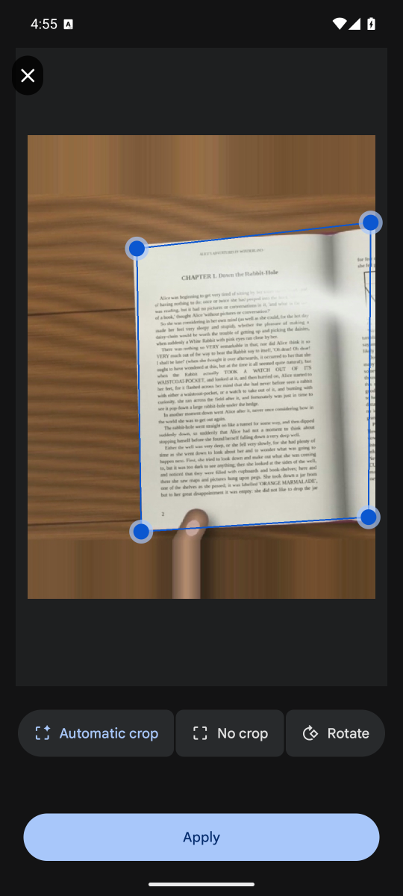

Run 3 findings (run 41393953610, opened every screenshot):

- The frame sits on the paper: on the spreads ML Kit's four handles are
  on the outer corners of the open book (mean 14–19 clip px off the
  ground truth, i.e. < 1.5 % of the spread width).
  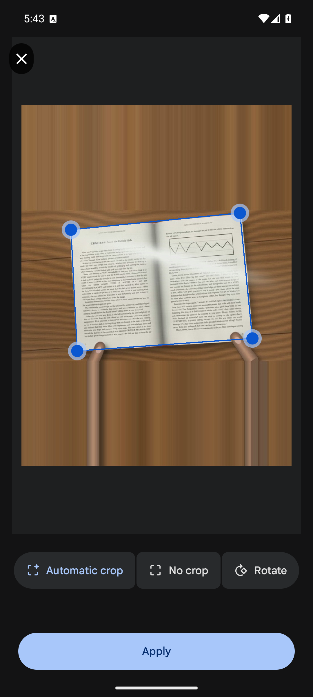
- Every list row of the three spread clips and of single-land-white
  says 撮れた + 番号を読めず: nothing silent there, but no page number
  was read, so the deliberately skipped p37 could not be shown as a red
  欠番. The whole 16:9 clip was squeezed into the 720 px wide window,
  and the page numbers were 4–6 px tall.
  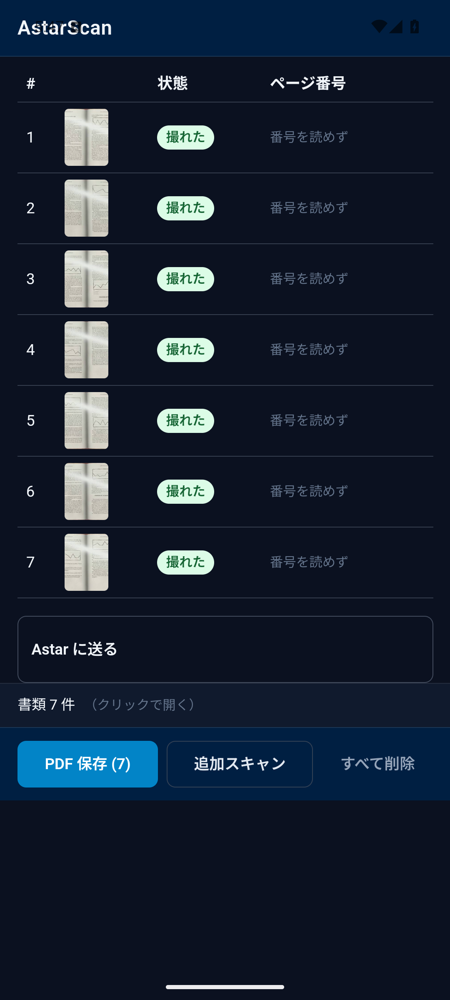
- single-land-white (target: the right page): ML Kit framed the whole
  open book, whose left page ran off the clip edge.
  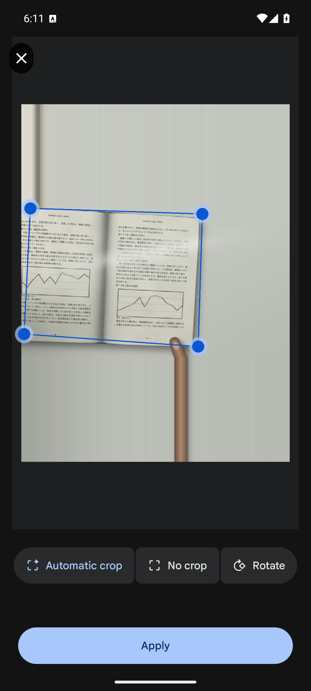
- ML Kit never auto-captured single-port-wood (stays at "Scanning… hold
  steady"); every page needed the manual shutter after the 25 s wait, so
  the clip used up its 10 min at 11 / 12 and the scan was dropped
  unsaved: 12 silent misses.

Run 4 changes: the feed shows the part of the clip around the target
pages (like holding the phone so the book fills the screen —
`clip_box()` in camera-feed.py, also used by book-measure.py); the
manual shutter comes after 15 s; a clip gets ~75 s per page (min 10
min), and when that runs out or the clip is given up, the pages taken so
far are saved instead of dropped.

After run 4 (in the APK from run 5 on): 番号を読めず and 読み取りできず
are drawn in red like 欠番 / 重複 (`CaptureReport.vue`) — a page whose
number cannot be read cannot be checked for gaps or repeats, so the user
has to look at it.

Run 4 findings (run 41399391353):

- With the zoom the single-page clips are framed on the target page
  (single-land-white mean error 64 → 17 clip px).
  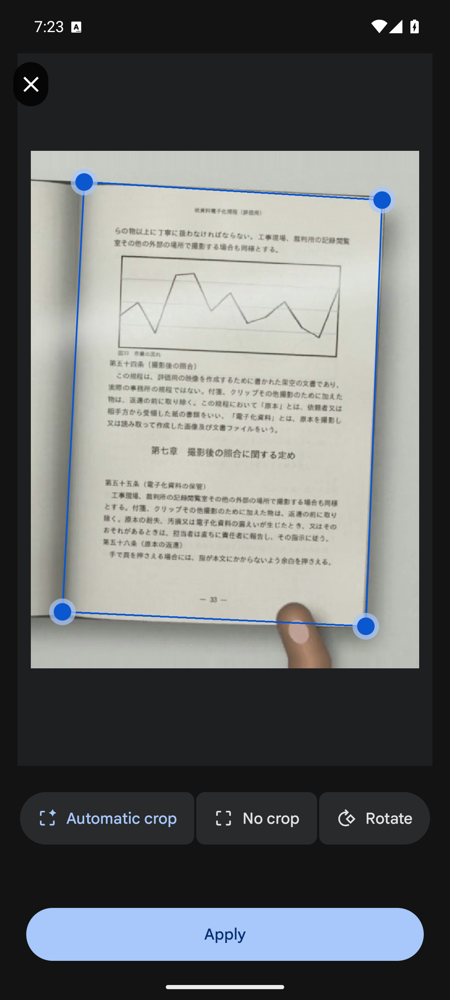
- Page numbers are still not read (35 of 38 rows 番号を読めず, the other
  3 misread: 198, 10, 4) although "— 49 —" is plainly printed on the
  scanned page. Cause: the app's NDLOCR layout step passes only the
  `line_*` classes to recognition; NDLOCR labels a page number
  `block_folio` (class 9, ndl.yaml), so it was dropped before it was ever
  read. 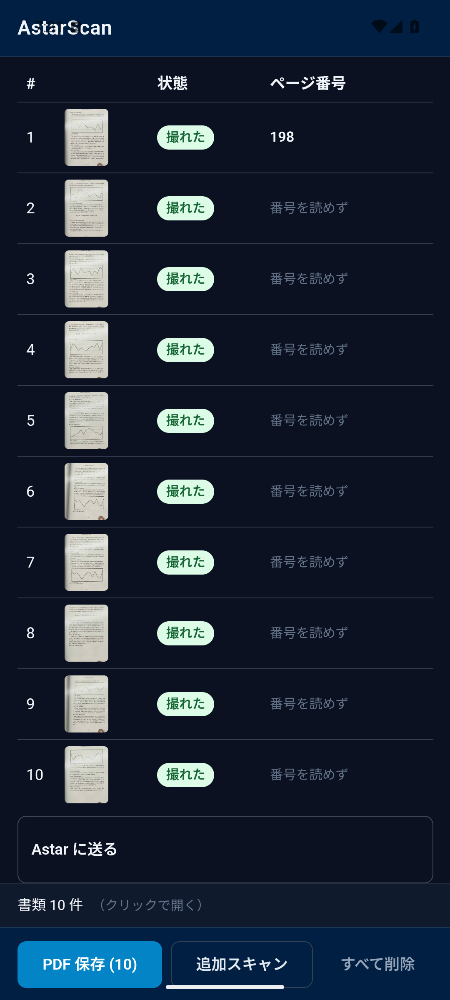
- ML Kit crashed when the 12th page of one scan was taken
  (`NullPointerException` in `CarouselLayoutManager`, Play services
  26.42.31, logcat 07:12:36) and the app received nothing — the 11 pages
  of that scan vanished without a row. A user with a long book would
  lose pages the same way.

Run 5 changes: the app's OCR now recognises `block_folio` (page number)
and `block_pillar` (running head) boxes too, a short page-number box is
widened so it is not read as vertical text (layout-detector.ts); the
check scans a clip in sessions of at most 10 pages (next session via
追加スキャン) and records the pages of a scan the scanner lost as
`kept=0` in captures.tsv.

Run 5 findings (run 41407726651):

- Page numbers are read now. single-port-wood (English, "5" in the
  corner): 15, 19, 21, 23 read right, 5 / 7 / 9 right but flagged
  順番が前後 because the first page read 10; 11, 13, 17, 25 番号を読めず.
  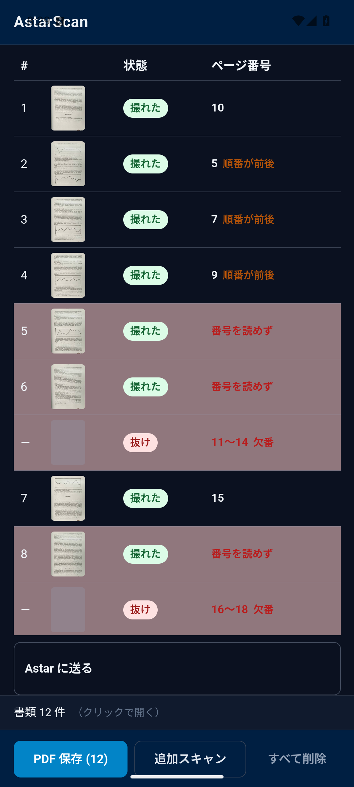
- single-land-white (Japanese "— 33 —"): read as 1, 6, 8, 5 — the dashes
  come back as the kanji 一, which parsed as page 1; the wrong numbers
  then produce false red 欠番 rows (2〜5, 7) and the real gap (p37) is
  not shown. Every page still has a row (撮れた / red 番号を読めず).
  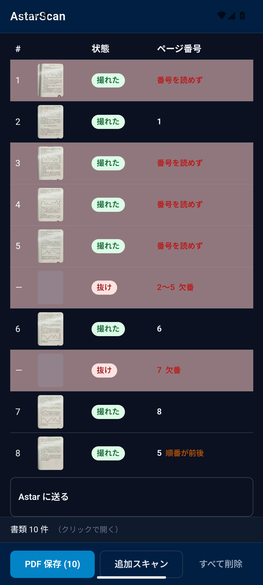
- The ML Kit crash came back on spread-land-wood right after the 7th
  page's Apply (same `CarouselLayoutManager` NPE): it is not a page-count
  limit. The app fell back to its start screen; the check started the
  clip again, but did not mark the lost captures (fixed for run 6).
- The scorer joined texts wrongly (`5順番が前後`, `2〜5欠番`,
  `重複候補 = 1` are single texts in the dump) and counted rows with a
  wrong number as silent; fixed, run 5 rescored above.

Run 6 changes: `parsePageNumberToken` treats 一 next to Arabic digits as
a dash and rejects a lone 一 (unit test added); a page-number box is
widened to 6× its height before recognition (the recognizer stretches
every crop to 16:1); the check marks a scan lost to a crash at the start
screen as `kept=0`.

Run 6 findings (run 41415695993, final; recording:
[book-eval-recording.mp4](https://github.com/AstarWorks/AstarScan/releases/download/android-android-mlkit-scanner/book-eval-recording.mp4),
screenshots: [emulator-check.zip](https://github.com/AstarWorks/AstarScan/releases/download/android-android-mlkit-scanner/emulator-check.zip)):

- All 41 captures (60 target pages) reached the list; every page has a
  row: 撮れた with a number, or red 番号を読めず / 重複 / 順番が前後, and
  red 抜け rows for the gaps the numbers imply. Silent (無表示): only
  p37 — the page the last clip skips on purpose. The app can only flag a
  skipped page from the numbers on either side, and p35 / p39 were
  番号を読めず.
  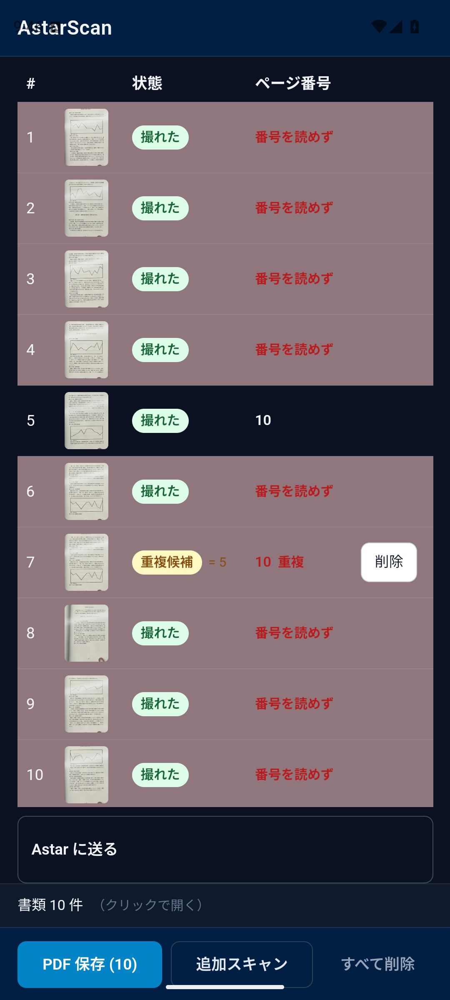
- The "1" reads from the dashes are gone, but the Japanese "— NN —"
  numbers are still mostly not read (1 of 10 read, as 10), and the
  spreads (4–8 px digits): 2 of 19 rows got a number, both a wrong "1". single-port-wood: 13, 15, 17
  right; 10, 5, 20, 1, 3 wrong, giving false 抜け rows (11〜12, 14, 16,
  18〜19). Widening the page-number box did not clearly help.
  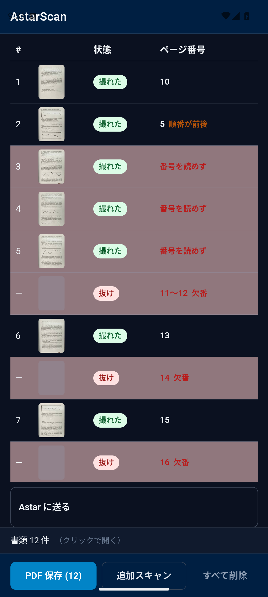
- Corner frames: ML Kit's handles are 11–20 clip px (mean) off the
  ground-truth corners on every clip; the worst single corners (≈ 100 px)
  are on single-land-white where the left edge sat on the facing page.

Run 7 changes: the Android app reads page numbers with ML Kit Text
Recognition v2 (`readMargins` in ScannerPlugin.kt; bundled Japanese
model, also reads Latin) on the full-size scan, top / bottom 15 % bands
enlarged to 1600 px wide, then the same `pickPageNumbers` /
`checkPageSequence`. NDLOCR (still used by the web app) keeps repeated
characters and no longer widens page-number boxes (see the offline
section). Each page's ML Kit lines are logged (`pageno.log`) and scored
per pass (`mlkit-lines.jsonl`).

Run 7 findings (run 41434186488):

- ML Kit read 6 page numbers, all right (3, 13, 15, 17, 23, 25 of
  single-port-wood); 0 wrong, so no 抜け row comes from a misread (run 6:
  4 right / 8 wrong). The other 33 rows are red 番号を読めず.
  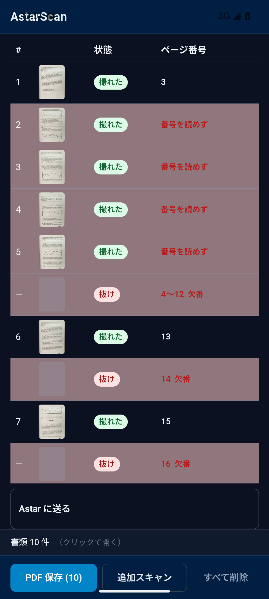
- Nothing on the spreads and nothing Japanese: ML Kit reads the body
  lines in the bands but not the page number. On the emulator the
  Japanese "— 33 —" is ~10 px tall in a 720×1040 capture.
  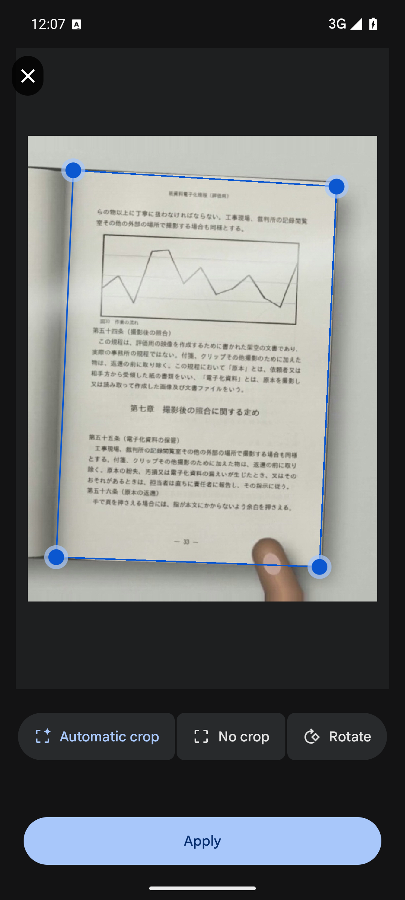
  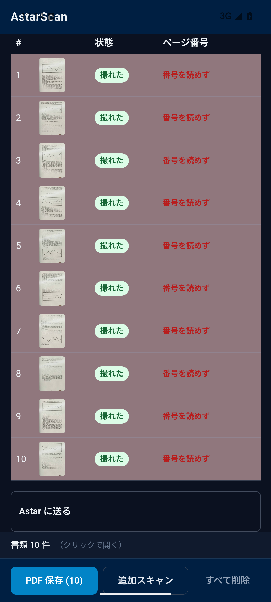
- p37 is still the one silent miss: p35 and p39 are not read, so no
  red 欠番 can cover it.
- Same-resolution comparison: NDLOCR on the simulated emulator-size pages
  (offline, run 7 NDLOCR) is 9 right / 4 wrong / 28 none; ML Kit 6 / 0 / 33. ML Kit stays: a wrong number makes a false 抜け row (or hides a real
  one), an unread number only a red 番号を読めず row.

Not verified: page-number OCR at real phone resolution (the emulator
webcam gives ML Kit at most 720×960, so a page is ~650 px wide); whether
ML Kit's carousel crash happens without the check opening Crop & rotate
on every page (a user normally does not); a real device.

## Page-number OCR offline (clip resolution vs emulator resolution)

`scripts/android/page-number-ocr.py` cuts the target page (single clips)
or the open spread (spread clips) out of the middle frame of every hold
with the ground-truth corners, at two sizes — `emu`: the frame as the
emulator camera shows it (`clip_box()` fitted into the 720×960 window,
so a spread is ~580×410 px, a single page ~540×770 px) and `clip`: the
clip frame itself (spread ~880–1250 px wide, single page ~650×920 /
940×1330 px) — and runs the app's NDLOCR page-number path on it (15 %
bands, DEIM layout, PARSeq rec100, `pickPageNumbers`).
`bun scripts/android/page-number-score.ts <jsonl>` scores it. 41 page
images (one per hold); "right" = the number(s) picked equal the truth (one
number of a spread counts):

| NDLOCR path                                         | emu right / wrong / none | clip right / wrong / none |
| --------------------------------------------------- | ------------------------ | ------------------------- |
| run 6 app (repeats collapsed, folio box widened 6×) | 4 / 9 / 28               | 12 / 17 / 12              |
| repeats kept, folio widened                         | 4 / 9 / 28               | 14 / 16 / 11              |
| repeats kept, folio box as detected (run 7 NDLOCR)  | 9 / 4 / 28               | 23 / 12 / 6               |

Per clip at clip resolution (run 7 NDLOCR): single-port-wood 12 / 0 / 0,
spread-land-wood 6 / 1 / 0, spread-land-white-thick 2 / 4 / 0,
single-land-white 3 / 4 / 3, spread-port-white 0 / 3 / 3.

What this separates:

- Resolution: at the emulator size almost nothing is found on the spreads
  (0 of 25 right — the digits are 4–8 px and the layout model sees the
  stacked bands scaled down to 800 px wide); at the clip's own size the
  English clips are read (single-port-wood 12 / 12, spread-land-wood 6 /
  7). So for the spreads the emulator resolution is the main cause.
- The OCR's own errors, independent of resolution:
  - NDLOCR's decoder dropped repeated characters as if it were CTC
    (PARSeq is autoregressive): "11" → "1", "33" → "3". Fixed.
  - The run 6 widening of short page-number boxes pulled the page edge
    / thumb into the crop, read as an extra leading "1" ("3" → "13").
    Removed.
  - Japanese "— NN —" stays poor even at clip size (single-land-white 3
    of 10, spread-port-white 0 of 6): two-digit numbers come back as one
    digit ("— 35 —" → "-3-", "— 47 —" → "-4-"), and on a spread one side
    misread wins over the other side read right ("54" + "65").
- Real phone: ML Kit returns the page at the camera's resolution (a 12 MP
  phone: a page ~2000–3000 px tall), above the clip size measured here,
  so the English numbers should be read there; the Japanese "— NN —" with
  NDLOCR would still be about 1 in 3. 未確認 on a real device.
