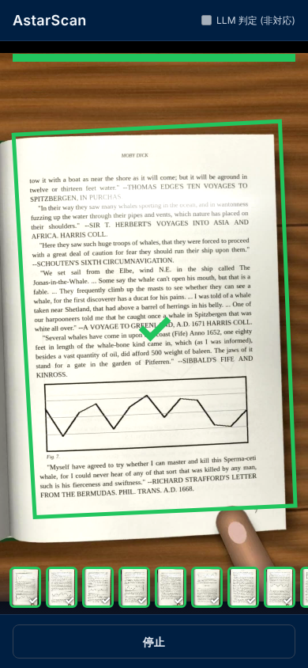
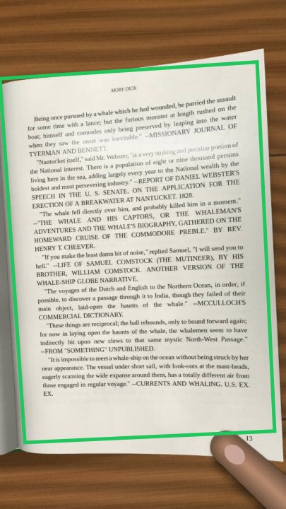
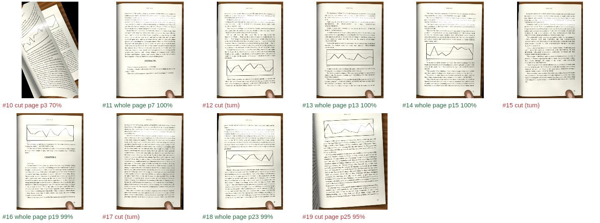
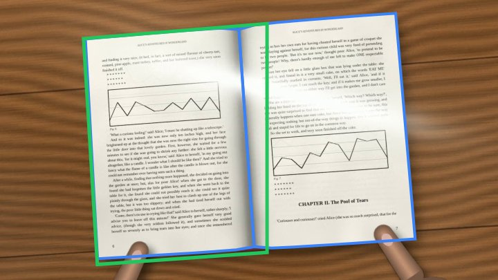
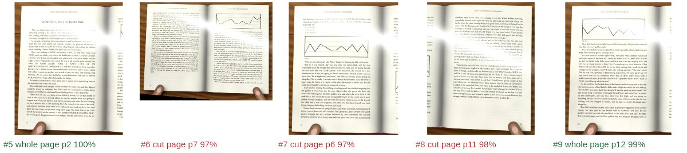

# ブラウザ版 × 本の映像（book-clips）検証

本の合成映像 5 本（`scripts/eval/book-clips/`、合計 60 ページ）を Playwright のテスト用カメラに流し、
実際の `apps/web/app/pages/index.vue` で測った。直しは 5 回（上限）まで行った。

## 測り方

`scripts/eval/book-clips/book-e2e.mjs`（集計は `table.mjs`）。

- 映像は MJPEG にしてテスト用カメラへ。2 周流し、**2 周目**（モデルの読み込みが済んだ状態）を数える。
- アプリ側に `window.__astarProbe` の受け口を足した（テストが置いたときだけ動く。通常は何もしない）。
  各フレームの四隅・✓・赤い案内・保存ページの出どころを受け取る。各フレームが映像の何コマ目かは、
  32×18 の縮小画像を映像と突き合わせて決める（カメラの開始時刻の推測に頼らない）。
- 縦長の映像は、スマホを縦に持ったときと同じく 1080×1920 で届くようにした（アプリは 1920×1080 を要求し、
  テスト用カメラはそれに合わせて縦長映像を 1080×1080 に切り抜いてしまうため。実機の縦持ちは 1080×1920 で返る）。
- 1 ページごとの判定（正解 JSON の hold 区間ごと）:
  - ✓: その区間の✓の枠が、そのページの 90% 以上を覆う
  - 赤: ✓が無く、「まだ撮れていません」がその区間に重なる
  - 何も出ず: どちらも無い
- 四隅のずれ: 4 隅の平均距離（px）。そのフレームの対象ページ・見開き全体のうち一番近いものと比べる。
  hold 中で検出のあった全フレームの中央値と、✓のフレームの中央値。
- 保存画像のうち紙全体: 切り抜き（枠 + アプリの 3% の余白）が対象ページ（または見開き）の 98% 以上を含むもの。

### アプリは「片ページ」か「見開き全体」か

コード上は **1 枚の紙（片ページ）を 1 回の✓で撮る**作り。検出は 1 フレーム 1 つの四隅だけで、見開きを扱う処理は無かった。
正解 JSON も見開きでは左右のページそれぞれが対象なので、評価は**片ページ単位**で数えた
（✓の枠が見開き全体を覆えば 2 ページとも✓と数える作りにしてあるが、実際にはそうならなかった）。

## 各回

数字は 60 ページの合計。表の列: ✓ / 赤 / 何も出ず、四隅のずれ中央値（hold 全フレーム / ✓）、保存枚数（紙全体）、標本化 fps。

| 回  | 直した点                                                                          | ✓   | 赤  | 何も出ず | 保存（紙全体） |
| --- | --------------------------------------------------------------------------------- | --- | --- | -------- | -------------- |
| 0   | （直す前）                                                                        | 1   | 13  | 46       | 9 (2)          |
| 1   | 四隅モデルを 4 フレームに 1 回にし、間は直前の枠の中で紙の縁を合わせ直す          | 2   | 15  | 43       | 7 (1)          |
| 2   | ページめくりの判定を pHash から ORB（同じページか）に替える                       | 5   | 21  | 34       | 18 (6)         |
| 3   | 見開きで左右のページを行き来しない（左→右の順に追う）、縁合わせで隣のページを隠す | 9   | 5   | 46       | 25 (9)         |
| 4   | ✓の無いまま別のページに替わったら赤い案内を出す                                   | 10  | 10  | 40       | 28 (10)        |
| 5   | 画面の中心にあるページを優先（片ページ撮影で半分映る隣ページを追わない）          | 8   | 10  | 42       | 21 (7)         |

クリップ別の全表は `docs/images/book-eval/rounds.json`（回ごと・クリップごとの全数字）と PR 本文にある。

### 回ごとの原因

1. **処理が遅い。** 単一スレッド WASM の YOLO が 1 フレーム約 500 ms（全体の約 75%）で、標本化は 1.1〜1.4 fps。
   ✓や赤の時間設定（0.6 秒静止など）は 5〜10 fps 前提。→ 縁合わせで済むフレームではモデルを回さない。
   木の机の 2 本で 3.0〜3.3 fps、白い机では縁が取れずモデルが毎回走り 1 fps 台のまま。
   （1 回目の spread-land-wood は、途中で手元の配信サーバーが止まりモデルを読めず OpenCV だけで動いた回なので無効。）
2. **めくっても「同じページ」と判定されていた。** 256 bit の平均ハッシュでは、組版の似た本のページ同士の差が
   26〜60 bit、同じページでも 10〜77 bit。しきい値 90 を超えず、最初の✓の後は 1 冊ずっと同じページ扱い。
   ORB の一致点数だと同じページ 15 以上（95%）、別ページ 8 以下で分かれる。→ 判定に ORB を使う。single-port-wood の✓ 0→5。
3. **見開きでは 2 ページが同じくらいの確かさで出て、毎フレーム取る方が入れ替わり、枠が止まらなかった。**
   → 上位候補を残し、追っているページを追い続ける。左ページ→✓→右ページ→✓、次のページが出たらまた左から。
   ✓は増えたが、ページが常に映っているため赤い案内が出なくなり「何も出ず」が増えた。
4. **本は視界から外れないので、赤い案内（ページが視界から消えたときだけ出る）が出なかった。**
   → ORB で別ページに替わったと分かった時点で、✓の無かったページを赤で知らせる。
5. **片ページ撮影の横長映像で、半分映る左ページ（対象外）を追っていた。** → 画面中心に乗っているページを優先。
   ただし single-land-white は横長フレームの向き判定（90° 回して試す）で崩れた枠が選ばれており、改善しなかった。

## 最終（5 回目）

| クリップ                | 対象 | ✓   | 赤  | 何も出ず | 四隅のずれ px（hold / ✓） | 保存（紙全体） | fps  |
| ----------------------- | ---- | --- | --- | -------- | ------------------------- | -------------- | ---- |
| single-land-white       | 10   | 0   | 2   | 8        | 825.5 / –                 | 0 (0)          | 1.58 |
| single-port-wood        | 12   | 3   | 1   | 8        | 23.6 / 42.7               | 10 (5)         | 1.70 |
| spread-land-white-thick | 12   | 1   | 2   | 9        | 123.9 / 123.9             | 2 (0)          | 1.61 |
| spread-land-wood        | 14   | 4   | 1   | 9        | 41.6 / 48.8               | 5 (2)          | 2.04 |
| spread-port-white       | 12   | 0   | 4   | 8        | 46.0 / 59.3               | 4 (0)          | 1.15 |
| **合計**                | 60   | 8   | 10  | 42       |                           | 21 (7)         |      |

何も出ずに抜けるページは 0 にならなかった（42 / 60）。

画面録画: `images/book-eval/final-single-port-wood-screen.mp4`（2 周、71 秒、4.9 MB）。

## 残った理由

- **処理（ブラウザ版の限界）**
  - 速度: この環境で 1〜2 fps。保持 1.5〜3 秒・めくり 0.5〜1 秒の映像では、1 ページあたり 2〜4 フレームしか見えない。
    ✓には「0.6 秒静止」と「別ページだと 2 フレーム続けて確認」が要り、見開きで 2 ページ撮る時間はほぼ無い。
    スマホの単一スレッド WASM はこの環境と同程度かそれより遅いと見込む（実機では未測定）。
  - 白い机: 紙と机の明るさが近く、明るさでの縁合わせが効かない（四隅はモデル頼みで 40〜60 px ずれ、毎フレームモデル）。
  - 横長フレーム: モデルが縦長でしか学習しておらず、90° 回して試す向き判定が崩れた枠を選ぶことがある
    （single-land-white、spread-land-white-thick の大きなずれ）。
  - ✓の後に撮る静止画が、取り込み待ちのあいだにめくり始めの絵になることがある（保存画像のうち✓と別ページのもの）。
- **映像（合成映像の限界）**: 手・反射・影は単純化されている（`book-clips/README.md` の「Not yet like a real book」）。
  めくりは毎回同じ速さ・同じ向き。実物の本・実機での違いは未確認。

## 未確認の点

- 実機（iOS / Android）の速度と結果。この数字はクラウドのコンテナ上の headless Chromium（CPU、GPU なし）。
- 同じ条件でも回ごとのばらつきが大きい（single-port-wood の✓は同じコードで 3〜6）。各回 1 本ずつしか流していない。
- 保存画像の「紙全体」判定は、静止画の撮影コマを縮小画像の照合で推定しており、めくり始め・終わりのコマ（正解 JSON では turn 扱い）は
  紙全体が写っていても数えていない。目で見た限り、数字より紙全体の画像は多い。
- 縦書き・右開きの本（左ページから追う前提が逆になる）は試していない。
- `spread-land-white-thick` / `single-land-white` の大きな四隅のずれは向き判定が原因と見ているが、直していない。
