# ブラウザ版の本の撮影（合意したモックの製品化）× 本の映像の検証

合意した体験の正: [`docs/ux/ideal-capture.html`](ux/ideal-capture.html)。画面は `apps/web/app/pages/book.vue`
（ブラウザで開くとこの画面になる。以前の画面は `/?classic`）、処理は `apps/web/app/services/book/`、
判定（抜け・撮影済み・番号の規則・綴じ目・曲がり補正の縁合わせ）は `packages/core/src/pipeline/`
（`book-coverage.ts` / `gutter.ts` / `page-flatten.ts` / `page-numbers.ts`）。

## 結論

- 同じ本の映像 5 本（60 ページ、Android の最終回と同じ `framed/` = エミュレーターのカメラと同じ 720×960 の見え方）で、
  **✓ 57 / 60、無表示の抜け 3、偽の赤 0、番号の読み違い 2**。わざと飛ばした p37 は撮った瞬間に赤（偽の赤 0）。
  前のブラウザ版（PR #11 の最終回: ✓ 8 / 無表示 42、1〜2 fps）から大きく改善し、
  枠の検出は WASM 4 スレッドで **14〜16 fps**（1 回 43〜48 ms）。
- 「撮れた」は静止から 1 秒以内（hold の始まりから中央値 0.24〜0.69 秒）。番号は撮影から片ページ 0.6〜0.7 秒、
  見開きは 1.2〜1.3 秒 → 読み取りを 2 本並べて **中央値 0.93 秒**（1920×1080 の見開き）。Android 版の約 8 秒より速い。
- 見開きは 1 回で撮り、綴じ目で 2 ページに分けて一覧・PDF に 1 ページずつ並ぶ。綴じ目の位置のずれは中央値 5〜12 px（clip px）。
- **見開きの番号は 720×960 では読めない**（0 / 38。読まずに「番号なし」に倒し、読み違いの赤を出さない）。
  Android 版も同じ解像度では見開き 0 / 19。1920×1080 の映像なら見開きの番号は ✓ の 36 ページ中 32 を正しく読めた（読み違い 0）。
- 調整に使っていない別の本（`other-sans-top`: ゴシック体、番号は上の外側、番号の無い図版ページ、緑灰色の机、暖色の光）では
  **最初の測定で番号を 1 つも読めなかった**（印刷が暖色の光で色付き、親指を除くための「色の付いたインク」判定に掛かった）。
  紙の色からの相対で判定するよう直して 6 / 10。過剰適合はあった、と書いておく（下の「別の本」）。
- WebGPU は**未測定**（この cloud に GPU が無い。headless Chromium のソフトウェア GPU では 1 回 5.5 秒で WASM より遅いので、
  ソフトウェアのアダプタは使わない作りにした）。実機では未確認。

## Android 版との比較（同じ `framed/` 5 本、60 ページ）

Android は PR #10 の最終回（Round 28、push CI 41779109741）。Android の hold は 41（見開きは 1 hold で 2 ページ）。

| 項目                                          | ブラウザ版（この PR）                                                                    | Android 版（Round 28）                                   |
| --------------------------------------------- | ---------------------------------------------------------------------------------------- | -------------------------------------------------------- |
| 無表示の抜け                                  | **3 / 60**（single-port-wood p7・17・21）                                                | 0 / 41 hold                                              |
| ✓（撮れた）                                   | 57 / 60                                                                                  | 41 / 41 hold                                             |
| 赤（撮り漏れの案内）                          | p37 を飛ばした回: p37 だけ赤                                                             | ライブでは p37 は赤にならず（静止画のセッションでは赤）  |
| 偽の赤                                        | **0**（飛ばした回も 0）                                                                  | 0                                                        |
| 番号 正 / 誤 / 読めず                         | 18 / 2 / 37（片ページ 18 / 0 / 1、見開き 0 / 2 / 36）                                    | single-port-wood 12/12、single-land-white 2/10、見開き 0 |
| 枠のずれ（clip px、ページごと 中央値 / 最大） | 見開き 4.4〜8.9 / 最大 13.1、single-port-wood 12.3 / 44.3、single-land-white 19.4 / 24.9 | 最大 2.1 / 6.7 / 23.1 / 23.8 / 49.3                      |
| 綴じ目の分割位置のずれ（中央値 / 最大）       | 6.0 / 10.2、5.3 / 7.7、12.1 / 17.4（見開き 3 本）                                        | —（見開きは分けない）                                    |
| fps（枠の検出）                               | 14.4〜16.3（WASM ×4、1 回 43〜48 ms）                                                    | 未記載（run 20 のログで 1 フレーム約 0.7 秒）            |
| 「撮れた」まで                                | hold の始まりから中央値 0.24〜0.69 秒、最大 1.0〜1.64 秒                                 | 撮影と同時                                               |
| 番号まで（撮影から）                          | 片ページ中央値 0.64〜0.73 秒、見開き 0.93 秒（2 本並べた後）                             | 中央値 7.9 秒                                            |
| 撮影中にめくりの途中を撮った                  | 2（single-port-wood）                                                                    | 0                                                        |
| 曲がり補正                                    | 60 / 60 ページ                                                                           | 41 / 41                                                  |

### クリップ別（`framed/`、最終回）

| クリップ                     | 対象 | ✓   | 赤      | 無表示      | 番号 正/誤/読めず | 枠のずれ 中央値/最大 | 綴じ目 中央値/最大 | fps  | ✓まで 中央値 | 番号まで 中央値 |
| ---------------------------- | ---- | --- | ------- | ----------- | ----------------- | -------------------- | ------------------ | ---- | ------------ | --------------- |
| spread-land-wood             | 14   | 14  | 0       | 0           | 0 / 0 / 14        | 4.4 / 5.7            | 6.0 / 10.2         | 14.4 | 0.69         | 1.21            |
| spread-port-white            | 12   | 12  | 0       | 0           | 0 / 2 / 10        | 4.5 / 8.2            | 5.3 / 7.7          | 14.7 | 0.63         | 1.21            |
| single-port-wood             | 12   | 9   | 0       | 3 (7,17,21) | 8 / 0 / 1         | 12.3 / 44.3          | —                  | 16.3 | 0.24         | 0.64            |
| spread-land-white-thick      | 12   | 12  | 0       | 0           | 0 / 0 / 12        | 8.9 / 13.1           | 12.1 / 17.4        | 15.7 | 0.67         | 1.33            |
| single-land-white            | 10   | 10  | 0       | 0           | 10 / 0 / 0        | 19.4 / 24.9          | —                  | 16.0 | 0.36         | 0.73            |
| single-land-white p37 飛ばし | 10   | 8   | 1 (p37) | 1 (49)      | 8 / 0 / 0         | 13.1 / 27.9          | —                  | 15.6 | 0.70         | 0.78            |

### 1920×1080 の映像（`clips/`、PR #11 と同じ入力）

| クリップ                | ✓   | 赤         | 無表示 | 番号 正/誤 | fps  | 番号まで                |
| ----------------------- | --- | ---------- | ------ | ---------- | ---- | ----------------------- |
| spread-land-wood        | 14  | 0          | 0      | 14 / 0     | 10.7 | 1.50（2 本並べて 0.93） |
| spread-port-white       | 12  | 0          | 0      | 8 / 0      | 11.4 | 1.36                    |
| single-port-wood        | 7   | 0          | 5      | 7 / 0      | 11.6 | 0.68                    |
| spread-land-white-thick | 10  | 2 (66・67) | 0      | 10 / 0     | 11.4 | 1.48                    |
| single-land-white       | 0   | 0          | 10     | —          | 14.3 | —                       |
| 合計（60）              | 43  | 2          | 15     | 39 / 0     |      |                         |

PR #11 の最終回は ✓ 8 / 赤 10 / 無表示 42。single-land-white（横長で左ページが半分映る）は DocAligner がページを見つけない
（四隅の確信度の中央値 0）。`framed/`（ページが画面を埋める持ち方）では 10 / 10。

## 合意した体験との差（実際の画面で確かめた）

| 場面                   | 画面                                            | 確認                                                         |
| ---------------------- | ----------------------------------------------- | ------------------------------------------------------------ |
| 見開きの ✓・番号       | 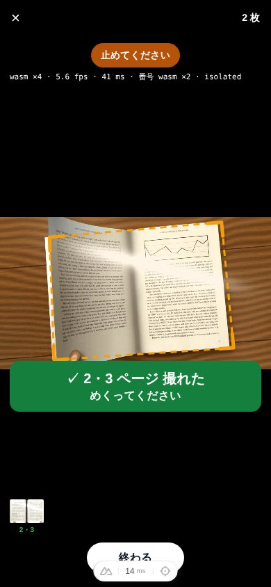       | 枠が緑、「✓ 撮れた」→ 番号                                   |
| 撮り漏れの赤           | 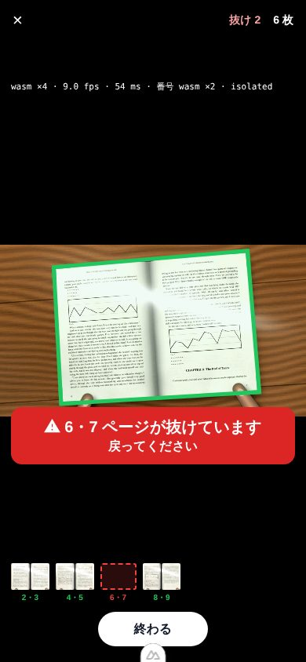            | 8・9 を撮った瞬間に「6・7 が抜けています」、下の列に赤い空き |
| 戻って撮ると埋まる     | 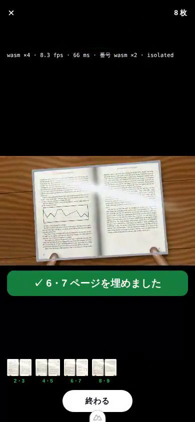         | 「✓ 6・7 ページを埋めました」、列が緑                        |
| 撮影済み               | 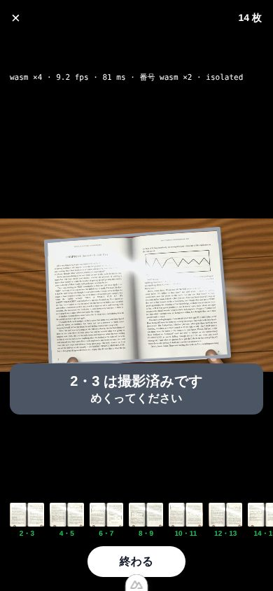      | 灰色「2・3 は撮影済みです」                                  |
| 片ページ・「— 43 —」型 | 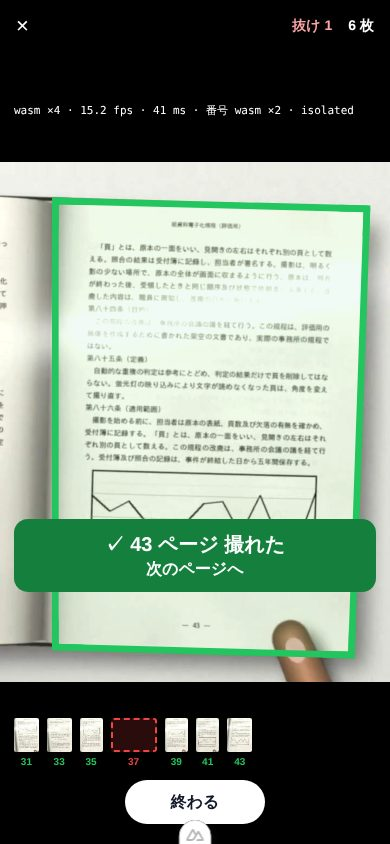 | 「✓ 43 ページ 撮れた」、p37 は赤い空き                       |
| 分けた一覧（見開き）   | 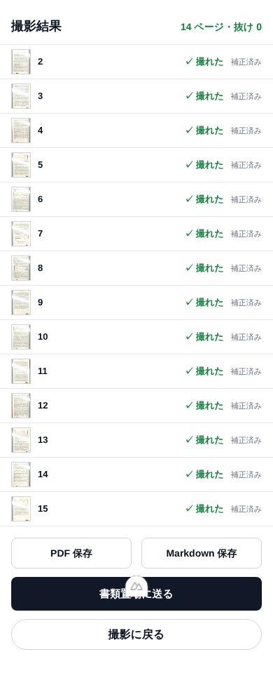  | 7 見開き → 14 行、補正済み                                   |
| 一覧（片ページ・抜け） | 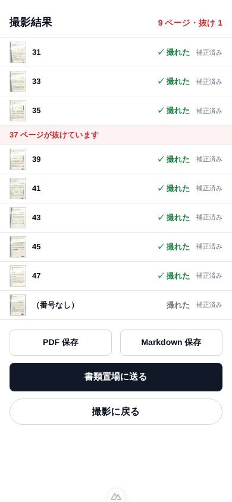        | 37 の抜けの行                                                |
| 分割した画像           | 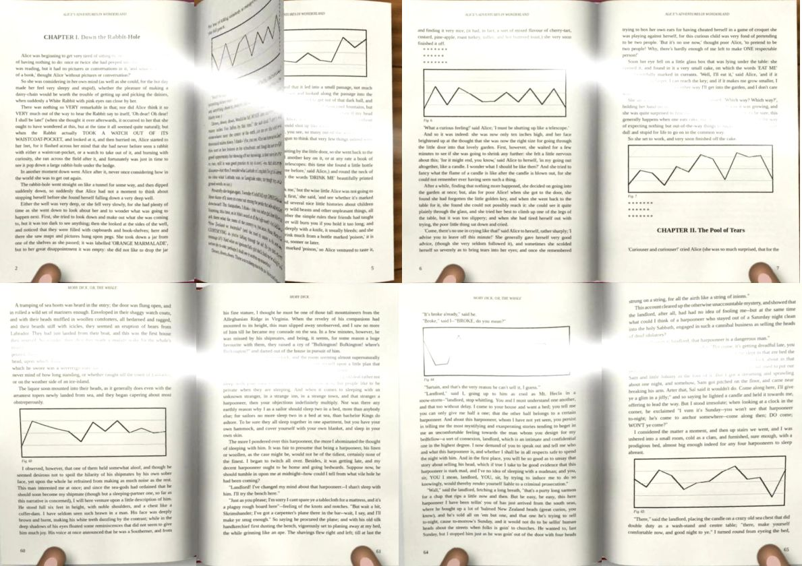        | 上: 1920×1080 の木の机、下: 厚い本                           |

録画: `images/book-eval/v2-scenario-spread.mp4`（30 秒: 2・3 → 4・5 → 8・9（6・7 を飛ばす）→ 6・7 に戻る → 8・9 → … の順に hold をつないだ映像）。

モックとの差:

- 読んだ番号を緑の枠で囲む表示は無い。
- 番号の無いページ（灰色「番号なし」）は別の本で動作（126・127 を番号なしと表示、抜けにしない）。同じ本の 5 本には該当ページが無い。
- 見開き↔片ページは枠の縦横比で自動で切り替わる（幅/高さ ≥ 1.0 で見開き）。本に寄って片ページに移る動きの映像は無く、片ページ 2 本で確認した。
- 赤は「確かめられた番号」の間だけに出す（読み違いで偽の赤を出さないため）。そのため、片ページで 1 ページ飛ばしたときの赤は、
  次のページの番号が前のページと続いて確かめられてから出る（p37 は p39・p41 の後）。見開きを 1 つ飛ばしたときは撮った瞬間に出る。
- 書類置場への送信（AstarManagement の受け口へ fetch）はブラウザからの CORS が未確認。Markdown 保存は NDLOCR（約 147 MB の
  モデル）で本文を読むため初回は時間がかかる。どちらもこの job では動かしていない。

## 作り

- **枠**: DocAligner lcnet100（Android と同じ ONNX、4.8 MB、`scripts/android/fetch-docaligner.sh` を `fetch-public-assets.sh` から）。
  前後処理は `CaptureDetector.kt` と同じ（正方形に黒で埋める、BGR/255、ヒートマップの arg-max を 5×5 の重心で補正、確信度 0.3 未満は捨てる）。
- **実行**: WebGPU（ソフトウェアのアダプタは除く）→ 使えなければ WASM。COOP/COEP（`public/_headers`、dev は `nuxt.config.ts`）で
  cross-origin isolated にして WASM を 4 スレッド。`?debug` で backend・スレッド数・fps を画面に出す。`?backend=wasm` で WebGPU を使わない。
- **静止と自動撮影**: 四隅は直近 5 フレームの中央値で、0.25 秒前との動きが対角線の 4 % 以内、かつ画面の 32×24 の変化が小さい（Android と同じ考え）。
  0.25 秒静止 → 緑の線が 0.4 秒で一周 → 撮影。直前に撮ったページか、撮影済みのページかは ORB（scan-core `orb.ts`）で見る。
  めくりで静止が崩れなかったとき（見開きの枠が動かない）は、撮った時からの画面の変化で判定し直す。
- **綴じ目で分ける**: 見開きを一度まっすぐに直し、上下 2 つの帯で最も暗い縦の筋（30〜70 % の範囲）を探して、
  その線をカメラ画像の座標に戻して左右それぞれを別に変換する（`gutter.ts`）。片ページで枠が綴じ目を越えたときは切り戻す。
- **曲がり補正**: `PageFlatten.kt` の縁合わせを `page-flatten.ts` に移し、分けた後の各ページで掛ける。
- **番号**: NDLOCR の PARSeq は単独の小さな数字を読めなかった（書籍クリップ 3 本の正解の枠で、切り出し方を変えても最大 4 / 36）ので、PaddleOCR PP-OCRv4 の
  認識モデル（10.8 MB、`scripts/fetch-folio-model.sh`、同じ条件で 48 / 60）を Web Worker 2 本で使う。上下 12 % の帯で
  インクの塊を文字単位で拾い（親指は大きさと紙に対する色で除く）、行にまとめて読む。高さ 5 px 未満は読まない。
  番号の位置（上・下 × 外・中央・内）は本ごとに学習し、それ以外の場所の数字は使わない。
- **抜けの判定**（`book-coverage.ts`）: 撮った番号の集合から抜けを出し、戻って撮れば消える。隣の番号（別の撮影）で確かめられた番号、
  または左右とも読めて続いている見開きだけを使う。見開き 1 つより広い抜けは両側とも隣で確かめられたときだけ。
  間に番号なし・未確定のページがあればその数まで抜けにしない。同じ番号でも絵が違えば読み違いとして番号を捨てる。

## 別の本（過剰適合の確認）

`render.py other-sans-top`（このブランチで追加、既定の 5 本には入らない）: 本文 DejaVu Sans、番号は上の外側、126・127 は番号の無い図版ページ、
緑灰色の机、暖色の光、手ぶれ強め。`docs/eval-results.md` の手持ちスマホ実写映像はこのリポジトリに無かったため、新しく作った（合成映像）。

| 回                    | 入力      | ✓       | 無表示                  | 番号 正（番号ありのページ） | 読み違い | 偽の赤 | fps  |
| --------------------- | --------- | ------- | ----------------------- | --------------------------- | -------- | ------ | ---- |
| 最初（調整なし）      | 1920×1080 | 12 / 14 | 2（120・121）           | **0 / 10**                  | 0        | 0      | 12.3 |
| 最初（調整なし）      | framed    | 12 / 14 | 2（120・121）           | 0 / 10                      | 0        | 0      | 15.6 |
| 色の判定を直した後    | 1920×1080 | 12 / 14 | 2（120・121）           | 6 / 10                      | 0        | 0      | 11.8 |
| 124・125 を飛ばした回 | 1920×1080 | 10 / 12 | 4（120・121・124・125） | 6 / 8                       | 0        | 0      | 11.7 |

- 番号が読めなかった原因: 暖色の光で印刷の彩度が 45〜55 になり、親指を除くための「彩度 40 超は除く」に掛かっていた（5 本はどれも中立色の光）。
  紙の彩度 + 35 を超えるものだけ除くように直した。この直しは別の本を見て入れたので、直した後の数字はもう「調整に使っていない本」の数字ではない。
- 最初の見開き（120・121）は 2 回とも DocAligner が紙を見つけなかった（確信度の中央値 0）。
- 124・125 を飛ばした回で赤が出なかった: 後ろが番号の無い 126・127 で、抜けの可能性があるページ数（4）に番号なし 2 が入るため、両側の確認を待つ規則のまま終わった。
- Android 版はこの job では回していない（**未測定**）。

## 未調整の別の本（2 冊目）

上の「別の本」は結果を見てコードを直したので、もう未調整ではない。そこで調整に一切使っていない 2 冊目
（`scripts/eval/book-clips/book2.py`、合成映像 3 本）を作り、**コードを変えずに**このブランチの head（8305d50 のアプリ）で 1 回ずつ測った。
結果を見た後もコードは直していない。

| クリップ                   | 元の解像度              | 本文の書体 | 番号の形・位置     | 紙                 | 机       | 光     | 手                               | 対象                                |
| -------------------------- | ----------------------- | ---------- | ------------------ | ------------------ | -------- | ------ | -------------------------------- | ----------------------------------- |
| `book2-spread-dash`        | 1920×1080 見開き        | Caladea    | 「— 44 —」・下中央 | 黄ばんだ紙         | 紺の布   | 青白い | 右手の親指が小口（外側の縁）中央 | 44〜57（7 見開き、50・51 を飛ばす） |
| `book2-single-top`         | 1080×1920 片ページ      | Carlito    | 「201」・上の外側  | 真っ白             | 濃い胡桃 | 中立   | 親指が上の余白から（柱にかかる） | 201〜219 の右ページ 10              |
| `book2-spread-center-1440` | 1440×1080 見開き（4:3） | FreeSerif  | 「88」・下中央     | 灰色がかった再生紙 | コルク   | 暗い   | 左右の親指（右は小口寄り）       | 88〜99（6 見開き）                  |

各本は元の解像度と、Android のエミュレーターと同じ 720×960 の切り出し（`frame.py` → `book2-framed/`）の 2 通りで流した。
飛ばしは `book2-spread-dash` の hold 3（50・51）で、`--skip-hold 3`（飛ばしたまま）と `--holds 0,1,2,4,3,5,6`（飛ばして戻る、Android と同じ順）の 2 回。

### ブラウザ版の結果（`book-e2e.mjs`、飛ばしたままの回で数える、対象 36 ページ）

| 入力              | ✓       | 赤（正しい赤） | 無表示                               | 偽の赤 | 番号 正 / 誤 / 読めず（✓ のページ） | 綴じ目のずれ 中央値 / 最大 | 「撮れた」まで 中央値 | 番号まで 中央値 | fps      |
| ----------------- | ------- | -------------- | ------------------------------------ | ------ | ----------------------------------- | -------------------------- | --------------------- | --------------- | -------- |
| 720×960（framed） | 32 / 36 | 0              | 4（50・51 = 飛ばした見開き、88・89） | 0      | **9 / 2 / 21**                      | 4.1 / 9.2、12.6 / 16.9     | 0.65〜1.28 秒         | 1.08〜1.21 秒   | 9.1〜9.9 |
| 元の解像度        | 29 / 36 | 2（50・51）    | 5（88・89・96・97・211）             | 0      | **20 / 2 / 7**                      | 15.2 / 23.8、23.5 / 36.0   | 1.03〜1.39 秒         | 1.21〜1.30 秒   | 6.8〜8.8 |

クリップ別:

| 回                           | 対象 | ✓   | 赤          | 無表示              | 番号 正/誤/読めず | 誤りの中身   | 枠のずれ 中央値/最大 | 綴じ目 中央値/最大 | fps | ✓まで | 番号まで | その他                                                  |
| ---------------------------- | ---- | --- | ----------- | ------------------- | ----------------- | ------------ | -------------------- | ------------------ | --- | ----- | -------- | ------------------------------------------------------- |
| framed dash 50・51 飛ばし    | 14   | 12  | 0           | 2（50・51）         | 0 / 0 / 12        |              | 5.0 / 6.2            | 4.1 / 9.2          | 9.9 | 0.86  | 1.21     | 飛ばした見開きに赤が出ない                              |
| framed dash 飛ばして戻る     | 14   | 14  | 0           | 0                   | 0 / 0 / 14        |              | 5.0 / 8.8            | 5.4 / 12.5         | 7.7 | 0.89  | 1.39     | 飛ばした間も赤は出ない                                  |
| framed single-top            | 10   | 10  | 0           | 0                   | 9 / 0 / 1         |              | 12.8 / 15.6          | —                  | 9.1 | 0.65  | 1.08     | 203 を 2 回撮った                                       |
| framed center-1440           | 12   | 10  | 0           | 2（88・89）         | 0 / 2 / 8         | 96→8、97→9   | 9.0 / 10.0           | 12.6 / 16.9        | 9.9 | 1.28  | 1.20     |                                                         |
| 1920×1080 dash 50・51 飛ばし | 14   | 12  | 2（50・51） | 0                   | 9 / 0 / 3         |              | 11.0 / 17.2          | 15.2 / 23.8        | 6.8 | 1.03  | 1.30     | めくり途中の撮影 1（54 と 57 の混ざり → 番号なし 2 行） |
| 1920×1080 dash 飛ばして戻る  | 14   | 14  | 0           | 0                   | 8 / 0 / 6         |              | 12.8 / 22.5          | 12.7 / 21.4        | 4.9 | 1.05  | 1.75     | 48・49、52・53 が読めず赤が出ない。54・55 を 2 回撮った |
| 1080×1920 single-top         | 10   | 9   | 0           | 1（211）            | 5 / 0 / 4         |              | 33.2 / 98.6          | —                  | 7.1 | 1.19  | 1.21     | 217 を 2 回、曲がり補正 9 / 11                          |
| 1440×1080 center             | 12   | 8   | 0           | 4（88・89・96・97） | 6 / 2 / 0         | 98→88、99→89 | 16.7 / 20.3          | 23.5 / 36.0        | 8.8 | 1.39  | 1.28     | 98・99 を「88・89 撮れた」と表示                        |

この cloud の CPU は前回より遅い: 同じビルドで 1 冊目の `spread-land-wood` を流し直すと、framed は ✓ 14 / 14・番号 0 / 0 / 14 で前回と同じだが
**9.6 fps**（前回 14.4）、1920×1080 は ✓ 14・番号 14 / 0 で **6.7 fps**（前回 10.7）。2 冊目の fps と時間はこの遅い CPU での値。

見立て（コードは直していない）:

- **見開きを飛ばしても 720×960 では赤が出ない**。見開きの番号が読めない（数字の高さ 4〜5 px）ので「確かめられた番号」が無く、
  抜けの規則（確かめられた番号の間だけ赤）が何も言わない。1 冊目の p37 は片ページ（番号が読める）だったので赤が出ていた。
  1920×1080 では 50・51 を正しく赤にした（偽の赤 0）。飛ばして戻る回は 1920×1080 でも、前後の 48・49 と 52・53 が読めず赤は出なかった。
- **番号の読み違い 2 組（FreeSerif の 9）**: 1440×1080 で 98・99 を 88・89、720×960 で 96・97 を 8・9。左右とも読めて続いているので
  「確かめられた見開き」になり、画面は 98・99 で「✓ 88・89 ページ 撮れた」と出し、一覧に 88・89 の行ができる（本当の 88・89 は撮れていない）。
  この形の読み違いは抜けを隠す（88・89 と 96・97 の赤が出ない）。1 冊目・別の本（Liberation Serif / IPAGothic / DejaVu Sans）では出ていない書体依存の誤り。
- **最初の見開き 88・89 が両方の解像度で無表示**: 四隅の確信度が 0〜0.9 で揺れ、緑の線が 2 回途中で切れた（hold は 2.1 秒）。
  別の本でも最初の見開き 120・121 が同じ形で落ちている。原因は未特定。
- **上の余白から入る親指（1080×1920 片ページ）**: 枠のずれが中央値 33 px・最大 99 px（framed では 13 / 16）、211 は枠がページの 78 % しか
  覆わず無表示、曲がり補正 2 枚失敗。
- 同じページの 2 回撮り（203、217、54・55）と、めくり途中の撮影 1（54 と下から見えた 57 の混ざり）。どちらも一覧に「番号なし」で残る。
- 番号の位置を本ごとに学ぶ作りは、上の外側（single-top: framed 9 / 10）と「— N —」の下中央（1920×1080: 9 / 12）でも働いた。

### 一覧・PDF・Markdown（実際に開いて確かめた）

1920×1080 の `book2-spread-dash`（50・51 飛ばし）を手元の同じビルドで撮り、一覧から保存した（`docs/book2-eval/`）。

- 一覧: 14 行、「50・51 ページが抜けています」の赤い行、めくり途中の 1 枚が「（番号なし）」2 行。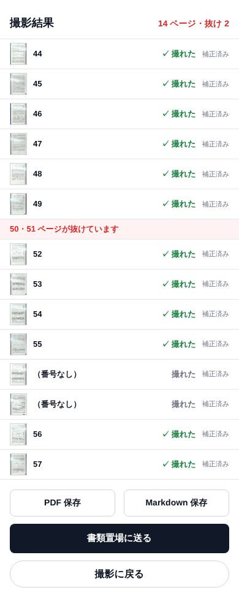
- PDF: 14 ページ（`pdfinfo`、153×213 pt の縦長 1 ページずつ）。見開きは綴じ目で分けた片ページで並ぶ。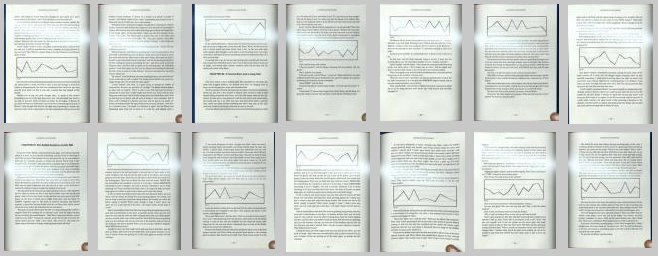
- Markdown: 251 秒（14 ページ、NDLOCR）。見出しは `## p. 44` … `## p. 57` と `## （番号なし 11 枚目）` で一覧と同じ順。
  **本文は英語が読めない**（NDLOCR の日本語モデルで英語を読むため、語がつながった崩れた文字列になる。`saved-markdown-1920-skip.txt`）。抜け（50・51）は Markdown には書かれない。
- 画面: 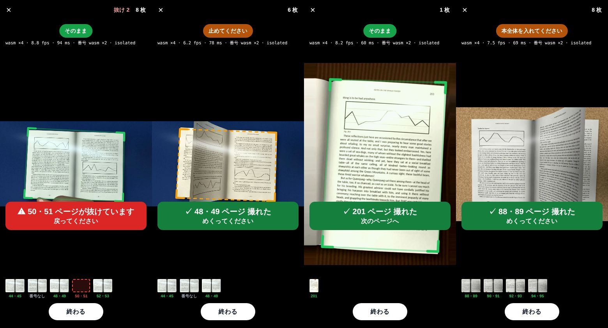（左から: 1920×1080 で 52・53 を撮った後の赤、48・49 の ✓、720×960 の片ページ 201、1440×1080 の 98・99 を 88・89 と読んだ表示）

preview（`browser-book-eval-astar-scan.atsuki-katayama.workers.dev`）はこの session のネットワークから開けないため、同じ commit を手元で
`nuxt generate` し、`_headers` と同じ COOP/COEP を付けた静的サーバーで開いた（NDLOCR のモデルは `scripts/download-ocr-models.sh` で取得）。

### Android 版の結果（PR #10 Round 28 と同じやり方）

ブランチ `book2-android-eval`（このブランチ + CI の入力を 2 冊目に向ける差分だけ。アプリのコードは変えていない）の push run
[42240438576](https://github.com/AstarWorks/AstarScan/actions/runs/42240438576)（job「Android emulator check」緑、アプリの異常終了 0）。
ライブは Google Play エミュレーターのカメラに `book2-framed/`（720×960）を v4l2loopback で流し、カメラの絵は 960×1280。
`book2-spread-dash` は Round 28 と同じく hold を 0,1,2,4,3,5,6 の順（飛ばして戻る）で流した。飛ばしたままの回は
静止画（スマホの静止画の大きさ 3000×4000 / 4000×3000 に描き直した各 hold の中央フレーム）のセッションだけで測った。
スクリーンショット・録画はリリース `android-book2-android-eval` の `emulator-check.zip` / `book-eval-recording.mp4`。

| 入力                                       | 撮れた（hold）                   | 無表示 | 赤                      | 偽の赤 | 番号 正 / 誤 / 読めず（ページ）                     | 枠のずれ 平均 / 最大（clip px）                 | 「撮れた」まで 中央値 / 最大 | 番号まで 中央値 / 最大 |
| ------------------------------------------ | -------------------------------- | ------ | ----------------------- | ------ | --------------------------------------------------- | ----------------------------------------------- | ---------------------------- | ---------------------- |
| ライブ 960×1280（720×960 の framed）       | 23 / 23（片 10 ✓、見開き 13 灰） | 0      | 0（飛ばして戻る回のみ） | 0      | **10 / 0 / 26**（片 10 / 0 / 0、見開き 0 / 0 / 26） | 片 4.8 / 21.8、center 2.1 / 6.2、dash 1.5 / 4.8 | 2.3 / 5.4 秒                 | 8.6 / 41.3 秒          |
| 静止画 3000×4000 / 4000×3000（セッション） | 22 / 22（飛ばしたまま）          | 0      | 50・51 だけ             | 0      | **46 / 0 / 0**（23 / 23 hold）                      | —（枠は DocAligner 23 / 23）                    | —                            | 1 枚 1.25 秒（中央値） |

- 30 秒以内に画面へ「✓ N ページ」が出たのは 23 hold 中 9（片ページ）。ML Kit 1 回の呼び出しが中央値 8.6 秒（このエミュレーターの CPU で）。
- 見開きはライブで 13 / 13 が「撮れた（番号なし）」の灰。1 冊目と同じく 960×1280 では見開きの番号が小さすぎる。番号が無いので、
  飛ばして戻る回も、飛ばしている間に赤は出ない（ブラウザ版の 720×960 と同じ）。
- 静止画では FreeSerif の 98・99 / 96・97 も正しく読んだ（ブラウザ版が 88・89 / 8・9 と読み違えた見開き）。
- 保存: PDF 7 ページ（Android は見開きを分けないので 7 見開き = 7 ページ）、Markdown 7 見出し。Markdown の本文は英語が崩れる（`wr Myet t es e ed e` など）。
- 枠の検出器の比較（同じ run、clip px 平均）: DocAligner+アプリの後処理は片 10.2、center 1.6、dash 1.2。

### 2 冊目のまとめ（ブラウザ版と Android 版）

| 項目                      | ブラウザ 720×960                      | ブラウザ 元の解像度（1920×1080 / 1080×1920 / 1440×1080） | Android ライブ 960×1280      | Android 静止画（スマホの大きさ）       |
| ------------------------- | ------------------------------------- | -------------------------------------------------------- | ---------------------------- | -------------------------------------- |
| 無表示の抜け（36 ページ） | 4（うち 2 は飛ばした 50・51）→ 実質 2 | 5（88・89・96・97・211）                                 | 0                            | 0                                      |
| ✓（番号つき or 撮れた）   | 32 / 36                               | 29 / 36                                                  | 片 10 ✓ + 見開き 26 ページ灰 | 46 / 46（飛ばしたまま 44 + 50・51 赤） |
| 飛ばした 50・51 の赤      | 出ない                                | 出た（飛ばしたままの回）                                 | 出ない（飛ばして戻る回）     | 出た                                   |
| 偽の赤                    | 0                                     | 0                                                        | 0                            | 0                                      |
| 番号 正 / 誤 / 読めず     | 9 / **2** / 21                        | 20 / **2** / 7                                           | 10 / 0 / 26                  | 46 / 0 / 0                             |
| 綴じ目の分割位置のずれ    | 4.1 / 9.2、12.6 / 16.9                | 15.2 / 23.8、23.5 / 36.0                                 | —（分けない）                | —                                      |
| 「撮れた」まで            | 0.65〜1.28 秒                         | 1.03〜1.39 秒                                            | 2.3 秒                       | —                                      |
| 番号まで                  | 1.08〜1.21 秒                         | 1.21〜1.30 秒                                            | 8.6 秒                       | 1.25 秒 / 枚                           |

見立て: 読み違いはブラウザ版だけ（PP-OCRv4 が FreeSerif の 9 を 8 / 落とす。続いた 2 つの番号なので「確かめられた」扱いになり、抜けを隠す）。
Android 版は読み違い 0 だがライブでは見開きの番号が出ず、抜けも出ない。どちらも 720×960 相当の見開きでは飛ばしを知らせられない。

## 2 冊目で負けた点を直した後（PR #12）と、3 冊目

2 冊目は直しに使ったので、もう未調整ではない。3 冊目（`book3.py`）を作り、1 回ずつ測った。
**3 冊目が未調整かどうかは不明**（下の「3 冊目は未調整か」。3 冊目は直しの途中で作られ、その後にも直しが 3 つ入っている）。
数字はすべてこの cloud の headless Chromium（CPU 4 コア、WASM ×4）。同じビルドで 1・2・3 冊目を続けて流した（`run4`）。

### 直したもの（どれも原因をフレームのログで確かめてから）

| 直し                                                                               | 原因（ログ）                                                                                                                                                                                                                             | 場所                                                                                                                                                                                                                                                                                           |
| ---------------------------------------------------------------------------------- | ---------------------------------------------------------------------------------------------------------------------------------------------------------------------------------------------------------------------------------------- | ---------------------------------------------------------------------------------------------------------------------------------------------------------------------------------------------------------------------------------------------------------------------------------------------- |
| 番号が前後の並びに合わなければ「撮れた」の番号にしない（読めず）                   | FreeSerif の 9 を 8 と読み、98・99 → 88・89 / 96・97 → 8・9。左右とも読めて続くので「確かめられた見開き」になり、撮影済み扱いで抜けを隠した。後の測定でも 205 → 5（201 の後）、最初のページ 31 → 40（33, 35 の前）、10・11 → 1・2 が出た | `packages/core` `numbersFitOrder`。前の撮影で確かめられた番号より下 / 前のどの番号より下で、次に確かめられた番号から間の撮影数では届かないほど離れている / 前に何も無く、後の確かめられた番号 2 つ以上がそれより下。新しい撮影のたびに全撮影を見直す（後のページで分かった読み違いを取り消す） |
| 枠のモデルの一瞬の見失い（瞬き）で静止を切らない                                   | 2 冊目 1440×1080 の 88・89・96〜99: 一番弱い角の確信度が 0.89 → 0.06 → 0.79（画面の変化は 1〜3 階調）。そのたびに静止が切れ、緑の線が終わらない                                                                                          | `book-capture.ts` `BLINK_MS` 700 ms（Android `CaptureActivity` の NULL_RESET 2 と同じ考え）                                                                                                                                                                                                    |
| 撮る枠の角が静止中の読みから跳んだら戻す                                           | 1 冊目 single-land-white p39: 静止中 12 フレームは左上 (−2, 48)、撮る直前の 3 フレームだけ (101, 318)。直近の中央値がそれを取り、枠がページの 80 % しか覆わず無表示                                                                      | `book-capture.ts` `SPELL_QUAD_MS`: 直近 1 秒の中央値から STILL_CORNER（対角線の 4 %）より離れた角だけ戻す                                                                                                                                                                                      |
| 片ページの小口の切り落としは折り目が上下両方にあるときだけ、幅も影ほどあるときだけ | single-port-wood p7: 図の枠の縦線（下半分だけ 31 % 暗い）を折り目と見て 13 % 切り、番号ごと落とした（✓ にならない）。p5 は上下に図が並び線がそろっていた                                                                                 | `packages/core` `findEdgeGutter`（`edgeMinWidth` 2.5 %）                                                                                                                                                                                                                                       |

閾値を 2 冊目に合わせて動かしただけの直しは無い（`BLINK_MS` は Android の 1 解析フレーム分、角の戻しは既存の静止の閾値をそのまま使う）。

### 直した場面（実際の画面）

- 読み違いが撮影済みにならない（同じ入力で前後比較）: 2 冊目 1440×1080 の 98・99 の番号を「88・89」と印刷した映像（`book2.py` の `book2-misread-demo`、
  前の回の読み違いを入力で再現）を、88・89 と 96・97 を飛ばした順（前の回の無表示と同じ）で流した。左: 直す前（`june-pipeline`）は「✓ 88・89 ページ 撮れた」で
  列の先頭に 88・89 の緑。右: 直した後は「✓ 撮れた（番号なし）」、列の末尾に「番号なし」。
  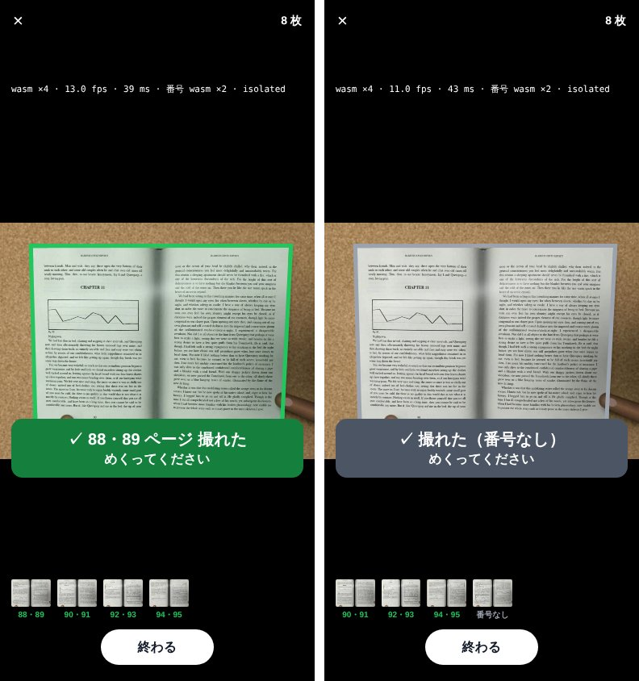
- 3 冊目で実際に起きた読み違いの取り消し: 1080×1920 の見開き「( 315 )」型で最初の 314・315 を 324・325 と読み「✓ 324・325」と出たが、
  316・317、318・319 が続いた時点で番号を取り消し、列の先頭が「番号なし」になった（最後の本当の 324・325 は正しく ✓）。
  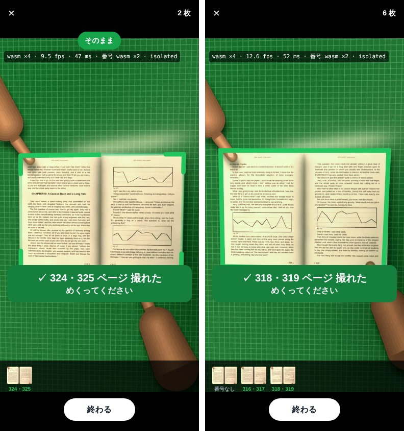
- 以前抜けたページが撮れる: 左: 2 冊目 1440×1080 の 88・89（前の回は両方の解像度で無表示）。右: 1 冊目 single-port-wood の一覧、7・17・21 が ✓（前の回は無表示）。
  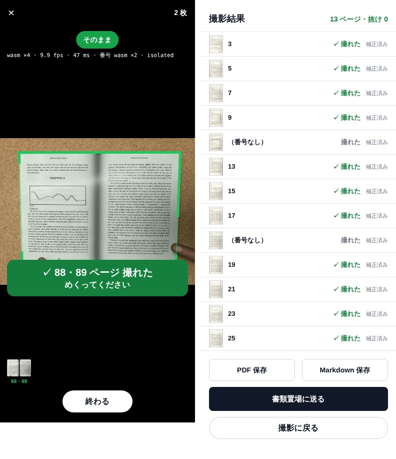

赤について: 読み違いを取り消しても、取り消したページの番号は分からない（読めず）ので、その手前の抜け（2 冊目の 96・97）は次に確かめられた番号が来るまで赤にならない。
「撮影済みと誤って表示して赤を消す」ことは無くなったが、「読み違えたページの直前の抜けを赤にする」まではしていない。

### 3 冊目（コードを変えずに 1 回。未調整かは不明）

| クリップ                  | 元の解像度                 | 本文の書体      | 番号の形・位置                | 紙             | 机                     | 光               | 手                             | 対象                                        |
| ------------------------- | -------------------------- | --------------- | ----------------------------- | -------------- | ---------------------- | ---------------- | ------------------------------ | ------------------------------------------- |
| `book3-spread-topnum`     | 1920×1080 見開き           | DejaVu Serif    | 「160」・上の中央（柱は下へ） | 青白いコート紙 | ベージュの麻布         | 明るすぎ         | 右手の親指が綴じ目の下         | 160〜173（7 見開き、**166・167 を飛ばす**） |
| `book3-single-p`          | 1080×1920 片ページ         | Liberation Mono | 「p. 133」・下の外側          | 茶色い古紙     | 黒い天板               | 緑がかった蛍光灯 | 右手の親指が下の綴じ目寄り     | 133〜151 の右ページ 10                      |
| `book3-spread-paren-port` | 1080×1920 見開き（縦持ち） | Liberation Sans | 「( 315 )」・下の綴じ目寄り   | 薄桃のクリーム | 緑のカッティングマット | 琥珀色           | 左手の親指が左ページの上の外角 | 314〜325（6 見開き）                        |

各本は元の解像度と 720×960 の切り出し（`book3-framed/`）。飛ばしは topnum の hold 3（166・167）で、飛ばしたまま（`--skip-hold 3`）と飛ばして戻る（`--holds 0,1,2,4,3,5,6`）。

### 1・2・3 冊目の全クリップ（直した後のビルド、`run4`）

「取り消した読み」= 一度「✓ N」と出し、後のページで並びに合わないと分かって取り消した番号（最後は読めずとして数える）。

| run                                   | 対象 | ✓   | 赤  | 無表示      | 偽の赤 | 番号 正/誤/読めず | 誤り      | 枠 中央値/最大 | 綴じ目 中央値/最大 | fps  | ✓まで 中央値/最大 | 番号まで 中央値 | めくり中 | 2回撮り | 取り消した読み |
| ------------------------------------- | ---- | --- | --- | ----------- | ------ | ----------------- | --------- | -------------- | ------------------ | ---- | ----------------- | --------------- | -------- | ------- | -------------- |
| 1冊目 framed single-land-white        | 10   | 10  | 0   | 0           | 0      | 10/0/0            |           | 13.4/29.3      | —/—                | 18.1 | 0.38/1.20         | 0.66            | 0        | 0       |                |
| 1冊目 framed single-land-white-skip37 | 10   | 9   | 1   | 0           | 0      | 8/0/1             |           | 13.0/27.9      | —/—                | 17.5 | 0.36/1.14         | 0.68            | 0        | 0       |                |
| 1冊目 framed single-port-wood         | 12   | 12  | 0   | 0           | 0      | 11/0/1            |           | 12.0/17.6      | —/—                | 17.5 | 0.28/1.77         | 0.56            | 1        | 1       |                |
| 1冊目 framed spread-land-white-thick  | 12   | 12  | 0   | 0           | 0      | 4/0/8             |           | 9.2/12.3       | 11.1/15.2          | 16.5 | 0.65/1.06         | 0.73            | 0        | 0       |                |
| 1冊目 framed spread-land-wood         | 14   | 14  | 0   | 0           | 0      | 0/0/14            |           | 5.3/10.2       | 6.4/16.2           | 16.6 | 0.61/1.00         | 0.78            | 0        | 0       |                |
| 1冊目 framed spread-port-white        | 12   | 12  | 0   | 0           | 0      | 0/2/10            | 10→1 11→2 | 4.0/10.1       | 4.4/8.5            | 17.1 | 0.61/0.95         | 0.77            | 0        | 0       |                |
| 2冊目 720×960 center                  | 12   | 12  | 0   | 0           | 0      | 0/0/12            |           | 7.6/10.4       | 12.4/18.6          | 16.1 | 0.75/1.10         | 0.82            | 0        | 0       |                |
| 2冊目 720×960 dash-back               | 14   | 14  | 0   | 0           | 0      | 0/0/14            |           | 4.8/10.5       | 4.8/11.2           | 16.6 | 0.72/0.89         | 0.77            | 0        | 0       |                |
| 2冊目 720×960 dash-skip               | 14   | 12  | 0   | 2 (50,51)   | 0      | 0/0/12            |           | 4.8/9.5        | 4.2/11.7           | 16.9 | 0.75/0.92         | 0.75            | 0        | 0       |                |
| 2冊目 720×960 single-top              | 10   | 10  | 0   | 0           | 0      | 8/0/2             |           | 11.8/15.6      | —/—                | 16.5 | 0.46/1.16         | 0.68            | 0        | 0       |                |
| 2冊目 元の解像度 center               | 12   | 12  | 0   | 0           | 0      | 12/0/0            |           | 15.4/19.6      | 22.6/27.4          | 13.1 | 1.07/1.45         | 0.99            | 0        | 0       |                |
| 2冊目 元の解像度 dash-back            | 14   | 14  | 0   | 0           | 0      | 14/0/0            |           | 8.6/13.3       | 6.3/19.1           | 12.8 | 0.72/0.87         | 0.87            | 0        | 0       |                |
| 2冊目 元の解像度 dash-skip            | 14   | 12  | 0   | 2 (50,51)   | 0      | 10/0/2            |           | 9.0/10.8       | 10.9/19.7          | 12.3 | 0.69/2.63         | 0.86            | 0        | 2       |                |
| 2冊目 元の解像度 single-top           | 10   | 10  | 0   | 0           | 0      | 8/0/2             |           | 29.7/38.5      | —/—                | 12.0 | 0.43/2.16         | 0.80            | 0        | 2       |                |
| 3冊目 720×960 paren-port              | 12   | 12  | 0   | 0           | 0      | 0/0/12            |           | 4.0/5.9        | 3.8/6.3            | 16.2 | 0.61/0.88         | 0.82            | 0        | 0       |                |
| 3冊目 720×960 single-p                | 10   | 9   | 0   | 1 (143)     | 0      | 8/0/1             |           | 13.3/50.8      | —/—                | 16.9 | 0.32/2.44         | 0.63            | 1        | 0       |                |
| 3冊目 720×960 topnum-back             | 14   | 12  | 0   | 2 (166,167) | 0      | 0/0/12            |           | 5.8/14.2       | 6.6/11.7           | 13.9 | 0.74/0.93         | 0.97            | 0        | 0       |                |
| 3冊目 720×960 topnum-skip             | 14   | 12  | 0   | 2 (166,167) | 0      | 0/0/12            |           | 5.6/8.2        | 5.8/12.6           | 17.1 | 0.58/0.93         | 0.71            | 0        | 0       |                |
| 3冊目 元の解像度 paren-port           | 12   | 12  | 0   | 0           | 0      | 10/0/2            |           | 5.3/8.0        | 5.8/7.7            | 12.6 | 0.61/1.44         | 0.97            | 0        | 0       | 324・325       |
| 3冊目 元の解像度 single-p             | 10   | 10  | 0   | 0           | 0      | 10/0/0            |           | 24.4/28.4      | —/—                | 13.1 | 0.35/1.02         | 0.78            | 0        | 0       |                |
| 3冊目 元の解像度 topnum-back          | 14   | 12  | 2   | 0           | 0      | 12/0/0            |           | 11.8/22.6      | 14.6/22.3          | 13.2 | 0.75/1.27         | 0.88            | 0        | 0       |                |
| 3冊目 元の解像度 topnum-skip          | 14   | 12  | 2   | 0           | 0      | 12/0/0            |           | 12.7/23.7      | 15.5/20.0          | 12.3 | 0.76/1.31         | 0.98            | 0        | 0       |                |

- 1 冊目 single-land-white p37 飛ばしの回: 最初の hold（31）がカメラの開き始めで撮れず、映像の 2 周目で最後に撮った。31 は「前の撮影で確かめられた 33 より下」なので
  番号を取り消した（正しい番号を読めず扱いにした例。抜けも偽の赤も出ない）。
- 3 冊目 720×960 の single-p 143 と 1 冊目の single-port-wood（めくり中 1）: めくりが 84 % まで進んだフレームで撮った（画面は「✓ 143」、ページの 97 % を覆う）。
  hold の前なので採点では無表示。
- 3 冊目 topnum の「飛ばして戻る」回で 166・167 が両方の解像度で撮れない: 映像は 168・169 から 166・167 へめくりの動き無しで切り替わる（つなぎ）。
  32×24 の画面の変化が「めくった」の閾値 14 に届かず（上の中央に番号がある同じ体裁のページ）、直前に撮ったページのままと見た。実際に戻るときはめくりの動きがある。
- 2 冊目 元の解像度の 50・51 飛ばしの回は、この回は赤が出なかった（前後の 48・49 か 52・53 を読めず「確かめられた番号」が片側だけ）。直す前の回と run3 では赤が出た。読み取りの揺れ。

## 測り直し（`run5`、head 4c17b44、別の session）

`run4` の後、コードを変えずに別の cloud session で同じ head（アプリのコードは 4c17b44 から変わっていない）を `nuxt generate` し、
COOP/COEP 付きの静的サーバーで 1・2・3 冊目を 1 回ずつ流し直した（headless Chromium、CPU 4 コア、WASM ×4）。採点は
「取り消した読みは読めず」の `book-e2e.mjs`（2eacb2e）。生の結果は `docs/book3-eval/browser-results.jsonl`。

### 冊ごとのまとめ（ブラウザ版 `run5` と Android 版）

ブラウザ版の 2・3 冊目は飛ばしたままの回（2 冊目 50・51、3 冊目 166・167 を飛ばす。この 2 ページは赤が正解で、無表示なら抜け）で数える。
Android 版は 1 冊目 PR #10 Round 28、2 冊目 run 42240438576（上の表）、3 冊目は下の「Android 版の 3 冊目」。

| 本           | 版・入力                                     | 無表示の抜け                                | ✓                                                         | 赤（正しい）                                              | 偽の赤 | 番号 正 / 誤 / 読めず                                        | 「撮れた」まで（中央値） | 番号まで（中央値） |
| ------------ | -------------------------------------------- | ------------------------------------------- | --------------------------------------------------------- | --------------------------------------------------------- | ------ | ------------------------------------------------------------ | ------------------------ | ------------------ |
| 1 冊目（60） | ブラウザ 720×960                             | 1（single-port-wood p21）                   | 59 / 60                                                   | p37 飛ばしの回: 37 だけ赤                                 | 0      | 23 / **2** / 34（片ページ 21 / 0 / 0）                       | 0.23〜0.69 秒            | 0.61〜0.90 秒      |
|              | Android ライブ 960×1280                      | 0                                           | 41 / 41 hold                                              | ライブでは p37 は赤にならない（静止画のセッションでは赤） | 0      | single-port-wood 12 / 12、single-land-white 2 / 10、見開き 0 | 撮影と同時               | 7.9 秒             |
| 2 冊目（36） | ブラウザ 720×960                             | 2（飛ばした 50・51。赤にならない）          | 34 / 36                                                   | 出ない                                                    | 0      | 5 / **2** / 27                                               | 0.47〜0.78 秒            | 0.72〜0.89 秒      |
|              | ブラウザ 元の解像度                          | 0                                           | 34 / 36                                                   | **50・51**                                                | 0      | 30 / 0 / 4（205 → 5 は取り消し）                             | 0.46〜1.02 秒            | 0.88〜1.06 秒      |
|              | Android ライブ 960×1280                      | 0                                           | 23 / 23 hold（片 10 ✓、見開き 13 灰）                     | 出ない（飛ばして戻る回）                                  | 0      | 10 / 0 / 26                                                  | 2.3 秒                   | 8.6 秒             |
|              | Android 静止画                               | 0                                           | 22 / 22 hold                                              | 50・51                                                    | 0      | 46 / 0 / 0                                                   | —                        | 1.25 秒 / 枚       |
| 3 冊目（36） | ブラウザ 720×960                             | 2（飛ばした 166・167。赤にならない）        | 34 / 36                                                   | 出ない                                                    | 0      | 11 / **2** / 21                                              | 0.34〜0.68 秒            | 0.72〜0.96 秒      |
|              | ブラウザ 元の解像度（1920×1080 / 1080×1920） | **2**（paren-port 316・317）                | 32 / 36                                                   | **166・167**                                              | 0      | 31 / 0 / 1                                                   | 0.36〜0.77 秒            | 0.93〜1.05 秒      |
|              | Android ライブ 960×1280                      | single-p 0、paren-port 0、**topnum 未測定** | single-p 10 / 10、paren-port 6 / 6 hold（灰「番号なし」） | topnum 未測定                                             | 0      | single-p 10 / 0 / 0、paren-port 0 / 0 / 12                   | 2.7 秒                   | 10.1 秒            |
|              | Android 静止画                               | 0                                           | 23 / 23 hold（飛ばした回は 22）                           | 167 だけ（166 は出ず）                                    | 0      | 21 / 1 / 1（hold。145 → 445 は灰）                           | —                        | 約 1 秒 / 枚       |

### Android 版の 3 冊目

- run [42262395484](https://github.com/AstarWorks/AstarScan/actions/runs/42262395484)（`book3-android-eval` 390de83、job「Android emulator check」緑）:
  ライブは single-p（10 / 10「撮れた」、番号 10 / 0 / 0、枠のずれ平均 8.7 / 最大 32.9 px）と paren-port（6 / 6 hold が灰「撮れた（番号なし）」、枠 3.1 / 5.2 px）。
  3 本目の topnum はアプリが応答しなくなり撮影画面が開かず、7 hold とも何も出ない（アプリの結果ではないので上の表では数えない）。
  30 秒以内に「✓ N」が出たのは 16 枚中 9。ML Kit 1 回の呼び出しが中央値 9.9 秒。静止画（3000×4000 / 4000×3000）は 23 枚中 正 21・誤 1（145 → 445）・読めず 1（133）。
  静止画のセッション（166・167 を飛ばす）は赤が 167 だけで、166 は出なかった。PDF / Markdown の保存ボタンは見つからず（保存は未確認）。
- 測り直しの run [42271420796](https://github.com/AstarWorks/AstarScan/actions/runs/42271420796)（3db8676、topnum を 2 本目に）: **取り消し（cancelled）**。
  emulator job の「Virtual webcam (v4l2loopback)」の手順（`apt-get update` / `apt-get install` / `modprobe v4l2loopback`、出力は捨てている）が
  18:39 から 45 分間何も出さずに止まり、19:25 に取り消された。アプリは起動していない。どの命令で止まったかはログに無い（出力を捨てているため）。
  **3 冊目 topnum の Android ライブは未測定**。

### クリップ別（`run5`）

| run                                       | 対象 | ✓   | 赤          | 無表示      | 偽の赤 | 番号 正/誤/読めず | 誤り                 | 枠 中央値/最大 | 綴じ目 中央値/最大 | fps  | ✓まで 中央値/最大 | 番号まで 中央値/最大 | めくり中 | 曲がり補正 |
| ----------------------------------------- | ---- | --- | ----------- | ----------- | ------ | ----------------- | -------------------- | -------------- | ------------------ | ---- | ----------------- | -------------------- | -------- | ---------- |
| 1冊目 framed single-land-white            | 10   | 10  | 0           | 0           | 0      | 10/0/0            |                      | 24.9/32.8      | —                  | 15.4 | 0.37/1.35         | 0.76/1.05            | 0        | 10/10      |
| 1冊目 framed single-land-white p37 飛ばし | 10   | 9   | 1 (37)      | 0           | 0      | 9/0/0             |                      | 10.1/26.6      | —                  | 15.1 | 0.35/1.53         | 0.76/1.04            | 0        | 9/9        |
| 1冊目 framed single-port-wood             | 12   | 11  | 0           | 1 (21)      | 0      | 11/0/0            |                      | 11.2/22.6      | —                  | 15.8 | 0.23/0.91         | 0.61/0.89            | 1        | 12/12      |
| 1冊目 framed spread-land-white-thick      | 12   | 12  | 0           | 0           | 0      | 2/0/10            |                      | 9.5/11.8       | 10.7/15.9          | 14.8 | 0.69/1.15         | 0.90/1.14            | 0        | 12/12      |
| 1冊目 framed spread-land-wood             | 14   | 14  | 0           | 0           | 0      | 0/0/14            |                      | 4.7/11.0       | 7.6/13.4           | 13.1 | 0.65/1.21         | 0.89/1.37            | 0        | 14/14      |
| 1冊目 framed spread-port-white            | 12   | 12  | 0           | 0           | 0      | 0/2/10            | 4→1, 5→2             | 4.7/10.1       | 4.8/8.5            | 15.3 | 0.62/0.94         | 0.79/0.88            | 0        | 12/12      |
| 2冊目 720×960 center                      | 12   | 12  | 0           | 0           | 0      | 0/2/10            | 96→8, 97→9           | 8.4/10.0       | 12.8/18.8          | 14.3 | 0.78/1.07         | 0.89/1.24            | 0        | 12/12      |
| 2冊目 720×960 dash 50・51 飛ばし          | 14   | 12  | 0           | 2 (50,51)   | 0      | 0/0/12            |                      | 4.5/9.5        | 4.5/11.7           | 15.5 | 0.75/0.93         | 0.81/1.17            | 0        | 12/12      |
| 2冊目 720×960 single-top                  | 10   | 10  | 0           | 0           | 0      | 5/0/5             |                      | 11.5/13.6      | —                  | 14.7 | 0.47/0.96         | 0.72/0.81            | 0        | 10/10      |
| 2冊目 1440×1080 center                    | 12   | 12  | 0           | 0           | 0      | 10/0/2            |                      | 13.9/20.0      | 23.6/29.4          | 11.7 | 1.02/1.44         | 1.06/1.25            | 0        | 12/12      |
| 2冊目 1920×1080 dash 50・51 飛ばし        | 14   | 12  | 2 (50,51)   | 0           | 0      | 12/0/0            |                      | 10.0/14.1      | 11.7/18.9          | 11.1 | 0.77/0.97         | 1.06/1.18            | 0        | 12/12      |
| 2冊目 1080×1920 single-top                | 10   | 10  | 0           | 0           | 0      | 8/0/2             | （205→5 は取り消し） | 30.3/90.6      | —                  | 10.6 | 0.46/1.86         | 0.88/1.28            | 0        | 10/11      |
| 3冊目 720×960 topnum 166・167 飛ばし      | 14   | 12  | 0           | 2 (166,167) | 0      | 0/0/12            |                      | 6.4/10.1       | 7.8/13.6           | 12.9 | 0.67/1.07         | 0.96/1.44            | 0        | 8/12       |
| 3冊目 720×960 topnum 飛ばして戻る         | 14   | 14  | 0           | 0           | 0      | 0/0/14            |                      | 6.3/11.6       | 7.5/15.4           | 13.4 | 0.68/0.86         | 0.85/1.28            | 0        | 10/14      |
| 3冊目 720×960 single-p                    | 10   | 10  | 0           | 0           | 0      | 9/0/1             |                      | 13.9/16.5      | —                  | 13.9 | 0.34/0.92         | 0.72/1.17            | 0        | 10/10      |
| 3冊目 720×960 paren-port                  | 12   | 12  | 0           | 0           | 0      | 2/**2**/8         | 324→824, 325→825     | 5.0/6.2        | 3.3/8.5            | 13.0 | 0.68/1.01         | 0.95/1.19            | 0        | 12/12      |
| 3冊目 1920×1080 topnum 166・167 飛ばし    | 14   | 12  | 2 (166,167) | 0           | 0      | 12/0/0            |                      | 14.4/28.3      | 15.5/26.2          | 9.8  | 0.77/1.46         | 1.03/1.97            | 0        | 7/12       |
| 3冊目 1920×1080 topnum 飛ばして戻る       | 14   | 12  | 2 (166,167) | 0           | 0      | 12/0/0            |                      | 12.6/15.7      | 15.6/22.6          | 11.0 | 0.74/0.90         | 1.19/1.62            | 0        | 7/12       |
| 3冊目 1080×1920 single-p                  | 10   | 10  | 0           | 0           | 0      | 9/0/1             |                      | 24.3/47.3      | —                  | 10.4 | 0.36/2.36         | 0.93/1.28            | 0        | 11/11      |
| 3冊目 1080×1920 paren-port                | 12   | 10  | 0           | 2 (316,317) | 0      | 10/0/0            |                      | 7.1/9.3        | 5.5/12.9           | 11.3 | 0.49/1.23         | 1.05/1.24            | 0        | 10/10      |

`run4` との違い（同じコード、1 回ずつ）: 1 冊目 single-port-wood p21 が無表示（run4 は ✓）、3 冊目 720×960 の topnum 飛ばして戻るは 14 / 14（run4 は 12）、
3 冊目 720×960 paren-port で 324・325 を 824・825 と読み違えたまま残った（run4 は 0/0/12）、3 冊目 1080×1920 paren-port で 316・317 が無表示（run4 は 12 / 12、
代わりに 324・325 の取り消し）。同じ条件でも 1 回ごとに 2 ページ前後は動く。

見立て（コードは直していない）:

- **720×960 の見開きの読み違いが残る**（1 冊目 4・5 → 1・2、2 冊目 96・97 → 8・9、3 冊目 324・325 → 824・825）。720×960 の見開きは他の番号がほぼ読めないので
  「確かめられた番号」が無く、`numbersFitOrder` の「前の確かめられた番号より下 / 後の確かめられた番号 2 つより上」に掛からない。824・825 は上へ外れた読み違いで、
  下へ外れた読み違い（98・99 → 88・89）向けの規則はもともと見ない。画面には「✓ 824・825」と出て、一覧も 824・825 になる。抜けは隠さない（赤の規則は
  確かめられた番号だけで動くので、ほかの番号が無い 720×960 ではどのみち赤は出ない）。
- **見開きのめくりで静止が切れず、次の見開きを撮らない**（3 冊目 1080×1920 paren-port の 316・317、1920×1080 topnum 飛ばして戻るの 166・167）。
  314・315 を撮った後、めくりの間も枠がほとんど動かず（縦持ちの見開きは画面の高さの約 45 %）、32×24 の画面の変化が「めくった」の閾値 14（`TURNED_VIEW`）に届いたのは
  次のめくり（318・319 へ）だった。topnum の戻りは映像のつなぎ（めくりの動き無し）で、同じ形。
- **読み違いは ✓ にならないが、その場面で抜けが赤くなるとは限らない**: 2 冊目の `book2-misread-demo`（98・99 を「88・89」と印刷）を 94・95 を飛ばして
  （hold 0,1,2,4,5）流すと、98・99 は「撮れた（番号なし）」になった（✓ にならない）が、94・95 の赤は出なかった。92・93 の 92 を「9」と読み（93 から 92 を補った）、
  93 が隣の撮影で確かめられないので、確かめられた番号の間は 91〜96 の 4 ページ（見開き 1 つより広い）になり、両側とも隣で確かめられたときだけ赤を出す規則で止まった。
  scan-core の `bookCoverage` に同じ番号（90・91 / 92・93 / 96・97、全部読めた場合）を渡すと 94・95 の抜けが出る。
- **曲がり補正**: 3 冊目 topnum（上の中央に番号、青白いコート紙、明るすぎ）の左ページが「上の縁の段差」で補正できない（7〜10 / 12〜14）。ほかの本は全ページ補正。
- 1 冊目 single-port-wood p21: めくり途中（84 % まで進んだフレーム）で撮り、hold の間はもう撮らなかった（一覧には 21 が ✓ で並ぶが、採点では無表示）。

### 確かめた画面（`run5` と同じビルド）

- 抜けの赤・読み違いの扱い・番号の形（左から）: 3 冊目 1920×1080 で 166・167 を飛ばし 168・169 を撮った瞬間の「166・167 ページが抜けています」と列の赤い空き /
  `book2-misread-demo` の 98・99（「88・89」と印刷）が「✓ 撮れた（番号なし）」で列の末尾が「番号なし」（✓ 88・89 にならない）/ 2 冊目「— 44 —」型の
  「✓ 44・45 ページ 撮れた」/ 3 冊目「p. 133」型の片ページ「✓ 133 ページ 撮れた」（画面のカメラはもう次の 135 を映している）。
  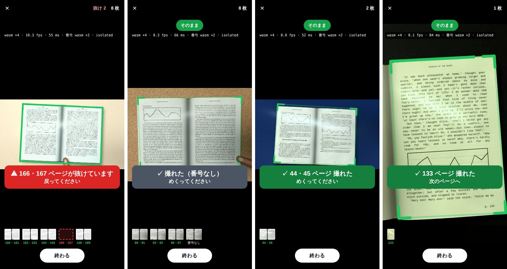
- 以前抜けたページが撮れる: 左: 2 冊目 1440×1080 center の一覧、88・89（`run3` 以前は両方の解像度で無表示）と 96・97・98・99 が ✓、抜け 0
  （94・95 は番号なし 2 行）。右: 1 冊目 single-port-wood の一覧、7・17・21 が並ぶ（PR #12 の最初の回は無表示）。
  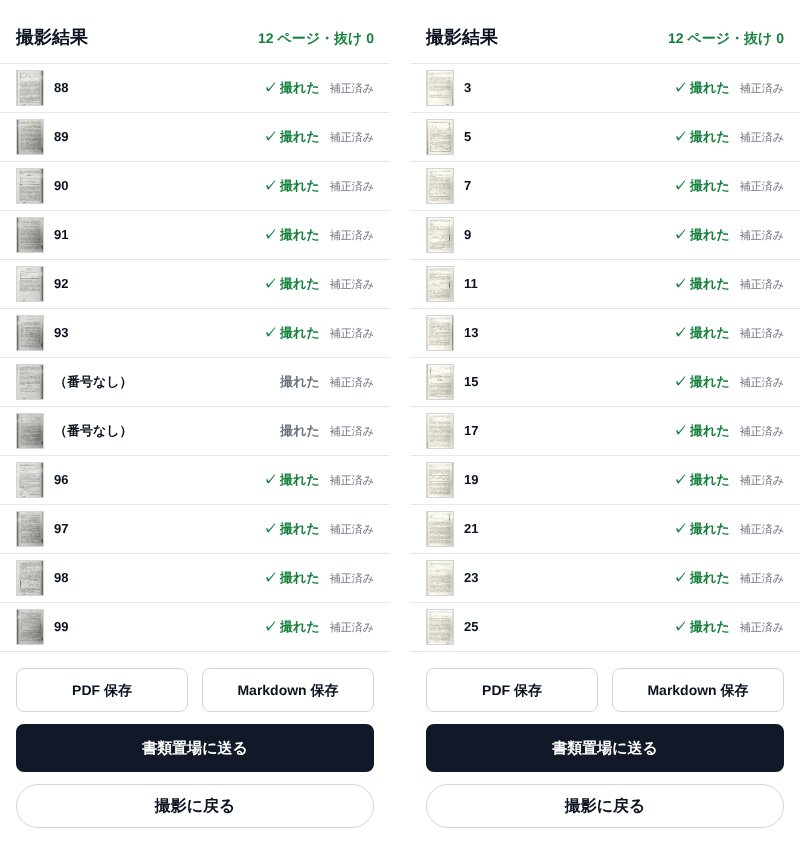
- 見開きが一覧・PDF・Markdown で 1 ページずつ: 3 冊目 1920×1080 topnum（166・167 を飛ばす）を撮って一覧から保存した。一覧 12 行（160〜165、赤い行
  「166・167 ページが抜けています」、168〜173）。PDF は 12 ページ（`pdfinfo`、150×215 pt の縦長 1 ページずつ、0.1 秒）。Markdown は 189 秒（NDLOCR）で
  `## p. 160` … `## p. 173` の 12 見出しが一覧と同じ順（`docs/book3-eval/saved-markdown-book3-1920-skip.md`。抜けの 166・167 は書かれない。英語の本文は崩れる）。
  左ページ 6 枚は「補正なし」（上の「曲がり補正」）。
  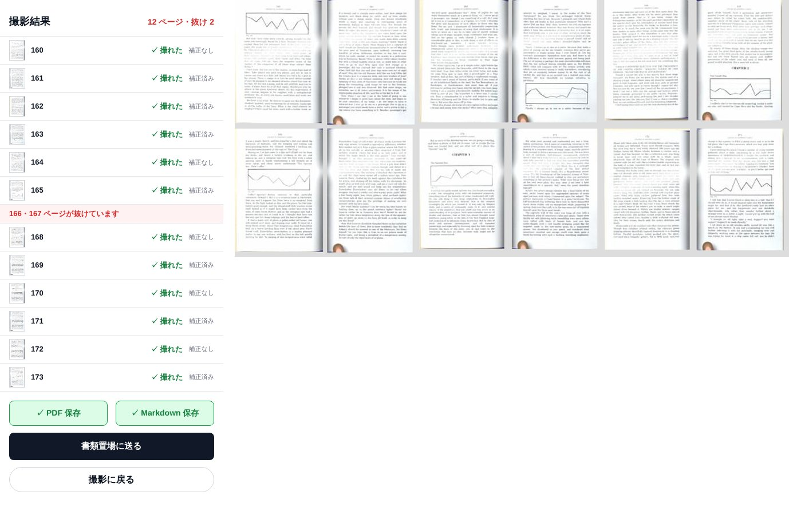

### 3 冊目は未調整か

**不明**（未調整とは呼ばない）。ブランチで分かること:

- 3 冊目の設定と映像は 942c2ae / 5a7f0ac（17:20 / 17:31、session cloud-7mmhn5nx）。その後に別の session（cloud-9ezpgo95）がアプリの直しを 3 つ入れた:
  8c1309d（17:54）、6d7d6e9（18:06）、4c17b44（18:15）。commit のメッセージが挙げる根拠は 1・2 冊目だけ。
- 3 冊目の Android 版 run 42262395484 は 17:31〜18:28 に走っていた。ブラウザ版の 3 冊目の結果が初めて branch に出るのは 61928e2（18:37、`run4`）で、
  そこに `run3` という前の回がある（何を流したかは branch に残っていない）。
- 6d7d6e9 の規則の 1 つ（前に何も無く、後の確かめられた番号 2 つ以上がそれより下なら取り消す）は、3 冊目 paren-port の「最初の 314・315 を 324・325 と読む」形に
  そのまま当たる。2eacb2e の採点の注釈もこの 3 冊目の例を挙げている。commit のメッセージでは 1 冊目の「最初の 31 を 40 と読む」が根拠。
- 前の session の作業ログはこの session からは見られない。3 冊目の結果を見たうえで直したかは、branch からは決められない。

## 律速と残り

- 番号の読み取り: 1 ページ約 0.55 秒（WASM、行ごとに PP-OCR）。見開きは 2 本並べて 0.93 秒。片ページ 1 秒以内、見開きはほぼ 1 秒。
- 720×960 の見開きの番号は数字の高さ 4〜5 px で読めない。読み違いを出さないよう 5 px 未満は読まない（spread-port-white の 2 件は 5 px をわずかに超えた）。
- single-port-wood の無表示 3 と「めくりの途中を撮った」2: 強い手ぶれで DocAligner の四隅が揺れ、静止が続かない／めくり始めを静止と見た。
  撮る直前に画面の変化を見る対策（緑の線の間の変化 6 以下）は、手ぶれで正しい撮影まで消した（spread-land-wood ✓ 14 → 8）ので入れていない。
- 1920×1080 の single-land-white（横長、左ページが半分）は 0 / 10。ページで画面を埋める持ち方（framed）なら 10 / 10。

## 未確認の点

- 実機（iOS Safari / Android Chrome）の速度・結果。数字はすべて cloud の headless Chromium（CPU、GPU なし）。
- WebGPU の速度（未測定）。
- 実物の本・実際の手ぶれ・照明・紙。映像はすべて合成（`book-clips/README.md` の「Not yet like a real book」）。
- iOS Safari の振動（`navigator.vibrate` が無い）、cross-origin isolation の下での動作。
- 書類置場への送信（CORS）、Markdown 保存（NDLOCR）、PDF 保存の実機での保存先。
- 各回 1 本ずつしか流していない。同じ条件でも ✓ が 1〜3 変わる（single-port-wood framed: 9〜11）。

## 測り方

`scripts/eval/book-clips/book-e2e.mjs`（Playwright のテスト用カメラ、モデルを読み込んでからカメラを開くので 1 周目を数える）。

```sh
NODE_PATH=<playwright> node scripts/eval/book-clips/book-e2e.mjs http://127.0.0.1:3005 spread-land-wood out \
  --clips scripts/eval/book-clips/framed [--skip-hold 3] [--holds 0,1,3,2,3,4] [--no-folio 126,127] [--record]
```

各フレームが映像の何コマ目かは、アプリの 32×24 の縮小画面を映像と突き合わせて決める。✓ = hold 中の撮影で、分けた後のページの枠が
そのページの 90 % 以上を覆う。赤 = ✓ が無く、そのページを含む赤い案内が出た。番号は ✓ のページで数える。
