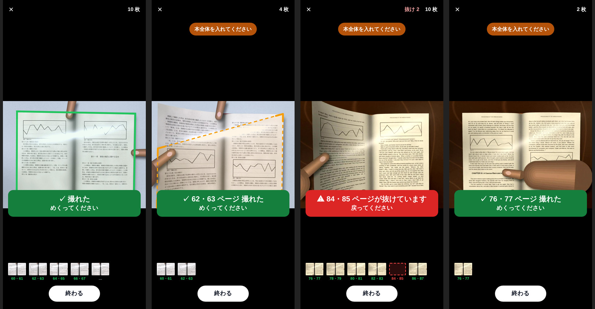
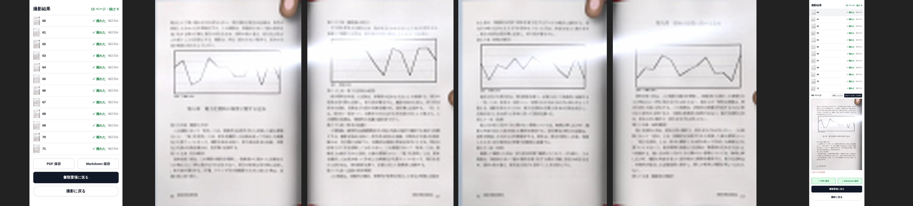

# 4〜7 冊目（未調整の本）とその前後の測り直し（ブラウザ版・Android 版）

設計は [book4-design.md](book4-design.md)、経緯は [book-eval.md](book-eval.md)。
数字はすべてこの cloud の headless Chromium（CPU 4 コア、WASM ×4）、`book-e2e.mjs`（取り消した読みは読めず、保留のまま終わった読みも読めず）。
生の結果は `docs/book4-eval/*.jsonl`。各回 1 本ずつ。同じ条件でも 1 回ごとに 1〜2 ページは動く。

## 結論

- **4 冊目**（別 session が bc8a4d3 の後に作った未調整の本、`book4.py`: Inter / Bitstream Charter / WenQuanYi、「Page 58」「– 233 –」「124頁」、大理石・錆色フェルトの机、紫・マゼンタの光、1440×1920 / 1080×1440 / 1920×1440）を
  57ca745 で流す（`run10`）と、スマホ解像度でも番号は **14 / 0 / 18**、720×960 では 10 / 0 / 22 で、飛ばした 62・63 の赤はどちらでも出なかった。
  原因は 4 つとも本ごとの閾値ではなく判定の規則の穴（「Page58」を番号と見ない、PP-OCR が返す 页 を 頁 と見ない、細い印字がインクの閾値に掛からない、読めた側が違う見開きどうしが隣にならない）。
  `packages/core` の共通の判定として直した後（`run12`）、スマホ解像度で **28 / 0 / 4、62・63 の赤が出る**。720×960 は 16 / 0 / 16（赤は出たり出なかったり: 6〜8 px の読みは 1 回ごとに揺れる）。
- 1〜3 冊目の測り直し（`run12`、242 ページ）: ✓ 225、赤 7、無表示 10、**偽の赤 0、読み違い 0**、番号 129 / 0 / 96（直す前の `run8`: ✓ 227、赤 7、無表示 8、117 / 0 / 110）。
  最初の直し（`run11`）では 720×960 の見開きの番号が多く読めるようになった代わりに、2 冊目 center で 6 px の読み違い（94・95 → 98・99）が隣の 6 px の正しい読みに「確かめられ」て偽の赤 2 が出た。
  `surePx` 未満の読みは、`surePx` 以上の読みを持つ撮影か 2 つの撮影が接するときだけ確かめられる規則にして偽の赤 0 に戻した（その分 720×960 の見開きの番号は保留が多い）。
- **5 冊目**（この PR の最後のコードの後に作った未調整の本、`book5.py`）: 下の「5 冊目」。
- Android 版の 4 冊目: 下の「Android 版」。
- 無表示の抜けで残っているのは、720×960 で飛ばした見開き（番号が読めず赤にできない: 2 冊目 50・51、3 冊目 166・167、4 冊目 62・63）、片ページのめくりの終わりで撮った 1 枚（1 冊目 p17 / 3 冊目 143）、厚い本の左縁（1 冊目 66）、上の余白から入る親指（2 冊目 215）— どれも [book4-design.md](book4-design.md) の「直さなかったもの」。

## 4 冊目

| クリップ             | 元の解像度             | 本文の書体        | 番号の形・位置              | 紙             | 机             | 光               | 手                                               | 対象                                    |
| -------------------- | ---------------------- | ----------------- | --------------------------- | -------------- | -------------- | ---------------- | ------------------------------------------------ | --------------------------------------- |
| `book4-spread-inner` | 1440×1920 見開き（縦） | Inter             | 「Page 58」・上の綴じ目寄り | 淡い灰緑       | 白大理石       | 紫がかった寒色   | 右手の親指が上の外角、左手の親指が下の綴じ目寄り | 58〜69（6 見開き、**62・63 を飛ばす**） |
| `book4-single-dash`  | 1080×1440 片ページ     | Bitstream Charter | 「– 233 –」・下の綴じ目寄り | 新聞紙の黄     | 錆色のフェルト | 暗い暖色、強い影 | 右手の親指が下の外角                             | 233〜251 の右ページ 10                  |
| `book4-spread-ja-43` | 1920×1440 見開き（横） | WenQuanYi Zen Hei | 「124頁」・下の外側         | 真っ白（寒色） | 白大理石       | マゼンタ、強い光 | 右手の親指が下中央、左手の親指が左の小口         | 124〜135（6 見開き）                    |

各本は元の解像度（`--own-size`: 偽のカメラがクリップをアプリの 1920×1080 の要求に合わせて潰さないよう、クリップの大きさで）と 720×960 の切り出し（`book4-framed/`）。

### run10: 直す前（57ca745 = `june-pipeline` + bc8a4d3 + 2e0f632 + 57ca745）

| run                                 | 対象 | ✓   | 赤  | 無表示    | 偽の赤 | 番号 正/誤/読めず | 誤り | 保留のまま / 後で出た | 枠 中央値/最大 | 綴じ目 中央値/最大 | fps  | ✓まで 中央値/最大 | 番号まで 中央値/最大 | めくり中 | 曲がり補正 |
| ----------------------------------- | ---- | --- | --- | --------- | ------ | ----------------- | ---- | --------------------- | -------------- | ------------------ | ---- | ----------------- | -------------------- | -------- | ---------- |
| 4冊目 720×960 inner 62・63 飛ばし   | 12   | 10  | 0   | 2 (62,63) | 0      | 0/0/10            |      | 6・7                  | 5.2/12.0       | 5.6/13.1           | 15.5 | 0.95/1.03         | 0.86/1.27            | 0        | 10/10      |
| 4冊目 720×960 single-dash           | 10   | 10  | 0   | 0         | 0      | 10/0/0            |      |                       | 9.1/15.3       | —/—                | 16.0 | 0.35/0.92         | 0.76/0.95            | 0        | 10/10      |
| 4冊目 720×960 ja-43                 | 12   | 12  | 0   | 0         | 0      | 0/0/12            |      | 128・129              | 8.6/11.4       | 11.4/16.7          | 14.4 | 0.68/0.90         | 0.90/1.21            | 0        | 12/12      |
| 4冊目 1440×1920 inner 62・63 飛ばし | 12   | 10  | 0   | 2 (62,63) | 0      | 4/0/6             |      | 64・65→出た           | 11.3/19.0      | 8.7/29.3           | 11.8 | 1.04/1.07         | 1.06/4.37            | 0        | 10/10      |
| 4冊目 1080×1440 single-dash         | 10   | 10  | 0   | 0         | 0      | 10/0/0            |      |                       | 12.9/18.7      | —/—                | 14.0 | 0.34/0.95         | 0.77/1.01            | 0        | 10/10      |
| 4冊目 1920×1440 ja-43               | 12   | 12  | 0   | 0         | 0      | 0/0/12            |      | 49・50                | 18.9/27.2      | 23.7/41.6          | 12.4 | 0.72/0.94         | 1.03/1.35            | 0        | 11/12      |
| **合計**                            | 68   | 64  | 0   | 4         | 0      | 24/0/40           |      |                       |                |                    |      |                   |                      |          |            |

### run12: 直した後（この PR の最後のコード 78e0d43）

| run                                 | 対象 | ✓   | 赤         | 無表示    | 偽の赤 | 番号 正/誤/読めず | 誤り | 保留のまま / 後で出た                                     | 枠 中央値/最大 | 綴じ目 中央値/最大 | fps  | ✓まで 中央値/最大 | 番号まで 中央値/最大 | めくり中 | 曲がり補正 |
| ----------------------------------- | ---- | --- | ---------- | --------- | ------ | ----------------- | ---- | --------------------------------------------------------- | -------------- | ------------------ | ---- | ----------------- | -------------------- | -------- | ---------- |
| 4冊目 720×960 inner 62・63 飛ばし   | 12   | 10  | 0          | 2 (62,63) | 0      | 4/0/6             |      | 58・59→出た / 64・65 / 60・61                             | 7.3/13.4       | 8.8/14.4           | 13.9 | 0.96/1.04         | 0.93/4.49            | 0        | 9/10       |
| 4冊目 720×960 single-dash           | 10   | 10  | 0          | 0         | 0      | 10/0/0            |      |                                                           | 9.5/17.1       | —/—                | 16.1 | 0.36/0.99         | 0.74/1.08            | 0        | 10/10      |
| 4冊目 720×960 ja-43                 | 12   | 12  | 0          | 0         | 0      | 2/0/10            |      | 124・125 / 126・127 / 130・131 / 132・133→出た / 134・135 | 8.5/9.4        | 12.1/14.5          | 15.0 | 0.66/0.98         | 0.99/3.88            | 0        | 12/12      |
| 4冊目 1440×1920 inner 62・63 飛ばし | 12   | 10  | 2 (62〜63) | 0         | 0      | 6/0/4             |      | 68・69                                                    | 13.8/18.8      | 9.3/28.4           | 12.2 | 1.01/1.05         | 0.92/1.10            | 0        | 10/10      |
| 4冊目 1080×1440 single-dash         | 10   | 10  | 0          | 0         | 0      | 10/0/0            |      |                                                           | 13.1/20.3      | —/—                | 13.3 | 0.36/0.96         | 0.82/1.37            | 0        | 10/10      |
| 4冊目 1920×1440 ja-43               | 12   | 12  | 0          | 0         | 0      | 12/0/0            |      |                                                           | 18.0/23.2      | 23.9/39.5          | 12.7 | 0.71/0.98         | 0.99/1.48            | 0        | 12/12      |
| **合計**                            | 68   | 64  | 2          | 2         | 0      | 44/0/20           |      |                                                           |                |                    |      |                   |                      |          |            |

### 1〜3 冊目（`run12`、同じビルド）

| run                                       | 対象 | ✓   | 赤           | 無表示      | 偽の赤 | 番号 正/誤/読めず | 誤り | 保留のまま / 後で出た                                                     | 枠 中央値/最大 | 綴じ目 中央値/最大 | fps  | ✓まで 中央値/最大 | 番号まで 中央値/最大 | めくり中 | 曲がり補正 |
| ----------------------------------------- | ---- | --- | ------------ | ----------- | ------ | ----------------- | ---- | ------------------------------------------------------------------------- | -------------- | ------------------ | ---- | ----------------- | -------------------- | -------- | ---------- |
| 1冊目 framed single-land-white            | 10   | 10  | 0            | 0           | 0      | 9/0/1             |      |                                                                           | 23.4/29.4      | —/—                | 14.3 | 0.37/1.05         | 0.86/1.07            | 0        | 10/10      |
| 1冊目 framed single-land-white p37 飛ばし | 10   | 9   | 1 (37)       | 0           | 0      | 9/0/0             |      |                                                                           | 18.2/28.0      | —/—                | 15.3 | 0.32/1.18         | 0.69/1.09            | 0        | 9/9        |
| 1冊目 framed single-port-wood             | 12   | 11  | 0            | 1 (17)      | 0      | 10/0/1            |      |                                                                           | 11.6/20.1      | —/—                | 12.4 | 0.31/1.38         | 0.63/1.27            | 1        | 12/12      |
| 1冊目 framed spread-land-white-thick      | 12   | 11  | 0            | 1 (66)      | 0      | 0/0/11            |      | 62・63 / 64・65 / 68・69                                                  | 11.5/20.3      | 9.8/16.5           | 13.2 | 0.70/1.13         | 1.08/1.18            | 0        | 12/12      |
| 1冊目 framed spread-land-wood             | 14   | 14  | 0            | 0           | 0      | 0/0/14            |      | 6・7 / 12・13                                                             | 5.5/7.6        | 6.7/12.9           | 14.5 | 0.66/0.99         | 0.94/1.34            | 0        | 14/14      |
| 1冊目 framed spread-port-white            | 12   | 12  | 0            | 0           | 0      | 0/0/12            |      | 2・3 / 8・9 / 8・9                                                        | 4.3/9.5        | 4.9/7.8            | 13.0 | 0.70/0.93         | 0.96/0.99            | 0        | 12/12      |
| 2冊目 720×960 center                      | 12   | 12  | 0            | 0           | 0      | 0/0/12            |      | 90・91 / 92・93 / 98・99                                                  | 8.9/11.4       | 12.7/18.5          | 13.4 | 0.77/1.19         | 1.23/1.26            | 0        | 12/12      |
| 2冊目 720×960 dash 50・51 飛ばし          | 14   | 12  | 0            | 2 (50,51)   | 0      | 0/0/12            |      | 44・45 / 46・47 / 54・55                                                  | 5.4/7.9        | 5.2/9.0            | 14.1 | 0.83/0.90         | 0.90/1.08            | 0        | 12/12      |
| 2冊目 720×960 single-top                  | 10   | 10  | 0            | 0           | 0      | 8/0/2             |      |                                                                           | 11.9/14.0      | —/—                | 14.8 | 0.47/1.15         | 0.77/1.20            | 0        | 10/10      |
| 2冊目 1440×1080 center                    | 12   | 12  | 0            | 0           | 0      | 12/0/0            |      |                                                                           | 14.9/18.9      | 20.6/26.5          | 11.7 | 0.92/1.41         | 1.11/1.22            | 0        | 12/12      |
| 2冊目 1920×1080 dash 50・51 飛ばし        | 14   | 12  | 2 (50〜51)   | 0           | 0      | 12/0/0            |      | 54・55                                                                    | 9.0/14.6       | 7.8/18.4           | 10.6 | 0.76/2.64         | 0.79/1.07            | 0        | 14/14      |
| 2冊目 1080×1920 single-top                | 10   | 9   | 0            | 1 (215)     | 0      | 9/0/0             |      | 211 / 201                                                                 | 30.2/88.9      | —/—                | 10.9 | 0.48/1.72         | 0.86/1.09            | 0        | 10/12      |
| 3冊目 720×960 topnum 166・167 飛ばし      | 14   | 12  | 0            | 2 (166,167) | 0      | 4/0/8             |      | 160・161 / 162・163→出た / 164・165 / 168・169 / 170・171→出た / 172・173 | 6.3/8.6        | 7.7/11.7           | 14.6 | 0.66/1.03         | 1.45/4.16            | 0        | 8/12       |
| 3冊目 720×960 topnum 飛ばして戻る         | 14   | 12  | 0            | 2 (166,167) | 0      | 4/0/8             |      | 160・161 / 162・163→出た / 164・165 / 168・169 / 170・171→出た / 172・173 | 5.4/11.2       | 5.3/13.6           | 15.5 | 0.68/0.98         | 1.30/3.98            | 0        | 8/12       |
| 3冊目 720×960 single-p                    | 10   | 9   | 0            | 1 (143)     | 0      | 9/0/0             |      |                                                                           | 13.1/15.2      | —/—                | 16.3 | 0.32/0.88         | 0.67/1.26            | 1        | 10/10      |
| 3冊目 720×960 paren-port                  | 12   | 12  | 0            | 0           | 0      | 0/0/12            |      | 214・215 / 320・321 / 821・822 / 326・327                                 | 3.9/6.0        | 4.2/9.4            | 14.8 | 0.66/0.98         | 0.91/1.35            | 0        | 12/12      |
| 3冊目 1920×1080 topnum 166・167 飛ばし    | 14   | 12  | 2 (166〜167) | 0           | 0      | 12/0/0            |      |                                                                           | 14.4/20.2      | 15.6/26.0          | 11.6 | 0.69/0.93         | 1.05/1.31            | 0        | 8/12       |
| 3冊目 1920×1080 topnum 飛ばして戻る       | 14   | 12  | 2 (166〜167) | 0           | 0      | 12/0/0            |      |                                                                           | 14.4/24.0      | 15.7/24.9          | 11.4 | 0.72/1.01         | 1.09/1.46            | 0        | 7/12       |
| 3冊目 1080×1920 single-p                  | 10   | 10  | 0            | 0           | 0      | 10/0/0            |      |                                                                           | 25.2/31.4      | —/—                | 11.9 | 0.33/0.92         | 0.86/1.32            | 0        | 10/10      |
| 3冊目 1080×1920 paren-port                | 12   | 12  | 0            | 0           | 0      | 9/0/3             |      | 214・215 / 318・319                                                       | 7.2/10.7       | 5.6/14.8           | 11.4 | 0.63/1.28         | 1.12/1.25            | 1        | 14/14      |
| **合計**                                  | 242  | 225 | 7            | 10          | 0      | 129/0/96          |      |                                                                           |                |                    |      |                   |                      |          |            |

- 1 冊目 framed spread-land-wood は最初の回が別の処理と重なって 8.4 fps だったので測り直した（表は測り直し。`jsonl` には両方ある）。
- 720×960 の見開きの番号（6〜7 px）は「保留のまま」が多い（`surePx` 8 未満で、接する撮影が 1 つしかないか、その撮影も小さい読み）。読めたものに誤りは無い。
- 3 冊目 720×960 topnum は `run11` では 166・167 が赤（12 / 0 / 0）、`run12` では無表示（4 / 0 / 8）。同じ入力でも 6 px の読みは回ごとに揺れ、確かめの連鎖がつながるかどうかで変わる。

### run11: 最初の直し（8ce9888）の後、小さい読みの規則の前

| run                                       | 対象 | ✓   | 赤           | 無表示      | 偽の赤 | 番号 正/誤/読めず | 誤り         | 保留のまま / 後で出た               | 枠 中央値/最大 | 綴じ目 中央値/最大 | fps  | ✓まで 中央値/最大 | 番号まで 中央値/最大 | めくり中 | 曲がり補正 |
| ----------------------------------------- | ---- | --- | ------------ | ----------- | ------ | ----------------- | ------------ | ----------------------------------- | -------------- | ------------------ | ---- | ----------------- | -------------------- | -------- | ---------- |
| 4冊目 720×960 inner 62・63 飛ばし         | 12   | 10  | 2 (62〜63)   | 0           | 0      | 8/0/2             |              | 58・59→出た / 64・65→出た / 59・60  | 8.3/12.7       | 7.7/13.8           | 14.2 | 1.00/1.04         | 0.95/4.83            | 0        | 10/10      |
| 4冊目 720×960 single-dash                 | 10   | 10  | 0            | 0           | 0      | 10/0/0            |              |                                     | 9.3/15.1       | —/—                | 15.9 | 0.36/1.03         | 0.77/1.14            | 0        | 10/10      |
| 4冊目 720×960 ja-43                       | 12   | 12  | 0            | 0           | 0      | 4/0/8             |              | 124・125→出た / 130・131 / 134・135 | 8.9/9.4        | 12.2/14.5          | 14.8 | 0.68/0.95         | 0.92/3.83            | 0        | 12/12      |
| 4冊目 1440×1920 inner 62・63 飛ばし       | 12   | 10  | 2 (62〜63)   | 0           | 0      | 10/0/0            |              | 64・65→出た                         | 9.9/19.1       | 10.9/29.3          | 12.1 | 0.99/1.15         | 0.96/4.31            | 0        | 10/10      |
| 4冊目 1080×1440 single-dash               | 10   | 10  | 0            | 0           | 0      | 10/0/0            |              |                                     | 13.4/18.0      | —/—                | 12.8 | 0.41/0.98         | 0.79/1.23            | 0        | 10/10      |
| 4冊目 1920×1440 ja-43                     | 12   | 12  | 0            | 0           | 0      | 12/0/0            |              |                                     | 19.7/25.9      | 27.6/40.9          | 12.1 | 0.71/1.00         | 0.90/1.36            | 0        | 11/12      |
| 1冊目 framed single-land-white            | 10   | 10  | 0            | 0           | 0      | 8/0/2             |              |                                     | 21.4/26.8      | —/—                | 16.2 | 0.39/1.23         | 0.79/1.08            | 0        | 10/10      |
| 1冊目 framed single-land-white p37 飛ばし | 10   | 9   | 1 (37)       | 0           | 0      | 8/0/1             |              |                                     | 23.1/27.5      | —/—                | 15.7 | 0.35/1.01         | 0.80/1.02            | 0        | 9/9        |
| 1冊目 framed single-port-wood             | 12   | 11  | 0            | 1 (17)      | 0      | 10/0/1            |              |                                     | 11.5/21.4      | —/—                | 16.5 | 0.22/1.07         | 0.46/1.21            | 1        | 12/12      |
| 1冊目 framed spread-land-white-thick      | 12   | 11  | 0            | 1 (66)      | 0      | 0/0/11            |              | 64・65 / 39・40                     | 10.1/20.4      | 11.0/16.1          | 14.8 | 0.73/1.13         | 1.03/1.35            | 0        | 12/12      |
| 1冊目 framed spread-land-wood             | 14   | 14  | 0            | 0           | 0      | 12/0/2            |              | 2・3→出た / 8・9→出た               | 5.2/9.2        | 5.1/13.5           | 14.0 | 0.68/0.99         | 1.07/3.66            | 0        | 14/14      |
| 1冊目 framed spread-port-white            | 12   | 12  | 0            | 0           | 0      | 0/0/12            |              | 4・5 / 12・13                       | 4.6/11.4       | 4.8/11.0           | 14.4 | 0.66/0.90         | 0.90/0.97            | 0        | 12/12      |
| 2冊目 720×960 center                      | 12   | 12  | 0            | 0           | 2      | 6/2/4             | 94→98, 95→99 | 90・91→出た / 98・99→出た           | 8.9/13.5       | 12.7/25.5          | 14.9 | 0.74/0.90         | 1.32/4.60            | 0        | 12/12      |
| 2冊目 720×960 dash 50・51 飛ばし          | 14   | 12  | 0            | 2 (50,51)   | 0      | 4/0/8             |              | 44・45→出た / 58・59                | 5.3/9.1        | 4.6/11.2           | 14.7 | 0.77/0.91         | 0.90/3.53            | 0        | 12/12      |
| 2冊目 720×960 single-top                  | 10   | 9   | 0            | 1 (203)     | 0      | 8/0/1             |              |                                     | 11.3/31.4      | —/—                | 16.3 | 0.44/1.01         | 0.71/1.08            | 0        | 10/10      |
| 2冊目 1440×1080 center                    | 12   | 12  | 0            | 0           | 0      | 12/0/0            |              |                                     | 14.7/20.7      | 22.8/31.7          | 11.5 | 1.03/1.43         | 1.02/1.13            | 0        | 12/12      |
| 2冊目 1920×1080 dash 50・51 飛ばし        | 14   | 12  | 2 (50〜51)   | 0           | 0      | 12/0/0            |              |                                     | 10.2/18.5      | 11.3/22.1          | 10.3 | 0.82/2.82         | 0.90/1.46            | 0        | 14/14      |
| 2冊目 1080×1920 single-top                | 10   | 8   | 0            | 2 (203,215) | 0      | 8/0/0             |              |                                     | 33.3/53.1      | —/—                | 11.6 | 0.51/1.12         | 0.85/1.03            | 0        | 8/10       |
| 3冊目 720×960 topnum 166・167 飛ばし      | 14   | 12  | 2 (166〜167) | 0           | 0      | 12/0/0            |              | 160・161→出た / 168・169→出た       | 5.8/7.8        | 7.6/10.7           | 15.1 | 0.68/0.99         | 1.00/4.40            | 0        | 8/12       |
| 3冊目 720×960 topnum 飛ばして戻る         | 14   | 12  | 2 (166〜167) | 0           | 0      | 12/0/0            |              | 160・161→出た / 168・169→出た       | 5.7/7.6        | 7.0/10.7           | 15.2 | 0.67/1.00         | 0.86/6.01            | 0        | 8/12       |
| 3冊目 720×960 single-p                    | 10   | 10  | 0            | 0           | 0      | 10/0/0            |              |                                     | 13.7/17.8      | —/—                | 15.3 | 0.30/1.61         | 0.71/1.15            | 0        | 11/11      |
| 3冊目 720×960 paren-port                  | 12   | 12  | 0            | 0           | 0      | 6/0/6             |              | 314・315 / 318・319→出た            | 4.7/6.2        | 3.7/6.0            | 14.5 | 0.68/1.06         | 1.19/3.60            | 0        | 12/12      |
| 3冊目 1920×1080 topnum 166・167 飛ばし    | 14   | 12  | 2 (166〜167) | 0           | 0      | 12/0/0            |              |                                     | 12.1/22.3      | 16.4/22.9          | 11.1 | 0.70/1.40         | 1.14/1.60            | 0        | 7/12       |
| 3冊目 1920×1080 topnum 飛ばして戻る       | 14   | 12  | 2 (166〜167) | 0           | 0      | 12/0/0            |              |                                     | 12.4/23.6      | 14.2/24.9          | 11.2 | 0.69/1.04         | 1.27/1.40            | 0        | 7/12       |
| 3冊目 1080×1920 single-p                  | 10   | 9   | 0            | 1 (137)     | 0      | 9/0/0             |              |                                     | 25.6/48.4      | —/—                | 11.0 | 0.29/0.92         | 0.86/1.61            | 0        | 10/10      |
| 3冊目 1080×1920 paren-port                | 12   | 12  | 0            | 0           | 0      | 8/0/4             |              | 324・325 / 16・17                   | 7.5/13.5       | 4.2/10.6           | 10.2 | 0.65/1.41         | 1.33/1.50            | 0        | 12/12      |
| **合計**                                  | 310  | 287 | 15           | 8           | 2      | 223/2/62          |              |                                     |                |                    |      |                   |                      |          |            |

### 一覧・PDF・Markdown（4 冊目 1440×1920 inner、62・63 飛ばし、この PR のビルド）

`book-e2e.mjs --save pdf,md` で一覧の「PDF 保存」「Markdown 保存」を押して保存したファイルを開いた。

- 一覧: 10 行（見開き 5 つが 1 ページずつ）と「62・63 ページが抜けています」の赤い行。
- PDF: 10 ページ（`pdfinfo`、104〜109 × 146〜154 pt の縦長 1 ページずつ）。
- Markdown: 148 秒（10 ページ、NDLOCR）。見出しは `## p. 58` … `## p. 69` の 10 本で一覧と同じ順（`docs/book4-eval/saved-markdown-book4-inner-skip.md`）。英語の本文は NDLOCR の日本語モデルのため語がつながって崩れる（PR #12 と同じ）。

## 5 冊目（コードを変えずに 1 回）

5 冊目（`book5.py`）は、この PR の最後のアプリのコード（78e0d43）の後に作り、コードを変えずに 1 回流した（`run13`）。結果を見た後もコードは直していない。

| クリップ                | 元の解像度             | 本文の書体     | 番号の形・位置                     | 紙             | 机                   | 光                   | 手                                         | 対象                                    |
| ----------------------- | ---------------------- | -------------- | ---------------------------------- | -------------- | -------------------- | -------------------- | ------------------------------------------ | --------------------------------------- |
| `book5-spread-bracket`  | 1600×1200 見開き（横） | FreeSans       | 「[ 77 ]」・下中央                 | 暖色のクリーム | 焦げ茶の革（折り皺） | 暖色、中くらいの光   | 左手の親指が下の綴じ目寄り、右手が小口中央 | 76〜89（7 見開き、**84・85 を飛ばす**） |
| `book5-single-mono`     | 1200×1600 片ページ     | JetBrains Mono | 「117.」・上の外側                 | 寒色の白       | 灰色のコンクリート   | 暗い青白、強い影     | 右手の親指が下中央                         | 117〜135 の右ページ 10                  |
| `book5-spread-ja-kanji` | 1280×960 見開き（横）  | IPA P ゴシック | 漢数字「一一八」（位取り）・下中央 | 黄灰の古紙     | 畳                   | 明るい中立色、強い光 | 既定（両手の親指が下の余白）               | 118〜129（6 見開き）                    |

| run                                   | 対象 | ✓   | 赤         | 無表示    | 偽の赤 | 番号 正/誤/読めず | 誤り                                           | 保留のまま / 後で出た | 枠 中央値/最大 | 綴じ目 中央値/最大 | fps  | ✓まで 中央値/最大 | 番号まで 中央値/最大 | めくり中 | 曲がり補正 |
| ------------------------------------- | ---- | --- | ---------- | --------- | ------ | ----------------- | ---------------------------------------------- | --------------------- | -------------- | ------------------ | ---- | ----------------- | -------------------- | -------- | ---------- |
| 5冊目 720×960 bracket 84・85 飛ばし   | 14   | 12  | 0          | 2 (84,85) | 0      | 6/0/6             |                                                | 86・87                | 6.1/7.4        | 8.5/11.0           | 15.0 | 0.92/1.22         | 0.85/1.28            | 0        | 12/12      |
| 5冊目 720×960 single-mono             | 10   | 10  | 0          | 0         | 0      | 10/0/0            |                                                |                       | 10.6/13.1      | —/—                | 15.8 | 0.26/0.96         | 0.71/1.07            | 0        | 10/10      |
| 5冊目 720×960 ja-kanji                | 12   | 12  | 0          | 0         | 0      | 0/0/12            |                                                |                       | 4.2/8.7        | 5.6/15.2           | 14.6 | 0.67/0.86         | 0.94/1.02            | 0        | 12/12      |
| 5冊目 1600×1200 bracket 84・85 飛ばし | 14   | 12  | 2 (84〜85) | 0         | 0      | 12/0/0            |                                                |                       | 13.1/21.1      | 18.4/30.4          | 12.0 | 1.08/1.57         | 1.23/1.64            | 0        | 12/12      |
| 5冊目 1200×1600 single-mono           | 10   | 9   | 0          | 1 (127)   | 0      | 9/0/0             |                                                |                       | 16.8/20.0      | —/—                | 13.6 | 0.30/0.95         | 0.74/1.07            | 1        | 10/10      |
| 5冊目 1280×960 ja-kanji               | 12   | 12  | 0          | 0         | 0      | 0/6/6             | 124→24, 125→25, 126→26, 127→27, 128→28, 129→29 |                       | 7.6/11.4       | 8.9/18.2           | 14.2 | 0.69/0.92         | 0.87/1.07            | 0        | 12/12      |
| **合計**                              | 72   | 67  | 2          | 3         | 0      | 37/6/24           |                                                |                       |                |                    |      |                   |                      |          |            |

- 無表示の 84・85（720×960 で飛ばした見開き）と 127（片ページのめくりの終わり、進み 90 % 以上で撮って画面は「✓ 127」）は、1〜4 冊目と同じ既知の形。偽の赤 0。
- **漢数字の番号（1280×960、11 px）は 6 ページとも 100 小さく読んだ（一二四 → 二四）**。読み取り（PP-OCRv4 の中国語モデル）が位取りの漢数字の先頭の 一 を落とす（"二四"@0.89、"二五"@0.97、ほかに "-八"、"-一九" と 一 を "-" に）。
  6 見開きが 24・25、26・27 … と互いに接して確かめ合い、他に読めた番号が無いので順序の規則にも掛からず、「✓ 24・25」と出る。判定の規則では直せない（読み取り器の問題。NDLOCR の PARSeq は以前の測定で単独の数字をほぼ読めなかった）。漢数字のノンブルの本は実機で確かめること。
- 720×960 の漢数字は 6〜7 px で読めない（"A"、"二程"）。読めたものに誤りは無い。

## 1〜4 冊目の測り直し（`run14`、52a40e8 = run12b の 3 つの直しの後）

別の session が run12b（66cc336、`browser-run12b-books1-4.jsonl`）の無表示・読めず・誤りをログで見て直した 3 つ（[book4-design.md](book4-design.md) の「run12b で分かった問題」:
順序の規則を 2 段に、見開きどうしは 2 違いで続かない、撮る枠の角は十分読まれた場所のうち最も外側）の後、1〜4 冊目 26 本を 1 回ずつ流した
（`browser-run14-books1-4.jsonl`）。**✓ 293 / 310、赤 9、無表示 8、偽の赤 0、番号 182 / 0 / 111**（run12: ✓ 289、赤 9、無表示 12、173 / 0 / 116 の同じ 26 本）。

| run                                    | 対象 | ✓   | 赤          | 無表示      | 偽の赤 | 番号 正/誤/読めず | 誤り | 保留のまま / 後で出た                                                                      | 枠 中央値/最大 | 綴じ目 中央値/最大 | fps  | ✓まで 中央値/最大 | 番号まで 中央値/最大 | めくり中 | 曲がり補正 |
| -------------------------------------- | ---- | --- | ----------- | ----------- | ------ | ----------------- | ---- | ------------------------------------------------------------------------------------------ | -------------- | ------------------ | ---- | ----------------- | -------------------- | -------- | ---------- |
| 1冊目 720×960 single-land-white        | 10   | 10  | 0           | 0           | 0      | 8/0/2             |      | —                                                                                          | 27.8/40.3      | —/—                | 15.3 | 0.37/1.17         | 0.79/1.09            | 0        | 10/10      |
| 1冊目 720×960 single-land-white-skip37 | 10   | 9   | 1 (37)      | 0           | 0      | 9/0/0             |      | —                                                                                          | 22.0/28.2      | —/—                | 14.7 | 0.43/1.56         | 0.77/0.95            | 0        | 9/9        |
| 1冊目 720×960 single-port-wood         | 12   | 12  | 0           | 0           | 0      | 11/0/1            |      | —                                                                                          | 11.3/22.0      | —/—                | 15.3 | 0.23/1.45         | 0.46/0.83            | 0        | 12/12      |
| 1冊目 720×960 spread-land-white-thick  | 12   | 12  | 0           | 0           | 0      | 0/0/12            |      | 52・53 / 64・65 / 8・9                                                                     | 10.0/22.8      | 13.3/19.4          | 13.9 | 0.74/1.37         | 0.98/1.16            | 0        | 12/12      |
| 1冊目 720×960 spread-land-wood         | 14   | 14  | 0           | 0           | 0      | 0/0/14            |      | 2・3 / 4・5 / 8・9 / 12・13 / 14・15                                                       | 6.4/10.2       | 7.4/15.0           | 13.9 | 0.64/0.93         | 0.96/1.54            | 0        | 14/14      |
| 1冊目 720×960 spread-port-white        | 12   | 12  | 0           | 0           | 0      | 0/0/12            |      | 8・9                                                                                       | 4.3/10.4       | 4.6/15.0           | 14.0 | 0.61/1.05         | 0.88/0.96            | 0        | 12/12      |
| 2冊目 720×960 center                   | 12   | 12  | 0           | 0           | 0      | 4/0/8             |      | 90・91 / 92・93 / 94・95 / 96・97 → 後で 92・93 / 94・95                                   | 8.0/9.9        | 12.8/19.1          | 14.2 | 0.77/0.88         | 1.18/3.35            | 0        | 12/12      |
| 2冊目 720×960 dash-skip                | 14   | 12  | 0           | 2 (50,51)   | 0      | 2/0/10            |      | 44・45 / 46・47 / 48・49 / 54・55 → 後で 46・47                                            | 4.9/10.7       | 4.7/11.7           | 14.5 | 0.73/1.06         | 0.90/3.20            | 0        | 12/12      |
| 2冊目 720×960 single-top               | 10   | 10  | 0           | 0           | 0      | 9/0/1             |      | —                                                                                          | 11.4/12.6      | —/—                | 15.1 | 0.42/1.03         | 0.69/1.29            | 0        | 10/10      |
| 2冊目 元の解像度 center                | 12   | 12  | 0           | 0           | 0      | 12/0/0            |      | —                                                                                          | 14.3/19.3      | 23.2/28.6          | 11.8 | 1.02/1.44         | 1.00/1.21            | 0        | 12/12      |
| 2冊目 元の解像度 dash-skip             | 14   | 12  | 2 (50,51)   | 0           | 0      | 12/0/0            |      | —                                                                                          | 9.5/16.6       | 10.8/23.0          | 11.4 | 0.73/0.96         | 0.85/1.33            | 0        | 12/12      |
| 2冊目 元の解像度 single-top            | 10   | 10  | 0           | 0           | 0      | 9/0/1             |      | 211                                                                                        | 33.0/41.7      | —/—                | 11.3 | 0.59/1.81         | 0.83/1.01            | 0        | 11/11      |
| 3冊目 720×960 topnum-skip              | 14   | 12  | 0           | 2 (166,167) | 0      | 4/0/8             |      | 160・161 / 162・163 / 164・165 / 168・169 / 170・171 / 172・173 → 後で 162・163 / 170・171 | 6.7/9.1        | 7.3/12.7           | 15.1 | 0.64/0.93         | 1.30/4.17            | 0        | 8/12       |
| 3冊目 720×960 topnum-back              | 14   | 12  | 0           | 2 (166,167) | 0      | 4/0/8             |      | 160・161 / 162・163 / 164・165 / 168・169 / 170・171 / 172・173 → 後で 162・163 / 170・171 | 6.6/9.4        | 7.1/12.2           | 14.8 | 0.71/0.98         | 1.38/4.09            | 0        | 8/12       |
| 3冊目 720×960 single-p                 | 10   | 10  | 0           | 0           | 0      | 10/0/0            |      | 143                                                                                        | 13.5/14.8      | —/—                | 15.2 | 0.34/1.57         | 0.70/1.18            | 0        | 11/11      |
| 3冊目 720×960 paren-port               | 12   | 12  | 0           | 0           | 0      | 0/0/12            |      | 316・317 / 243・244 / 820・821 / 321・322                                                  | 4.6/14.1       | 4.0/24.3           | 13.8 | 0.62/0.88         | 0.88/1.46            | 0        | 12/12      |
| 3冊目 元の解像度 topnum-skip           | 14   | 12  | 2 (166,167) | 0           | 0      | 12/0/0            |      | —                                                                                          | 11.8/24.4      | 16.8/23.9          | 11.0 | 0.64/1.03         | 1.08/1.64            | 0        | 7/12       |
| 3冊目 元の解像度 topnum-back           | 14   | 12  | 2 (166,167) | 0           | 0      | 12/0/0            |      | —                                                                                          | 13.8/18.4      | 17.2/29.8          | 11.4 | 0.72/0.98         | 1.15/1.61            | 0        | 7/12       |
| 3冊目 元の解像度 single-p              | 10   | 10  | 0           | 0           | 0      | 10/0/0            |      | —                                                                                          | 24.2/29.7      | —/—                | 11.9 | 0.30/0.97         | 0.89/1.28            | 0        | 10/10      |
| 3冊目 元の解像度 paren-port            | 12   | 12  | 0           | 0           | 0      | 8/0/4             |      | 214・215 / 321・322                                                                        | 6.1/8.2        | 6.9/10.4           | 11.0 | 0.62/1.08         | 1.12/1.59            | 0        | 12/12      |
| 4冊目 720×960 inner-skip               | 12   | 10  | 0           | 2 (62,63)   | 0      | 4/0/6             |      | 58・59 / 64・65 / 60・61 / 68・69 → 後で 58・59                                            | 7.5/11.8       | 5.7/13.8           | 14.2 | 1.02/1.03         | 0.99/10.72           | 0        | 10/10      |
| 4冊目 720×960 single-dash              | 10   | 10  | 0           | 0           | 0      | 10/0/0            |      | —                                                                                          | 9.4/14.7       | —/—                | 15.7 | 0.33/1.00         | 0.68/1.10            | 0        | 10/10      |
| 4冊目 720×960 ja-43                    | 12   | 12  | 0           | 0           | 0      | 0/0/12            |      | 124・125 / 126・127 / 130・131                                                             | 7.7/13.1       | 12.0/19.0          | 15.0 | 0.64/1.00         | 1.00/1.36            | 0        | 11/12      |
| 4冊目 元の解像度 inner-skip            | 12   | 10  | 2 (62,63)   | 0           | 0      | 10/0/0            |      | 64・65 → 後で 64・65                                                                       | 17.7/24.1      | 12.5/29.3          | 11.7 | 1.06/1.10         | 0.99/4.40            | 0        | 10/10      |
| 4冊目 元の解像度 single-dash           | 10   | 10  | 0           | 0           | 0      | 10/0/0            |      | —                                                                                          | 12.9/18.7      | —/—                | 12.7 | 0.40/0.94         | 0.68/1.18            | 0        | 10/10      |
| 4冊目 元の解像度 ja-43                 | 12   | 12  | 0           | 0           | 0      | 12/0/0            |      | —                                                                                          | 20.5/36.4      | 27.6/63.9          | 12.0 | 0.71/1.00         | 0.95/1.43            | 0        | 10/12      |
| **合計**                               | 310  | 293 | 9           | 8           | 0      | 182/0/111         |      |                                                                                            |                |                    |      |                   |                      |          |            |

### run12b（クリップ別、52a40e8 の前、66cc336）

| run                                    | 対象 | ✓   | 赤          | 無表示    | 偽の赤 | 番号 正/誤/読めず | 誤り            | 保留のまま / 後で出た                          | 枠 中央値/最大 | 綴じ目 中央値/最大 | fps  | ✓まで 中央値/最大 | 番号まで 中央値/最大 | めくり中 | 曲がり補正 |
| -------------------------------------- | ---- | --- | ----------- | --------- | ------ | ----------------- | --------------- | ---------------------------------------------- | -------------- | ------------------ | ---- | ----------------- | -------------------- | -------- | ---------- |
| 4冊目 720×960 inner-skip               | 12   | 10  | 0           | 2 (62,63) | 0      | 4/0/6             |                 | 58・59 / 64・65 / 68・69 → 後で 58・59         | 8.3/12.9       | 8.3/13.8           | 11.5 | 1.02/1.14         | 1.00/4.70            | 0        | 10/10      |
| 4冊目 720×960 single-dash              | 10   | 10  | 0           | 0         | 0      | 10/0/0            |                 | —                                              | 9.7/15.1       | —/—                | 14.4 | 0.35/0.99         | 0.67/1.42            | 0        | 10/10      |
| 4冊目 720×960 ja-43                    | 12   | 12  | 0           | 0         | 0      | 10/0/2            |                 | 124・125 / 130・131 → 後で 124・125 / 130・131 | 8.8/10.2       | 11.9/16.8          | 12.9 | 0.67/0.96         | 1.12/4.30            | 0        | 11/12      |
| 4冊目 元の解像度 inner-skip            | 12   | 10  | 2 (62,63)   | 0         | 0      | 10/0/0            |                 | 58・59 → 後で 58・59                           | 12.6/17.7      | 11.1/19.9          | 10.1 | 1.04/1.10         | 1.19/5.41            | 0        | 10/10      |
| 4冊目 元の解像度 single-dash           | 10   | 10  | 0           | 0         | 0      | 10/0/0            |                 | —                                              | 14.7/18.0      | —/—                | 12.2 | 0.39/0.87         | 0.90/1.39            | 0        | 10/10      |
| 4冊目 元の解像度 ja-43                 | 12   | 12  | 0           | 0         | 0      | 12/0/0            |                 | —                                              | 20.6/34.4      | 27.6/41.4          | 11.1 | 0.78/1.01         | 0.95/1.50            | 0        | 11/12      |
| 1冊目 720×960 single-land-white        | 10   | 10  | 0           | 0         | 0      | 6/0/4             |                 | —                                              | 17.5/26.3      | —/—                | 14.7 | 0.37/1.20         | 0.76/0.92            | 0        | 10/10      |
| 1冊目 720×960 single-land-white-skip37 | 10   | 9   | 0           | 1 (37)    | 0      | 5/0/4             |                 | —                                              | 16.1/28.5      | —/—                | 14.9 | 0.38/1.31         | 0.72/1.17            | 0        | 9/9        |
| 1冊目 720×960 single-port-wood         | 12   | 12  | 0           | 0         | 0      | 11/0/1            |                 | —                                              | 11.6/22.7      | —/—                | 10.8 | 0.41/0.94         | 0.69/1.42            | 0        | 12/12      |
| 1冊目 720×960 spread-land-white-thick  | 12   | 11  | 0           | 1 (66)    | 0      | 4/0/7             |                 | 62・63 → 後で 62・63                           | 11.7/17.8      | 10.4/17.7          | 13.5 | 0.66/1.22         | 1.04/3.65            | 0        | 12/12      |
| 1冊目 720×960 spread-land-wood         | 14   | 14  | 0           | 0         | 0      | 14/0/0            |                 | 2・3 → 後で 2・3                               | 5.3/10.7       | 7.6/16.4           | 12.4 | 0.70/0.92         | 0.99/3.75            | 0        | 14/14      |
| 1冊目 720×960 spread-port-white        | 12   | 12  | 0           | 0         | 0      | 0/0/12            |                 | 8・9 / 12・13                                  | 5.6/10.1       | 4.2/9.8            | 13.5 | 0.71/1.00         | 0.90/1.11            | 0        | 12/12      |
| 2冊目 720×960 center                   | 12   | 12  | 0           | 0         | 0      | 10/0/2            |                 | 88・89 → 後で 88・89                           | 8.4/12.6       | 13.0/25.5          | 13.6 | 0.77/1.05         | 0.93/3.25            | 0        | 12/12      |
| 2冊目 720×960 dash-skip                | 14   | 12  | 0           | 2 (50,51) | 0      | 0/0/12            |                 | 44・45 / 48・49 / 54・55 / 6・7                | 5.9/9.5        | 6.1/11.7           | 14.0 | 0.71/0.91         | 0.80/1.48            | 0        | 12/12      |
| 2冊目 720×960 single-top               | 10   | 10  | 0           | 0         | 0      | 9/0/1             |                 | —                                              | 12.4/14.0      | —/—                | 14.6 | 0.49/1.12         | 0.73/1.09            | 0        | 10/10      |
| 2冊目 元の解像度 center                | 12   | 12  | 0           | 0         | 0      | 12/0/0            |                 | —                                              | 14.8/20.9      | 21.0/27.6          | 10.9 | 1.02/1.44         | 1.10/1.14            | 0        | 12/12      |
| 2冊目 元の解像度 dash-skip             | 14   | 12  | 2 (50,51)   | 0         | 0      | 12/0/0            |                 | —                                              | 12.7/16.9      | 11.6/22.9          | 9.7  | 0.87/2.67         | 0.97/1.47            | 0        | 14/14      |
| 2冊目 元の解像度 single-top            | 10   | 9   | 0           | 1 (215)   | 0      | 8/0/1             |                 | —                                              | 28.3/80.9      | —/—                | 10.6 | 0.50/1.73         | 0.74/1.11            | 0        | 9/11       |
| 3冊目 720×960 topnum-skip              | 14   | 12  | 2 (166,167) | 0         | 0      | 12/0/0            |                 | 160・161 / 168・169 → 後で 160・161 / 168・169 | 5.9/8.6        | 7.6/11.7           | 14.2 | 0.65/0.98         | 0.94/4.30            | 0        | 8/12       |
| 3冊目 720×960 topnum-back              | 14   | 12  | 2 (166,167) | 0         | 0      | 12/0/0            |                 | 160・161 / 168・169 → 後で 160・161 / 168・169 | 5.8/8.3        | 7.2/12.5           | 14.5 | 0.73/1.49         | 1.00/6.33            | 0        | 8/12       |
| 3冊目 720×960 single-p                 | 10   | 10  | 0           | 0         | 0      | 10/0/0            |                 | —                                              | 13.9/17.9      | —/—                | 14.7 | 0.29/0.95         | 0.76/1.09            | 0        | 10/10      |
| 3冊目 720×960 paren-port               | 12   | 12  | 0           | 0         | 0      | 2/2/8             | 322→321 323→322 | 314・315 / 318・319 / 223・224 → 後で 318・319 | 4.4/8.2        | 3.6/10.4           | 13.5 | 0.63/1.01         | 0.97/7.82            | 0        | 12/12      |
| 3冊目 元の解像度 topnum-skip           | 14   | 12  | 2 (166,167) | 0         | 0      | 12/0/0            |                 | —                                              | 14.0/21.6      | 16.2/27.8          | 10.3 | 0.71/1.00         | 1.14/1.35            | 0        | 7/12       |
| 3冊目 元の解像度 topnum-back           | 14   | 12  | 2 (166,167) | 0         | 0      | 12/0/0            |                 | —                                              | 12.8/21.5      | 16.2/22.9          | 10.6 | 0.80/0.95         | 1.22/1.48            | 0        | 7/12       |
| 3冊目 元の解像度 single-p              | 10   | 9   | 0           | 1 (137)   | 0      | 9/0/0             |                 | —                                              | 24.4/50.4      | —/—                | 11.0 | 0.32/1.19         | 0.90/1.34            | 0        | 10/10      |
| 3冊目 元の解像度 paren-port            | 12   | 12  | 0           | 0         | 0      | 12/0/0            |                 | 314・315 → 後で 314・315                       | 6.0/9.9        | 5.6/11.1           | 10.5 | 0.65/1.27         | 1.17/3.27            | 0        | 12/12      |
| **合計**                               | 310  | 290 | 12          | 8         | 0      | 228/2/60          |                 |                                                |                |                    |      |                   |                      |          |            |

## 6 冊目（コードを変えずに 1 回）

5 冊目は 52a40e8 の 3 つの直しより前に作って測ったので、この PR の最後のコードの後の未調整の本は 6 冊目（`book6.py`）。52a40e8 の後に作り、コードを変えずに 1 回流した（`run15`）。結果を見た後もコードは直していない。

| クリップ                  | 元の解像度               | 本文の書体       | 番号の形・位置                                                 | 紙                 | 机                           | 光                       | 手                                                   | 対象                                        |
| ------------------------- | ------------------------ | ---------------- | -------------------------------------------------------------- | ------------------ | ---------------------------- | ------------------------ | ---------------------------------------------------- | ------------------------------------------- |
| `book6-spread-head`       | 2048×1536 見開き（横）   | Loma             | 柱の行の外側の端「202 TITLE」「TITLE 203」（長い行の端の数字） | 薄い藤色がかった灰 | ヘアライン仕上げのステンレス | 青白い昼光、強い影       | 左手の親指が左ページの下の外角、右手が上の綴じ目寄り | 202〜215（7 見開き、**210・211 を飛ばす**） |
| `book6-single-typewriter` | 1792×1344 片ページ（横） | Courier 10 Pitch | 「-11-」（詰めたハイフン）・下の外側                           | 薄い灰のコート紙   | 赤白のギンガムチェックの布   | 明るい中立色、広い光の帯 | 右手の親指が上の縁の中央から                         | 11〜31 の右ページ 11                        |
| `book6-spread-ja-mincho`  | 1536×2048 見開き（縦）   | IPA 明朝         | 数字だけ・上の外側、柱の下に罫線。92・93 は番号なし（図版）    | 象牙色             | 青灰のループカーペット       | 橙色の白熱灯             | 両手の親指が下の外角                                 | 86〜97（6 見開き）                          |

### run15: 6 冊目（52a40e8、コードを変えずに 1 回）

| run                                | 対象 | ✓   | 赤  | 無表示                                       | 偽の赤 | 番号 正/誤/読めず | 誤り | 保留のまま / 後で出た                           | 枠 中央値/最大 | 綴じ目 中央値/最大 | fps  | ✓まで 中央値/最大 | 番号まで 中央値/最大 | めくり中 | 曲がり補正 |
| ---------------------------------- | ---- | --- | --- | -------------------------------------------- | ------ | ----------------- | ---- | ----------------------------------------------- | -------------- | ------------------ | ---- | ----------------- | -------------------- | -------- | ---------- |
| 6冊目 720×960 head-skip            | 14   | 8   | 0   | 6 (204,205,208,209,210,211)                  | 0      | 0/0/8             |      | 202・203 / 212・213                             | 8.9/13.3       | 9.4/16.1           | 13.6 | 1.06/1.32         | 1.32/1.36            | 0        | 8/8        |
| 6冊目 720×960 single-typewriter    | 11   | 11  | 0   | 0                                            | 0      | 11/0/0            |      | —                                               | 16.4/35.6      | —/—                | 14.2 | 0.55/2.03         | 0.77/1.18            | 0        | 11/11      |
| 6冊目 720×960 ja-mincho            | 12   | 12  | 0   | 0                                            | 0      | 2/0/10            |      | 90・91 / 94・95 / 6・7                          | 5.7/8.3        | 6.8/10.4           | 14.0 | 0.65/0.92         | 0.80/1.31            | 0        | 12/12      |
| 6冊目 元の解像度 head-skip         | 14   | 4   | 0   | 10 (202,203,204,205,208,209,214,215,210,211) | 0      | 0/0/4             |      | 206・207                                        | 28.2/29.3      | 43.3/49.3          | 12.1 | 1.19/1.19         | 1.04/1.04            | 0        | 4/4        |
| 6冊目 元の解像度 single-typewriter | 11   | 0   | 0   | 11 (11,13,15,17,19,21,23,25,27,29,31)        | 0      | 0/0/0             |      | —                                               | —/—            | —/—                | 15.9 | —/—               | —/—                  | 0        | 0/0        |
| 6冊目 元の解像度 ja-mincho         | 12   | 12  | 0   | 0                                            | 0      | 10/0/2            |      | 56・57 / 88・89 / 94・95 → 後で 88・89 / 94・95 | 11.8/21.5      | 14.2/24.9          | 12.4 | 0.67/0.93         | 1.38/4.24            | 0        | 12/12      |
| **合計**                           | 74   | 47  | 0   | 27                                           | 0      | 23/0/24           |      |                                                 |                |                    |      |                   |                      |          |            |

- **ステンレスの机の見開き（左手の親指が左ページの下の外角）が 1440×1080 で ✓ 4 / 14、720×960 で 8 / 14**: 隠れた左下の角をモデルが綴じ目の下端に置き（確信度 0.03〜0.4、他の 3 角は 0.85〜0.93）、「一番弱い角が 0.3 未満」で紙なしになり続けた（瞬き 64 回、撮影 2 回）。
  原因と直し（3 つの確かな角から隠れた角を決める `completeHiddenCorner`）は [book4-design.md](book4-design.md)。直した後は `run16`。
- 横長の片ページ（1792×1344）は元の解像度で ✓ 0 / 11、720×960 では 11 / 11（1 冊目 single-land-white の `clips/` と同じ、左ページが半分映る絵で DocAligner が紙を見つけない。モデルの限界）。
- 明朝の見開き（1536×2048 → 1080×1440）は ✓ 12 / 12、番号 10 / 0 / 2（92・93 は番号なしのページで正解は「番号なし」、読めずの 2 は 86・87）。720×960 は 2 / 0 / 10。偽の赤 0、読み違い 0。
- 5 冊目を同じコード（52a40e8）で流した結果は `browser-run15-book5.jsonl`: 別 session の run13 と同じ形（84・85 は 1600×1200 で赤、720×960 で無表示、漢数字は 100 小さく読む 6 誤り、127 は今回 ✓）。

### run15（この session の回、`browser-run15-book6.jsonl`）

上と同じ 6 本の別の 1 回（cloud-kri2r4ih。✓ 46 / 74、無表示 28、偽の赤 0、読み違い 0。原因は上と同じ: 親指の下の角、くっついた柱の番号、横長の片ページ）。

| run                                | 対象 | ✓   | 赤  | 無表示                                  | 偽の赤 | 番号 正/誤/読めず | 誤り | 保留のまま / 後で出た                  | 枠 中央値/最大 | 綴じ目 中央値/最大 | fps  | ✓まで 中央値/最大 | 番号まで 中央値/最大 | めくり中 | 曲がり補正 |
| ---------------------------------- | ---- | --- | --- | --------------------------------------- | ------ | ----------------- | ---- | -------------------------------------- | -------------- | ------------------ | ---- | ----------------- | -------------------- | -------- | ---------- |
| 6冊目 720×960 head-skip            | 14   | 6   | 0   | 8 (204,205,208,209,214,215,210,211)     | 0      | 0/0/6             |      | 202・203 / 212・213                    | 14.1/17.6      | 13.5/19.4          | 15.3 | 1.27/1.38         | 0.90/1.46            | 0        | 8/8        |
| 6冊目 720×960 single-typewriter    | 11   | 11  | 0   | 0                                       | 0      | 11/0/0            |      | —                                      | 15.7/36.8      | —/—                | 14.1 | 1.12/2.06         | 0.76/1.24            | 0        | 11/11      |
| 6冊目 720×960 ja-mincho            | 12   | 12  | 0   | 0                                       | 0      | 2/0/10            |      | 90・91 / 96・97                        | 6.0/8.5        | 6.2/10.4           | 13.6 | 0.67/0.89         | 0.82/1.07            | 0        | 12/12      |
| 6冊目 元の解像度 head-skip         | 14   | 5   | 0   | 9 (202,203,204,205,208,209,214,210,211) | 0      | 0/0/5             |      | 206・207 / 214・215                    | 27.8/122.1     | 47.4/239.6         | 11.0 | 0.78/1.18         | 1.17/1.23            | 0        | 5/6        |
| 6冊目 元の解像度 single-typewriter | 11   | 0   | 0   | 11 (11,13,15,17,19,21,23,25,27,29,31)   | 0      | 0/0/0             |      | —                                      | —/—            | —/—                | 15.5 | —/—               | —/—                  | 0        | 0/0        |
| 6冊目 元の解像度 ja-mincho         | 12   | 12  | 0   | 0                                       | 0      | 8/0/4             |      | 85・86 / 90・91 / 94・95 → 後で 94・95 | 10.9/21.7      | 12.9/18.4          | 11.8 | 0.66/0.89         | 1.03/4.09            | 0        | 12/12      |
| **合計**                           | 74   | 46  | 0   | 28                                      | 0      | 21/0/25           |      |                                        |                |                    |      |                   |                      |          |            |

### 6 冊目で負けた点を直した後（7ab9dc5、`run16`: 1〜6 冊目、この session の回）

直しは 3 つ（[book4-design.md](book4-design.md) の「6 冊目」: 親指の下の角を他の 3 角から補う、柱にくっついた番号、柱の番号どうしの組）。直した後に 1〜6 冊目 38 本を 1 回ずつ流した（`browser-run16-books1-6.jsonl`）。

| 本       | 対象    | ✓       | 赤     | 無表示                                                                         | 偽の赤 | 番号 正 / 誤 / 読めず | 前の回                                                   |
| -------- | ------- | ------- | ------ | ------------------------------------------------------------------------------ | ------ | --------------------- | -------------------------------------------------------- |
| 1 冊目   | 70      | 68      | 1      | 1（single-port-wood 17: めくりの終わりで撮った、既知）                         | 0      | 25 / 0 / 43           | run14: 68・1・1・25 / 0 / 43（同じ）                     |
| 2 冊目   | 72      | 68      | 2      | 2（720×960 の飛ばした 50・51、既知）                                           | 0      | 42 / 0 / 26           | run14: 68・2・2・34 / 0 / 32                             |
| 3 冊目   | 100     | 92      | 4      | 4（720×960 の飛ばした 166・167 × 2 回、既知）                                  | 0      | 62 / 0 / 30           | run14: 93・4・4・58 / 0 / 32                             |
| 4 冊目   | 68      | 64      | 2      | 2（720×960 の飛ばした 62・63、既知）                                           | 0      | 56 / 0 / 8            | run14: 64・2・2・46 / 0 / 18                             |
| 5 冊目   | 72      | 68      | 2      | 2（720×960 の飛ばした 84・85、既知）                                           | 0      | 36 / **6** / 26       | run13（78e0d43）: 67・2・3・37 / 6 / 24（誤 6 は漢数字） |
| 6 冊目   | 74      | 57      | 2      | 15（元の大きさの typewriter 11、720×960 の head 214・215 と飛ばした 210・211） | 0      | 37 / 0 / 20           | run15（直す前）: 46・0・28・21 / 0 / 25                  |
| **合計** | **456** | **417** | **13** | **26**                                                                         | **0**  | **258 / 6 / 153**     |                                                          |

- 6 冊目の `spread-head`: 720×960 は ✓ 10 / 14（214・215 が無表示: 最後の hold で左下に加えて左上の角も一瞬落ちた回。直後の確認の 2 回は 12 / 12）、元の大きさは ✓ 12 / 14 で **飛ばした 210・211 が赤**、番号 12 / 0 / 0（直す前 0 / 0 / 5）。
  720×960 の番号は 6 / 0 / 4（直す前 0 / 0 / 6）。元の大きさの枠のずれは中央値 26 px（1440×1080。補った角の平行四辺形の誤差、他の見開きは 11〜18 px）。
- 6 冊目の `single-typewriter` の元の大きさは 0 / 11 のまま（直していない。1 冊目 single-land-white と同じ、横長の片ページで左ページが見える持ち方）。
- 1〜4 冊目は run14 と同じか ±1（同じ条件でも 1 回ごとに 1〜2 ページ動く範囲）。読み違い 0、偽の赤 0 のまま。
- 5 冊目を初めてこの PR の最後のコードで流した: ✓ 68 / 72、飛ばした 84・85 は元の大きさで赤、漢数字の 6 ページの読み違い（一二四 → 二四、読み取り器の問題）は変わらず。

| run                                    | 対象 | ✓   | 赤          | 無表示                                | 偽の赤 | 番号 正/誤/読めず | 誤り                                      | 保留のまま / 後で出た                                                                                            | 枠 中央値/最大 | 綴じ目 中央値/最大 | fps  | ✓まで 中央値/最大 | 番号まで 中央値/最大 | めくり中 | 曲がり補正 |
| -------------------------------------- | ---- | --- | ----------- | ------------------------------------- | ------ | ----------------- | ----------------------------------------- | ---------------------------------------------------------------------------------------------------------------- | -------------- | ------------------ | ---- | ----------------- | -------------------- | -------- | ---------- |
| 6冊目 720×960 head-skip                | 14   | 10  | 0           | 4 (214,215,210,211)                   | 0      | 6/0/4             |                                           | 202・203 / 204・205 / 206・207 / 212・213 → 後で 204・205 / 206・207                                             | 8.9/16.5       | 10.5/13.8          | 12.9 | 0.98/1.11         | 1.05/4.25            | 0        | 12/12      |
| 6冊目 720×960 single-typewriter        | 11   | 11  | 0           | 0                                     | 0      | 11/0/0            |                                           | 13 / 31                                                                                                          | 16.3/36.1      | —/—                | 14.4 | 0.59/2.31         | 0.80/1.24            | 1        | 12/13      |
| 6冊目 720×960 ja-mincho                | 12   | 12  | 0           | 0                                     | 0      | 2/0/10            |                                           | 16・17 / 90・91 / 96・97                                                                                         | 4.9/10.7       | 6.9/9.9            | 11.8 | 0.68/0.97         | 1.17/1.64            | 0        | 12/12      |
| 6冊目 元の解像度 head-skip             | 14   | 12  | 2 (210,211) | 0                                     | 0      | 12/0/0            |                                           | —                                                                                                                | 26.2/41.2      | 26.5/44.5          | 10.7 | 0.84/1.00         | 1.01/1.42            | 0        | 11/12      |
| 6冊目 元の解像度 single-typewriter     | 11   | 0   | 0           | 11 (11,13,15,17,19,21,23,25,27,29,31) | 0      | 0/0/0             |                                           | —                                                                                                                | —/—            | —/—                | 16.6 | —/—               | —/—                  | 0        | 0/0        |
| 6冊目 元の解像度 ja-mincho             | 12   | 12  | 0           | 0                                     | 0      | 6/0/6             |                                           | 86・87 / 85・86 / 90・91 / 94・95 → 後で 94・95                                                                  | 11.3/18.5      | 12.9/18.2          | 12.0 | 0.65/0.93         | 0.99/3.95            | 0        | 12/12      |
| 1冊目 720×960 single-land-white        | 10   | 10  | 0           | 0                                     | 0      | 6/0/4             |                                           | —                                                                                                                | 21.4/33.7      | —/—                | 15.4 | 0.53/1.58         | 0.76/1.09            | 0        | 10/10      |
| 1冊目 720×960 single-land-white-skip37 | 10   | 9   | 1 (37)      | 0                                     | 0      | 8/0/1             |                                           | —                                                                                                                | 22.7/29.9      | —/—                | 15.0 | 0.36/1.21         | 0.82/1.14            | 0        | 9/9        |
| 1冊目 720×960 single-port-wood         | 12   | 11  | 0           | 1 (17)                                | 0      | 11/0/0            |                                           | —                                                                                                                | 11.7/22.0      | —/—                | 16.1 | 0.24/0.96         | 0.52/0.77            | 1        | 12/12      |
| 1冊目 720×960 spread-land-white-thick  | 12   | 12  | 0           | 0                                     | 0      | 0/0/12            |                                           | 62・63 / 54・55 / 68・69 / 28・29                                                                                | 9.5/15.6       | 12.5/16.1          | 14.8 | 0.69/1.13         | 0.92/1.02            | 0        | 12/12      |
| 1冊目 720×960 spread-land-wood         | 14   | 14  | 0           | 0                                     | 0      | 0/0/14            |                                           | 4・5 / 10・11 / 12・13                                                                                           | 7.4/10.1       | 7.8/15.0           | 13.9 | 0.60/0.99         | 0.93/1.41            | 0        | 14/14      |
| 1冊目 720×960 spread-port-white        | 12   | 12  | 0           | 0                                     | 0      | 0/0/12            |                                           | 8・9                                                                                                             | 4.5/8.7        | 4.8/10.5           | 14.1 | 0.70/1.00         | 0.92/1.01            | 0        | 12/12      |
| 2冊目 720×960 center                   | 12   | 12  | 0           | 0                                     | 0      | 0/0/12            |                                           | 8・9 / 90・91 / 92・93 / 98・99 / 96・97                                                                         | 8.0/12.4       | 12.5/22.1          | 14.1 | 0.73/1.09         | 0.95/1.03            | 0        | 12/12      |
| 2冊目 720×960 dash-skip                | 14   | 12  | 0           | 2 (50,51)                             | 0      | 0/0/12            |                                           | 44・45 / 46・47 / 54・55                                                                                         | 4.8/9.0        | 4.4/11.2           | 14.7 | 0.75/1.00         | 0.82/0.88            | 0        | 12/12      |
| 2冊目 720×960 single-top               | 10   | 10  | 0           | 0                                     | 0      | 9/0/1             |                                           | —                                                                                                                | 11.0/12.7      | —/—                | 14.7 | 0.45/0.96         | 0.92/0.98            | 0        | 10/10      |
| 2冊目 元の解像度 center                | 12   | 12  | 0           | 0                                     | 0      | 12/0/0            |                                           | —                                                                                                                | 18.8/33.0      | 23.9/45.8          | 11.4 | 0.80/1.09         | 0.93/1.28            | 0        | 11/12      |
| 2冊目 元の解像度 dash-skip             | 14   | 12  | 2 (50,51)   | 0                                     | 0      | 12/0/0            |                                           | 54・55                                                                                                           | 10.2/13.2      | 12.5/19.5          | 10.6 | 0.71/2.68         | 1.03/1.82            | 0        | 14/14      |
| 2冊目 元の解像度 single-top            | 10   | 10  | 0           | 0                                     | 0      | 9/0/1             |                                           | —                                                                                                                | 27.0/34.7      | —/—                | 11.3 | 0.46/0.96         | 0.82/1.08            | 0        | 10/10      |
| 3冊目 720×960 topnum-skip              | 14   | 12  | 0           | 2 (166,167)                           | 0      | 4/0/8             |                                           | 160・161 / 162・163 / 164・165 / 168・169 / 170・171 / 172・173 → 後で 162・163 / 170・171                       | 6.9/11.3       | 7.3/15.8           | 15.0 | 0.67/1.01         | 1.28/4.32            | 0        | 8/12       |
| 3冊目 720×960 topnum-back              | 14   | 12  | 0           | 2 (166,167)                           | 0      | 4/0/8             |                                           | 160・161 / 162・163 / 164・165 / 168・169 / 170・171 / 172・173 → 後で 162・163 / 170・171                       | 6.4/9.6        | 7.5/12.8           | 15.5 | 0.66/0.95         | 1.18/4.17            | 0        | 8/12       |
| 3冊目 720×960 single-p                 | 10   | 10  | 0           | 0                                     | 0      | 10/0/0            |                                           | 143                                                                                                              | 13.7/15.4      | —/—                | 15.1 | 0.31/1.61         | 0.66/1.12            | 0        | 11/11      |
| 3冊目 720×960 paren-port               | 12   | 12  | 0           | 0                                     | 0      | 0/0/12            |                                           | 244・245 / 336・337 / 320・321 / 222・223 / 324・325                                                             | 4.5/13.7       | 4.5/21.8           | 14.7 | 0.66/0.85         | 0.91/1.35            | 0        | 12/12      |
| 3冊目 元の解像度 topnum-skip           | 14   | 12  | 2 (166,167) | 0                                     | 0      | 12/0/0            |                                           | —                                                                                                                | 13.7/19.5      | 17.3/24.4          | 11.0 | 0.69/0.99         | 1.21/1.46            | 0        | 7/12       |
| 3冊目 元の解像度 topnum-back           | 14   | 12  | 2 (166,167) | 0                                     | 0      | 12/0/0            |                                           | —                                                                                                                | 14.7/22.3      | 14.1/24.6          | 11.1 | 0.74/0.89         | 1.07/1.39            | 0        | 7/12       |
| 3冊目 元の解像度 single-p              | 10   | 10  | 0           | 0                                     | 0      | 10/0/0            |                                           | —                                                                                                                | 23.9/28.0      | —/—                | 11.5 | 0.28/0.98         | 0.94/1.23            | 0        | 10/10      |
| 3冊目 元の解像度 paren-port            | 12   | 12  | 0           | 0                                     | 0      | 10/0/2            |                                           | 214・215 / 316・317 → 後で 316・317                                                                              | 5.9/8.5        | 5.6/8.3            | 11.3 | 0.72/1.30         | 1.20/3.65            | 0        | 12/12      |
| 4冊目 720×960 inner-skip               | 12   | 10  | 0           | 2 (62,63)                             | 0      | 6/0/4             |                                           | 58・59                                                                                                           | 8.4/12.1       | 6.3/13.7           | 14.2 | 1.01/1.08         | 0.89/1.26            | 0        | 10/10      |
| 4冊目 720×960 single-dash              | 10   | 10  | 0           | 0                                     | 0      | 10/0/0            |                                           | —                                                                                                                | 9.1/13.5       | —/—                | 15.8 | 0.35/0.98         | 0.69/1.06            | 0        | 10/10      |
| 4冊目 720×960 ja-43                    | 12   | 12  | 0           | 0                                     | 0      | 8/0/4             |                                           | 124・125 / 126・127 / 128・129 / 130・131 / 132・133 / 134・135 → 後で 126・127 / 128・129 / 130・131 / 132・133 | 8.6/13.3       | 11.8/20.1          | 14.7 | 0.67/1.00         | 3.58/4.34            | 0        | 11/12      |
| 4冊目 元の解像度 inner-skip            | 12   | 10  | 2 (62,63)   | 0                                     | 0      | 10/0/0            |                                           | —                                                                                                                | 17.0/19.0      | 12.5/28.4          | 10.7 | 1.01/1.11         | 1.14/1.26            | 0        | 10/10      |
| 4冊目 元の解像度 single-dash           | 10   | 10  | 0           | 0                                     | 0      | 10/0/0            |                                           | —                                                                                                                | 13.4/19.9      | —/—                | 12.7 | 0.35/1.02         | 0.79/1.30            | 0        | 10/10      |
| 4冊目 元の解像度 ja-43                 | 12   | 12  | 0           | 0                                     | 0      | 12/0/0            |                                           | —                                                                                                                | 20.0/32.3      | 28.4/43.5          | 11.5 | 0.73/1.02         | 0.91/1.50            | 0        | 11/12      |
| 5冊目 720×960 bracket-skip             | 14   | 12  | 0           | 2 (84,85)                             | 0      | 4/0/8             |                                           | 86・87                                                                                                           | 6.6/9.3        | 7.8/13.2           | 15.3 | 0.95/2.66         | 0.80/1.71            | 0        | 14/14      |
| 5冊目 720×960 single-mono              | 10   | 10  | 0           | 0                                     | 0      | 10/0/0            |                                           | —                                                                                                                | 10.8/18.2      | —/—                | 15.9 | 0.23/0.94         | 0.72/1.22            | 0        | 10/10      |
| 5冊目 720×960 ja-kanji                 | 12   | 12  | 0           | 0                                     | 0      | 0/0/12            |                                           | 288・289 / 2・3                                                                                                  | 4.4/7.1        | 6.1/8.3            | 14.8 | 0.64/0.99         | 0.89/1.07            | 0        | 12/12      |
| 5冊目 元の解像度 bracket-skip          | 14   | 12  | 2 (84,85)   | 0                                     | 0      | 12/0/0            |                                           | —                                                                                                                | 11.5/18.1      | 17.2/31.2          | 12.2 | 1.03/1.16         | 0.76/1.40            | 0        | 12/12      |
| 5冊目 元の解像度 single-mono           | 10   | 10  | 0           | 0                                     | 0      | 10/0/0            |                                           | —                                                                                                                | 16.9/31.7      | —/—                | 12.9 | 0.28/0.91         | 0.88/1.28            | 0        | 10/10      |
| 5冊目 元の解像度 ja-kanji              | 12   | 12  | 0           | 0                                     | 0      | 0/6/6             | 124→24 125→25 126→26 127→27 128→28 129→29 | —                                                                                                                | 7.6/11.3       | 10.0/14.3          | 13.6 | 0.66/0.97         | 0.92/1.02            | 0        | 12/12      |
| **合計**                               | 456  | 417 | 13          | 26                                    | 0      | 258/6/153         |                                           |                                                                                                                  |                |                    |      |                   |                      |          |            |

## 合流後の測り直し（run15b / run16: この session の規則 + 別 session の直し）

別 session（cloud-ijo683f8 / cloud-kri2r4ih）が `book5-common-judge` を fa7bfeb でこの branch に合流させ（見開きどうしは 1 違いだけで接する `followGaps`、順序の規則は「下」を先に落とす、撮る枠の角は外側の読みのまとまり、その後 7ab9dc5 で親指の下の角の補完と柱の番号）、6 冊目を足した。
合流したコードは別々に測っただけなので、合流後の head で 1〜5 冊目を流し直した（生の結果 `browser-run15b-books1-5-at-fa7bfeb.jsonl`、`browser-run16-books1-5-at-7ab9dc5.jsonl`。別 session の run15 は 6 冊目）。

| 回                             | 1〜3 冊目（242）                                   | 4 冊目 スマホ解像度（34）       | 4 冊目 720×960（34）             | 5 冊目 スマホ解像度（36）            | 5 冊目 720×960（36）                  |
| ------------------------------ | -------------------------------------------------- | ------------------------------- | -------------------------------- | ------------------------------------ | ------------------------------------- |
| run12（78e0d43、この session） | ✓ 225、赤 7、無表示 10、偽の赤 0、128 / 0 / 96     | ✓ 32、赤 62・63、28 / 0 / 4     | ✓ 32、無表示 62・63、16 / 0 / 16 | （run13）✓ 33、赤 84・85、21 / 6 / 6 | ✓ 34、無表示 84・85、16 / 0 / 20      |
| run15b（fa7bfeb）              | ✓ 226、赤 7、無表示 9、偽の赤 0、**128 / 0 / 98**  | ✓ 32、赤 62・63、**32 / 0 / 0** | ✓ 32、無表示 62・63、18 / 0 / 14 | ✓ 34、赤 84・85、22 / 6 / 6          | ✓ 34、無表示 84・85、12 / 0 / 22      |
| run16（7ab9dc5）               | ✓ 224、赤 7、無表示 11、偽の赤 0、**127 / 0 / 97** | ✓ 32、赤 62・63、**32 / 0 / 0** | ✓ 32、**赤 62・63**、20 / 0 / 12 | ✓ 34、赤 84・85、22 / 6 / 6          | ✓ 33、無表示 84・85・135、15 / 0 / 18 |

読み違いは 5 冊目の漢数字 6 ページ（読み取り器）だけ、偽の赤はどの回も 0。無表示は既知の形（720×960 で飛ばした見開き、めくりの終わりの片ページ 17 / 21 / 143 / 135、厚い本の 66、親指の 203）。

## 7 冊目（コードを変えずに 1 回）

6 冊目は隠れた角の規則と柱の番号の規則（7ab9dc5）を見つけるのに使ったので、この PR の最後のコードの後の未調整の本は 7 冊目（`book7.py`）。7ab9dc5 の後に作り、コードを変えずに 1 回流した（`run17`、`browser-run17-book7.jsonl`）。結果を見た後もコードは直していない。

| クリップ                | 元の解像度             | 本文の書体        | 番号の形・位置                                                  | 紙       | 机                       | 光                     | 手                                                   | 対象                                        |
| ----------------------- | ---------------------- | ----------------- | --------------------------------------------------------------- | -------- | ------------------------ | ---------------------- | ---------------------------------------------------- | ------------------------------------------- |
| `book7-spread-garamond` | 1344×1792 見開き（縦） | EB Garamond       | 「~ 303 ~」・上中央（オールドスタイル数字: 数字が行の下に沈む） | 薄い緑   | 黒御影石（斑点）         | 暗い中立色、強い影     | 右手の親指が右ページの右下の角（角そのものを覆う）   | 302〜315（7 見開き、**306・307 を飛ばす**） |
| `book7-single-lato`     | 1260×1680 片ページ     | Lato              | 「PAGE 41」・下中央                                             | 青灰     | 茶のクラフト紙（折り目） | 強い黄色               | 右手の親指が上の綴じ目寄り                           | 41〜59 の右ページ 10                        |
| `book7-spread-ja-noto`  | 2560×1920 見開き（横） | Noto Serif CJK JP | 「60　柱」「柱　61」（番号と柱が 1 行）・下の外側               | 薄い褐色 | 明るいテラゾー（色の粒） | 寒色の LED、広い光の帯 | 左手の親指が左ページの上の綴じ目寄り、右手が小口中央 | 60〜71（6 見開き）                          |

| run                | 対象 | ✓   | 赤  | 無表示      | 偽の赤 | 番号 正/誤/読めず | 誤り | 保留のまま / 後で出た                                                                        | 枠 中央値/最大 | 綴じ目 中央値/最大 | fps  | ✓まで 中央値/最大 | 番号まで 中央値/最大 | めくり中 | 曲がり補正 |
| ------------------ | ---- | --- | --- | ----------- | ------ | ----------------- | ---- | -------------------------------------------------------------------------------------------- | -------------- | ------------------ | ---- | ----------------- | -------------------- | -------- | ---------- |
| b7-f-garamond-skip | 14   | 12  | 0   | 2 (306,307) | 0      | 0/0/12            |      | —                                                                                            | 5.9/7.7        | 6.6/11.5           | 15.0 | 0.70/0.90         | 0.90/1.09            | 0        | 12/12      |
| b7-f-single-lato   | 10   | 10  | 0   | 0           | 0      | 10/0/0            |      | —                                                                                            | 10.7/11.5      | —/—                | 16.2 | 0.39/0.91         | 0.55/0.88            | 0        | 10/10      |
| b7-f-ja-noto       | 12   | 11  | 0   | 1 (68)      | 0      | 7/0/4             |      | 60・61 / 62・63 / 64・65 / 66・67 / 68・69 / 70・71 → 後で 62・63 / 64・65 / 66・67 / 68・69 | 8.4/23.9       | 8.6/18.2           | 15.2 | 0.90/1.02         | 3.79/4.85            | 0        | 11/12      |
| b7-o-garamond-skip | 14   | 12  | 0   | 2 (306,307) | 0      | 0/0/12            |      | 1                                                                                            | 10.0/12.9      | 11.1/17.5          | 11.9 | 0.67/0.99         | 0.91/1.42            | 0        | 12/12      |
| b7-o-single-lato   | 10   | 10  | 0   | 0           | 0      | 10/0/0            |      | —                                                                                            | 19.8/21.9      | —/—                | 13.3 | 0.48/0.96         | 0.67/1.04            | 0        | 10/10      |
| b7-o-ja-noto       | 12   | 12  | 0   | 0           | 0      | 12/0/0            |      | —                                                                                            | 22.6/37.7      | 25.2/46.2          | 12.9 | 1.02/1.06         | 0.94/1.30            | 0        | 12/12      |
| **合計**           | 72   | 67  | 0   | 5           | 0      | 39/0/28           |      |                                                                                              |                |                    |      |                   |                      |          |            |

- **偽の赤 0、読み違い 0**。角を覆う親指の見開き（garamond）は両方の大きさで ✓ 12 / 12（飛ばした 306・307 以外）: 6 冊目で入れた隠れた角の規則が別の角・別の机でも効いた。
- **「~ 303 ~」（EB Garamond のオールドスタイル数字）はどちらの大きさでも 0 / 12**: 1344×1792 → 1080×1440 では番号が 9〜13 px あるのに、読み取り器（PP-OCRv4）は "gos-"、"-y04"、"3-4"、"13-" と返す（下に沈む数字と ~ を文字と見る）。番号が無いので飛ばした 306・307 は赤にならない（720×960 の見開きと同じ形）。判定では直せない読み取り器の問題。確かめられない番号を出さなかったので誤りは 0。
- 「PAGE 41」は 10 / 10（720×960 でも 10 / 10）。「60　柱」型（柱と 1 行）は元の解像度で 12 / 0 / 0（7ab9dc5 の柱の番号の規則）、720×960 では 5〜6 px で保留が多く 7 / 0 / 4。720×960 の 68 は綴じ目の分割が 18 px ずれて覆いが 88 %（他は 96〜99 %）。

### 画面（最終ビルド 7ab9dc5、`screens.mjs`）

7 冊目 ja-noto（2560×1920 → 1440×1080）と 5 冊目 bracket-skip（1600×1200）を最終ビルドで流し、画面を撮った。左から: 枠の緑の線（静止 → 一周）／「✓ 62・63 ページ 撮れた」（枠が紙を囲む、下の列に 60・61、62・63）／5 冊目で 84・85 を飛ばして 86・87 を撮った瞬間の「84・85 ページが抜けています」と列の赤い空き／「✓ 76・77 ページ 撮れた」。

一覧（12 行、見開きが 1 ページずつ、抜け 0）→ PDF 12 ページ（`pdfinfo`: 140.88 × 199.92 pt の縦長 1 ページずつ、左から 60〜63）→ Markdown 12 見出し `## p. 60` … `## p. 71`（NDLOCR、`docs/book4-eval/saved-markdown-book7-ja-noto.md`）。

### この session のもう 1 つの 7 冊目（取り下げ、結果だけ残す）

cloud-kri2r4ih も 7ab9dc5 の後に別の 7 冊目（EB Garamond「· 52 ·」下中央 2340×1080 / Hack「17 |」上の外側 1080×2340 / さわらび明朝「（88）」下の外側 1280×720、緑のベーズ・淡いオーク・白タイル）を作ったが、
cloud-ijo683f8 の 7 冊目（上）が先にでき Android 版も回っていたので、本は取り下げた（b6ec964 を revert。2 本だけ流した結果は `browser-run17b-dropped-second-book7.jsonl`）。
そこで分かったこと 1 つ: **「17 |」型（数字の後に縦線）は 720×960 の片ページ 11 枚すべてで 171・191・211 … と読まれ、✓ の番号として表示された**（読み取り器が「|」を 1 と読む: "171" 0.81、"191" 0.85、"231" 0.97。
20 ずつ増える列なので順序の規則にも掛からない）。偽の赤 0。実物でこの形のノンブルは少ないが、残る弱点として書いておく（判定では「17|」と「171」を区別できない）。
Garamond の見開き（720×960、飛ばしあり）は ✓ 12 / 14、番号 0 / 0 / 12（オールドスタイル数字、上の 7 冊目と同じ）。

## Android 版（4 冊目、エミュレーター）

run [42304742117](https://github.com/AstarWorks/AstarScan/actions/runs/42304742117)（branch `book4-android-eval-v2` = この PR の head + CI の入力を 4 冊目に向ける差分 0cfd0d1、job「Android emulator check」緑、アプリの異常終了 0、エミュレーターの手順 18 分）。
ライブは Google Play エミュレーターのカメラに `book4-framed/`（720×960）を v4l2loopback で流し、カメラの絵は 960×1280。順は single-dash → ja-43 → inner（hold 0 1 3 4 5 = 62・63 を飛ばす）。
静止画は各 hold の中央フレームをスマホの静止画の大きさ（3000×4000 / 4000×3000）に描き直したセッション。その前の 2 回は apt の取得で 10 分止まった（run 42300357620、`ci.yml` に 4 分 × 3 回の時間上限を付けた）と prettier / 単体テストの落ちで、エミュレーターに届いていない。
スクリーンショット・録画はリリース `android-book4-android-eval-v2` の `emulator-check.zip` / `book-eval-recording.mp4`。

| 入力                                       | 撮れた（hold）                                                                                                | 無表示                                                | 赤                                    | 偽の赤 | 番号 正 / 誤 / 読めず（ページ）                                                                                  | 枠のずれ 平均 / 最大（clip px）                | 「撮れた」まで 中央値 / 最大 | 番号まで 中央値 / 最大 |
| ------------------------------------------ | ------------------------------------------------------------------------------------------------------------- | ----------------------------------------------------- | ------------------------------------- | ------ | ---------------------------------------------------------------------------------------------------------------- | ---------------------------------------------- | ---------------------------- | ---------------------- |
| ライブ 960×1280（720×960 の framed）       | 19 / 21（片 10 ✓、ja 6 灰、inner 3 灰; inner の 60・61 と 68・69 は黄「紙全体を画面に入れてください」のまま） | 4（60・61、68・69）＋ 飛ばした 62・63（赤にならない） | 出ない                                | 0      | **10 / 0 / 18**（片 10 / 0 / 0、ja 0 / 0 / 12、inner 0 / 0 / 6）                                                 | 片 4.9 / 14.8、ja 1.5 / 3.1、inner 13.0 / 43.1 | 2.4 / 4.7 秒                 | 9.4 / 45.7 秒          |
| 静止画 3000×4000 / 4000×3000（セッション） | 21 / 21（inner は 5 hold とも灰「番号なし」）                                                                 | 0                                                     | 62・63 は出ない（inner の番号が無い） | 0      | **16 / 0 / 6**（片 10 / 0 / 0、ja 6 / 0 / 0 hold、inner 0 / 0 / 6: "Page 58" 型は弱い読み [58] [61] … で捨てる） | —（枠は DocAligner 22 / 22）                   | —                            | 1 枚 0.7〜2.5 秒       |

- ブラウザ版（run12）との比較、同じ 720×960: ブラウザは ✓ 32 / 34、無表示 2（飛ばした 62・63）、番号 16 / 0 / 16、「撮れた」まで 0.36〜0.96 秒、番号まで 0.74〜0.99 秒。Android ライブは 撮れた 19 / 21 hold（ページで 28 / 34）、無表示 6、番号 10 / 0 / 18、2.4 秒 / 9.4 秒。
  ブラウザ版が「Page 58」型（ライブ 6 / 10、保留 4）と「124頁」型（ライブ 2 / 12）を 720×960 で読み、Android はどちらも 0。Android の静止画（スマホの大きさ）は「124頁」を 12 / 12 読むが「Page 58」型は ML Kit の弱い読みで 0 / 10（番号なしの灰）。
- inner の 60・61 / 68・69 がライブで撮れない: 枠の検出（DocAligner 19 / 24、cv-paper 268 px）が紫の光と大理石の机で紙を見つけず、黄のまま。ブラウザ版は同じ 720×960 で 10 / 10 撮れている。
- 飛ばした 62・63 はどちらの版でも赤にならない（720×960 の見開きの番号が読めない/弱い）。ブラウザ版はスマホ解像度なら赤になる（run12）。

## Android 版（6 冊目、エミュレーター）

run [42308619390](https://github.com/AstarWorks/AstarScan/actions/runs/42308619390)（branch `book6-android-eval` = 52a40e8 の head + CI の入力を 6 冊目に向ける差分 df6d821、job「Android emulator check」緑、エミュレーターの手順 19 分、アプリの異常終了 1）。
ライブは Google Play エミュレーターのカメラに `book6-framed/`（720×960）を v4l2loopback で流し、カメラの絵は 960×1280。順は single-typewriter → ja-mincho → head（hold 0 1 2 3 5 6 = 210・211 を飛ばす）。
**静止画のセッションは未測定**: 静止画を描く手順が Loma の書体（`fonts-tlwg-loma-otf`）を入れておらず `stills.py` が落ちた（手順はパイプの後ろの `tail` で終わるため緑のまま、エミュレーターの手順に「no phone-resolution stills」）。
この PR の `ci.yml` は 6・7 冊目の書体を入れ、静止画が無ければ手順を赤にする。Android アプリのコードはこの PR では変えていない（親指の下の角の補完はブラウザ版 `page-detector.ts` だけ）。
スクリーンショット・録画はリリース `android-book6-android-eval` の `emulator-check.zip` / `book-eval-recording.mp4`。

| 入力                                 | 撮れた（hold）                                                                                                       | 無表示                                                          | 赤     | 偽の赤 | 番号 正 / 誤 / 読めず（ページ）                                 | 枠のずれ 平均 / 最大（clip px）              | 「撮れた」まで 中央値 / 最大 | 番号まで 中央値 / 最大 |
| ------------------------------------ | -------------------------------------------------------------------------------------------------------------------- | --------------------------------------------------------------- | ------ | ------ | --------------------------------------------------------------- | -------------------------------------------- | ---------------------------- | ---------------------- |
| ライブ 960×1280（720×960 の framed） | 18 / 23（片 11 ✓、ja 6 灰、head 1 灰; head の 202・203 と 208・209 は黄、204・205・212・213・214・215 は何も出ない） | 5 hold（head の 10 ページ）＋ 飛ばした 210・211（赤にならない） | 出ない | 0      | **10 / 0 / 24**（片 10 / 0 / 1、ja 0 / 0 / 12、head 0 / 0 / 2） | 片 16.9 / 85.0、ja 1.3 / 3.0、head 4.0 / 6.0 | 2.8 / 5.6 秒                 | 9.1 / 27.2 秒          |
| 静止画 3000×4000 / 4000×3000         | 未測定（上）                                                                                                         | —                                                               | —      | —      | —                                                               | —                                            | —                            | —                      |

- `spread-head`（左手の親指が左下の角）は Android でも落ちる: DocAligner が紙を見つけたのは 28 フレーム中 7（`corner-compare.py`）。ブラウザ版の直す前（720×960 で ✓ 6 / 14）と同じ原因で、Android の `CaptureDetector.kt` は角 1 つが 0.3 未満のフレームを捨てたまま。
- 片ページ（Courier、「-17-」）は 11 / 11 撮れ、番号 10 / 11（最初の 11 は 30 秒で出ず）。ブラウザ版は同じ 720×960 で 11 / 11・11 / 0 / 0・0.76 秒。
- 日本語の見開き（IPA 明朝、罫の上の素の数字）は 6 / 6 灰（番号なし）。960×1280 では見開きの番号が小さすぎる（1〜5 冊目と同じ）。ブラウザ版 720×960 は 2 / 0 / 10。
- 保存: PDF 1 ページ・Markdown 1 見出し（最後の clip の head で撮れたのが 1 見開きだけ）。

## Android 版（7 冊目、エミュレーター）

@@ANDROID7@@

## 測り方

`scripts/eval/book-clips/book-e2e.mjs` を各クリップに流し（`run-evals`: 1 本ずつ順に、並列にしない）、`probe.json` の番号の行（`numberLines`: 行の文字・確信度・高さ）、
`numberUnsure` / `numberOutOfOrder` / `numberConflict`、hold ごとの時系列で原因を見る。切り出したページ画像（`pages/*.jpg`）の帯を拡大して印字の濃さを測った。

## 以前の測り直し（run7 / run8、PR #12 の後・この PR の最初の直しの前）

- `run7`: cherry-pick 直後（12e31d5 = `june-pipeline` + bc8a4d3）。
- `run8`: 2e0f632（撮る枠の角を確信度で選ぶ、番号の位置を先に読む、片側の低確信度の読み）の後。読み違い（誤）は両回とも 0。

### run8（クリップ別）

| run                                       | 対象 | ✓   | 赤      | 無表示      | 偽の赤 | 番号 正/誤/読めず | 誤り | 保留のまま / 後で出た                            | 枠 中央値/最大 | 綴じ目 中央値/最大 | fps  | ✓まで 中央値/最大 | 番号まで 中央値/最大 | めくり中 | 曲がり補正 |
| ----------------------------------------- | ---- | --- | ------- | ----------- | ------ | ----------------- | ---- | ------------------------------------------------ | -------------- | ------------------ | ---- | ----------------- | -------------------- | -------- | ---------- |
| 1冊目 framed single-land-white            | 10   | 10  | 0       | 0           | 0      | 10/0/0            |      |                                                  | 14.2/27.7      | —/—                | 15.1 | 0.35/1.16         | 0.71/1.15            | 0        | 10/10      |
| 1冊目 framed single-land-white p37 飛ばし | 10   | 9   | 1 (37)  | 0           | 0      | 9/0/0             |      |                                                  | 24.9/28.4      | —/—                | 15.3 | 0.30/1.04         | 0.66/1.19            | 0        | 9/9        |
| 1冊目 framed single-port-wood             | 12   | 12  | 0       | 0           | 0      | 12/0/0            |      |                                                  | 11.9/17.6      | —/—                | 13.2 | 0.24/1.02         | 0.74/1.06            | 0        | 12/12      |
| 1冊目 framed spread-land-white-thick      | 12   | 12  | 0       | 0           | 0      | 0/0/12            |      | 64・65                                           | 9.6/13.6       | 10.7/16.8          | 15.8 | 0.69/1.14         | 0.90/1.10            | 0        | 12/12      |
| 1冊目 framed spread-land-wood             | 14   | 14  | 0       | 0           | 0      | 0/0/14            |      |                                                  | 5.2/8.9        | 5.1/13.0           | 15.6 | 0.62/0.93         | 0.78/1.27            | 0        | 14/14      |
| 1冊目 framed spread-port-white            | 12   | 12  | 0       | 0           | 0      | 0/0/12            |      |                                                  | 4.6/8.9        | 4.8/11.0           | 14.1 | 0.67/1.05         | 0.84/0.96            | 0        | 12/12      |
| 2冊目 720×960 center                      | 12   | 12  | 0       | 0           | 0      | 0/0/12            |      |                                                  | 7.5/9.4        | 11.9/16.3          | 15.0 | 0.75/1.24         | 0.88/1.24            | 0        | 12/12      |
| 2冊目 720×960 dash 50・51 飛ばし          | 14   | 12  | 0       | 2 (50,51)   | 0      | 0/0/12            |      |                                                  | 5.6/6.9        | 7.2/9.1            | 16.5 | 0.78/1.00         | 0.80/1.24            | 0        | 12/12      |
| 2冊目 720×960 single-top                  | 10   | 10  | 0       | 0           | 0      | 7/0/3             |      |                                                  | 12.4/18.5      | —/—                | 16.1 | 0.42/0.89         | 0.72/1.21            | 0        | 10/10      |
| 2冊目 1440×1080 center                    | 12   | 12  | 0       | 0           | 0      | 12/0/0            |      |                                                  | 15.5/22.7      | 23.0/31.2          | 12.6 | 0.98/1.47         | 1.06/1.52            | 0        | 12/12      |
| 2冊目 1920×1080 dash 50・51 飛ばし        | 14   | 12  | 2 (50)  | 0           | 0      | 12/0/0            |      | 44・45                                           | 9.4/13.9       | 7.3/19.0           | 11.4 | 0.73/2.60         | 0.91/3.36            | 0        | 14/14      |
| 2冊目 1080×1920 single-top                | 10   | 8   | 0       | 2 (203,215) | 0      | 7/0/1             |      |                                                  | 30.7/49.6      | —/—                | 11.8 | 0.51/0.96         | 0.89/1.32            | 0        | 8/10       |
| 3冊目 720×960 topnum 166・167 飛ばし      | 14   | 12  | 0       | 2 (166,167) | 0      | 0/0/12            |      |                                                  | 5.7/7.8        | 7.4/10.7           | 15.8 | 0.65/0.93         | 0.80/1.10            | 0        | 8/12       |
| 3冊目 720×960 topnum 飛ばして戻る         | 14   | 12  | 0       | 2 (166,167) | 0      | 0/0/12            |      |                                                  | 6.2/9.9        | 6.6/13.5           | 16.1 | 0.71/0.93         | 0.88/1.01            | 0        | 7/12       |
| 3冊目 720×960 single-p                    | 10   | 10  | 0       | 0           | 0      | 10/0/0            |      |                                                  | 13.4/15.2      | —/—                | 15.7 | 0.33/1.00         | 0.70/1.22            | 0        | 10/10      |
| 3冊目 720×960 paren-port                  | 12   | 12  | 0       | 0           | 0      | 0/0/12            |      |                                                  | 4.6/6.0        | 4.6/6.5            | 15.4 | 0.67/0.85         | 0.90/1.14            | 0        | 12/12      |
| 3冊目 1920×1080 topnum 166・167 飛ばし    | 14   | 12  | 2 (166) | 0           | 0      | 12/0/0            |      |                                                  | 13.1/18.2      | 17.0/26.4          | 12.1 | 0.71/0.99         | 1.05/1.38            | 0        | 7/12       |
| 3冊目 1920×1080 topnum 飛ばして戻る       | 14   | 12  | 2 (166) | 0           | 0      | 12/0/0            |      |                                                  | 11.8/18.2      | 16.8/27.2          | 11.7 | 0.71/1.04         | 1.02/1.39            | 0        | 7/12       |
| 3冊目 1080×1920 single-p                  | 10   | 10  | 0       | 0           | 0      | 10/0/0            |      |                                                  | 25.6/27.3      | —/—                | 12.8 | 0.34/1.04         | 0.81/1.17            | 0        | 10/10      |
| 3冊目 1080×1920 paren-port                | 12   | 12  | 0       | 0           | 0      | 4/0/8             |      | 4・5 / 335・336 / 321・322 / 324・325 / 318・319 | 6.2/9.4        | 4.0/10.0           | 11.7 | 0.59/1.58         | 1.19/4.30            | 0        | 12/12      |
| **合計**                                  | 242  | 227 | 7       | 8           | 0      | 117/0/110         |      |                                                  |                |                    |      |                   |                      |          |            |

### run7（クリップ別）

| run                                       | 対象 | ✓   | 赤      | 無表示      | 偽の赤 | 番号 正/誤/読めず | 誤り | 保留のまま / 後で出た | 枠 中央値/最大 | 綴じ目 中央値/最大 | fps  | ✓まで 中央値/最大 | 番号まで 中央値/最大 | めくり中 | 曲がり補正 |
| ----------------------------------------- | ---- | --- | ------- | ----------- | ------ | ----------------- | ---- | --------------------- | -------------- | ------------------ | ---- | ----------------- | -------------------- | -------- | ---------- |
| 1冊目 framed single-land-white            | 10   | 10  | 0       | 0           | 0      | 10/0/0            |      |                       | 19.8/32.4      | —/—                | 15.0 | 0.38/1.25         | 0.77/1.08            | 0        | 10/10      |
| 1冊目 framed single-land-white p37 飛ばし | 10   | 9   | 1 (37)  | 0           | 0      | 8/0/1             |      |                       | 10.5/27.9      | —/—                | 14.6 | 0.38/1.23         | 0.77/1.25            | 0        | 9/9        |
| 1冊目 framed single-port-wood             | 12   | 12  | 0       | 0           | 0      | 11/0/1            |      |                       | 11.1/21.4      | —/—                | 14.4 | 0.29/0.93         | 0.70/1.00            | 0        | 12/12      |
| 1冊目 framed spread-land-white-thick      | 12   | 11  | 0       | 1 (66)      | 0      | 0/0/11            |      |                       | 10.9/17.7      | 10.3/14.1          | 15.0 | 0.70/1.24         | 0.83/1.26            | 0        | 12/12      |
| 1冊目 framed spread-land-wood             | 14   | 14  | 0       | 0           | 0      | 0/0/14            |      |                       | 5.3/13.2       | 6.6/17.5           | 15.4 | 0.61/1.09         | 0.79/1.30            | 0        | 14/14      |
| 1冊目 framed spread-port-white            | 12   | 12  | 0       | 0           | 0      | 0/0/12            |      | 1・2 / 1・2           | 4.7/11.5       | 5.0/11.4           | 14.6 | 0.69/1.00         | 0.88/1.08            | 0        | 12/12      |
| 2冊目 720×960 center                      | 12   | 12  | 0       | 0           | 0      | 0/0/12            |      |                       | 8.0/12.5       | 12.5/22.2          | 14.5 | 0.76/0.89         | 0.84/1.23            | 0        | 12/12      |
| 2冊目 720×960 dash 50・51 飛ばし          | 14   | 12  | 0       | 2 (50,51)   | 0      | 0/0/12            |      |                       | 4.8/10.8       | 4.2/11.7           | 14.4 | 0.74/0.87         | 0.89/1.34            | 0        | 12/12      |
| 2冊目 720×960 single-top                  | 10   | 10  | 0       | 0           | 0      | 7/0/3             |      |                       | 11.7/13.6      | —/—                | 13.1 | 0.45/0.98         | 0.75/0.80            | 0        | 10/10      |
| 2冊目 1440×1080 center                    | 12   | 12  | 0       | 0           | 0      | 12/0/0            |      |                       | 15.1/22.3      | 23.0/30.7          | 10.1 | 1.14/2.18         | 1.03/1.41            | 0        | 12/12      |
| 2冊目 1920×1080 dash 50・51 飛ばし        | 14   | 12  | 0       | 2 (50,51)   | 0      | 10/0/2            |      | 52・53                | 9.4/15.3       | 10.7/19.7          | 10.3 | 0.73/1.05         | 1.00/4.52            | 0        | 12/12      |
| 2冊目 1080×1920 single-top                | 10   | 10  | 0       | 0           | 0      | 8/0/2             |      |                       | 29.9/92.0      | —/—                | 10.2 | 0.46/1.81         | 0.92/1.52            | 0        | 10/11      |
| 3冊目 720×960 topnum 166・167 飛ばし      | 14   | 12  | 0       | 2 (166,167) | 0      | 0/0/12            |      |                       | 6.4/8.6        | 7.6/11.7           | 14.6 | 0.69/1.50         | 0.82/0.83            | 0        | 8/12       |
| 3冊目 720×960 topnum 飛ばして戻る         | 14   | 12  | 0       | 2 (166,167) | 0      | 0/0/12            |      |                       | 6.3/12.2       | 6.2/10.8           | 14.7 | 0.75/0.92         | 0.82/1.26            | 0        | 7/12       |
| 3冊目 720×960 single-p                    | 10   | 8   | 0       | 2 (137,143) | 0      | 7/0/1             |      |                       | 13.5/53.8      | —/—                | 15.7 | 0.31/1.01         | 0.68/1.06            | 1        | 9/10       |
| 3冊目 720×960 paren-port                  | 12   | 12  | 0       | 0           | 0      | 0/0/12            |      | 824・825              | 4.9/7.2        | 4.4/9.2            | 13.5 | 0.65/1.02         | 1.02/1.18            | 0        | 12/12      |
| 3冊目 1920×1080 topnum 166・167 飛ばし    | 14   | 12  | 2 (166) | 0           | 0      | 12/0/0            |      |                       | 13.8/15.2      | 17.3/24.4          | 12.2 | 0.72/0.94         | 0.91/1.42            | 0        | 7/12       |
| 3冊目 1920×1080 topnum 飛ばして戻る       | 14   | 12  | 2 (166) | 0           | 0      | 12/0/0            |      |                       | 13.1/18.6      | 15.6/26.5          | 10.5 | 0.81/1.07         | 1.06/1.73            | 0        | 7/12       |
| 3冊目 1080×1920 single-p                  | 10   | 10  | 0       | 0           | 0      | 10/0/0            |      |                       | 23.8/27.0      | —/—                | 12.5 | 0.32/1.05         | 0.82/1.22            | 0        | 10/10      |
| 3冊目 1080×1920 paren-port                | 12   | 12  | 0       | 0           | 0      | 12/0/0            |      | 314・315              | 8.8/16.1       | 6.1/14.2           | 5.7  | 1.08/1.22         | 2.09/3.50            | 0        | 12/12      |
| **合計**                                  | 242  | 226 | 5       | 11          | 0      | 119/0/107         |      |                       |                |                    |      |                   |                      |          |            |
