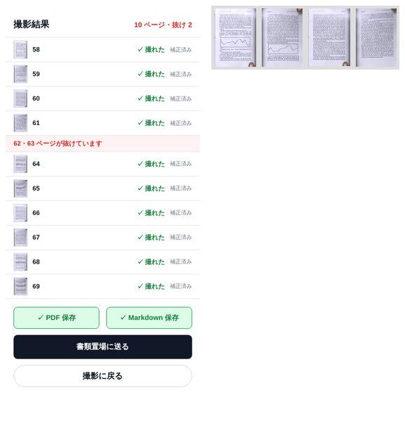

# 4 冊目・5 冊目（未調整）とその前後の測り直し（ブラウザ版・Android 版）

設計は [book4-design.md](book4-design.md)、経緯は [book-eval.md](book-eval.md)。
数字はすべてこの cloud の headless Chromium（CPU 4 コア、WASM ×4）、`book-e2e.mjs`（取り消した読みは読めず、保留のまま終わった読みも読めず）。
生の結果は `docs/book4-eval/*.jsonl`。各回 1 本ずつ。同じ条件でも 1 回ごとに 1〜2 ページは動く。

## 結論

- **4 冊目**（別 session が bc8a4d3 の後に作った未調整の本、`book4.py`: Inter / Bitstream Charter / WenQuanYi、「Page 58」「– 233 –」「124頁」、大理石・錆色フェルトの机、紫・マゼンタの光、1440×1920 / 1080×1440 / 1920×1440）を
  57ca745 で流す（`run10`）と、スマホ解像度でも番号は **14 / 0 / 18**、720×960 では 10 / 0 / 22 で、飛ばした 62・63 の赤はどちらでも出なかった。
  原因は 4 つとも本ごとの閾値ではなく判定の規則の穴（「Page58」を番号と見ない、PP-OCR が返す 页 を 頁 と見ない、細い印字がインクの閾値に掛からない、読めた側が違う見開きどうしが隣にならない）。
  `packages/core` の共通の判定として直した後（`run12`）、スマホ解像度で **28 / 0 / 4、62・63 の赤が出る**。720×960 は 16 / 0 / 16（赤は出たり出なかったり: 6〜8 px の読みは 1 回ごとに揺れる）。
- 1〜3 冊目の測り直し（`run12`、242 ページ）: ✓ 225、赤 7、無表示 10、**偽の赤 0、読み違い 0**、番号 129 / 0 / 96（直す前の `run8`: ✓ 227、赤 7、無表示 8、117 / 0 / 110）。
  最初の直し（`run11`）では 720×960 の見開きの番号が多く読めるようになった代わりに、2 冊目 center で 6 px の読み違い（94・95 → 98・99）が隣の 6 px の正しい読みに「確かめられ」て偽の赤 2 が出た。
  `surePx` 未満の読みは、`surePx` 以上の読みを持つ撮影か 2 つの撮影が接するときだけ確かめられる規則にして偽の赤 0 に戻した（その分 720×960 の見開きの番号は保留が多い）。
- **5 冊目**（この PR の最後のコードの後に作った未調整の本、`book5.py`）: 下の「5 冊目」。
- Android 版の 4 冊目: 下の「Android 版」。
- 無表示の抜けで残っているのは、720×960 で飛ばした見開き（番号が読めず赤にできない: 2 冊目 50・51、3 冊目 166・167、4 冊目 62・63）、片ページのめくりの終わりで撮った 1 枚（1 冊目 p17 / 3 冊目 143）、厚い本の左縁（1 冊目 66）、上の余白から入る親指（2 冊目 215）— どれも [book4-design.md](book4-design.md) の「直さなかったもの」。

## 4 冊目

| クリップ             | 元の解像度             | 本文の書体        | 番号の形・位置              | 紙             | 机             | 光               | 手                                               | 対象                                    |
| -------------------- | ---------------------- | ----------------- | --------------------------- | -------------- | -------------- | ---------------- | ------------------------------------------------ | --------------------------------------- |
| `book4-spread-inner` | 1440×1920 見開き（縦） | Inter             | 「Page 58」・上の綴じ目寄り | 淡い灰緑       | 白大理石       | 紫がかった寒色   | 右手の親指が上の外角、左手の親指が下の綴じ目寄り | 58〜69（6 見開き、**62・63 を飛ばす**） |
| `book4-single-dash`  | 1080×1440 片ページ     | Bitstream Charter | 「– 233 –」・下の綴じ目寄り | 新聞紙の黄     | 錆色のフェルト | 暗い暖色、強い影 | 右手の親指が下の外角                             | 233〜251 の右ページ 10                  |
| `book4-spread-ja-43` | 1920×1440 見開き（横） | WenQuanYi Zen Hei | 「124頁」・下の外側         | 真っ白（寒色） | 白大理石       | マゼンタ、強い光 | 右手の親指が下中央、左手の親指が左の小口         | 124〜135（6 見開き）                    |

各本は元の解像度（`--own-size`: 偽のカメラがクリップをアプリの 1920×1080 の要求に合わせて潰さないよう、クリップの大きさで）と 720×960 の切り出し（`book4-framed/`）。

### run10: 直す前（57ca745 = `june-pipeline` + bc8a4d3 + 2e0f632 + 57ca745）

| run                                 | 対象 | ✓   | 赤  | 無表示    | 偽の赤 | 番号 正/誤/読めず | 誤り | 保留のまま / 後で出た | 枠 中央値/最大 | 綴じ目 中央値/最大 | fps  | ✓まで 中央値/最大 | 番号まで 中央値/最大 | めくり中 | 曲がり補正 |
| ----------------------------------- | ---- | --- | --- | --------- | ------ | ----------------- | ---- | --------------------- | -------------- | ------------------ | ---- | ----------------- | -------------------- | -------- | ---------- |
| 4冊目 720×960 inner 62・63 飛ばし   | 12   | 10  | 0   | 2 (62,63) | 0      | 0/0/10            |      | 6・7                  | 5.2/12.0       | 5.6/13.1           | 15.5 | 0.95/1.03         | 0.86/1.27            | 0        | 10/10      |
| 4冊目 720×960 single-dash           | 10   | 10  | 0   | 0         | 0      | 10/0/0            |      |                       | 9.1/15.3       | —/—                | 16.0 | 0.35/0.92         | 0.76/0.95            | 0        | 10/10      |
| 4冊目 720×960 ja-43                 | 12   | 12  | 0   | 0         | 0      | 0/0/12            |      | 128・129              | 8.6/11.4       | 11.4/16.7          | 14.4 | 0.68/0.90         | 0.90/1.21            | 0        | 12/12      |
| 4冊目 1440×1920 inner 62・63 飛ばし | 12   | 10  | 0   | 2 (62,63) | 0      | 4/0/6             |      | 64・65→出た           | 11.3/19.0      | 8.7/29.3           | 11.8 | 1.04/1.07         | 1.06/4.37            | 0        | 10/10      |
| 4冊目 1080×1440 single-dash         | 10   | 10  | 0   | 0         | 0      | 10/0/0            |      |                       | 12.9/18.7      | —/—                | 14.0 | 0.34/0.95         | 0.77/1.01            | 0        | 10/10      |
| 4冊目 1920×1440 ja-43               | 12   | 12  | 0   | 0         | 0      | 0/0/12            |      | 49・50                | 18.9/27.2      | 23.7/41.6          | 12.4 | 0.72/0.94         | 1.03/1.35            | 0        | 11/12      |
| **合計**                            | 68   | 64  | 0   | 4         | 0      | 24/0/40           |      |                       |                |                    |      |                   |                      |          |            |

### run12: 直した後（この PR の最後のコード 78e0d43）

| run                                 | 対象 | ✓   | 赤         | 無表示    | 偽の赤 | 番号 正/誤/読めず | 誤り | 保留のまま / 後で出た                                     | 枠 中央値/最大 | 綴じ目 中央値/最大 | fps  | ✓まで 中央値/最大 | 番号まで 中央値/最大 | めくり中 | 曲がり補正 |
| ----------------------------------- | ---- | --- | ---------- | --------- | ------ | ----------------- | ---- | --------------------------------------------------------- | -------------- | ------------------ | ---- | ----------------- | -------------------- | -------- | ---------- |
| 4冊目 720×960 inner 62・63 飛ばし   | 12   | 10  | 0          | 2 (62,63) | 0      | 4/0/6             |      | 58・59→出た / 64・65 / 60・61                             | 7.3/13.4       | 8.8/14.4           | 13.9 | 0.96/1.04         | 0.93/4.49            | 0        | 9/10       |
| 4冊目 720×960 single-dash           | 10   | 10  | 0          | 0         | 0      | 10/0/0            |      |                                                           | 9.5/17.1       | —/—                | 16.1 | 0.36/0.99         | 0.74/1.08            | 0        | 10/10      |
| 4冊目 720×960 ja-43                 | 12   | 12  | 0          | 0         | 0      | 2/0/10            |      | 124・125 / 126・127 / 130・131 / 132・133→出た / 134・135 | 8.5/9.4        | 12.1/14.5          | 15.0 | 0.66/0.98         | 0.99/3.88            | 0        | 12/12      |
| 4冊目 1440×1920 inner 62・63 飛ばし | 12   | 10  | 2 (62〜63) | 0         | 0      | 6/0/4             |      | 68・69                                                    | 13.8/18.8      | 9.3/28.4           | 12.2 | 1.01/1.05         | 0.92/1.10            | 0        | 10/10      |
| 4冊目 1080×1440 single-dash         | 10   | 10  | 0          | 0         | 0      | 10/0/0            |      |                                                           | 13.1/20.3      | —/—                | 13.3 | 0.36/0.96         | 0.82/1.37            | 0        | 10/10      |
| 4冊目 1920×1440 ja-43               | 12   | 12  | 0          | 0         | 0      | 12/0/0            |      |                                                           | 18.0/23.2      | 23.9/39.5          | 12.7 | 0.71/0.98         | 0.99/1.48            | 0        | 12/12      |
| **合計**                            | 68   | 64  | 2          | 2         | 0      | 44/0/20           |      |                                                           |                |                    |      |                   |                      |          |            |

### 1〜3 冊目（`run12`、同じビルド）

| run                                       | 対象 | ✓   | 赤           | 無表示      | 偽の赤 | 番号 正/誤/読めず | 誤り | 保留のまま / 後で出た                                                     | 枠 中央値/最大 | 綴じ目 中央値/最大 | fps  | ✓まで 中央値/最大 | 番号まで 中央値/最大 | めくり中 | 曲がり補正 |
| ----------------------------------------- | ---- | --- | ------------ | ----------- | ------ | ----------------- | ---- | ------------------------------------------------------------------------- | -------------- | ------------------ | ---- | ----------------- | -------------------- | -------- | ---------- |
| 1冊目 framed single-land-white            | 10   | 10  | 0            | 0           | 0      | 9/0/1             |      |                                                                           | 23.4/29.4      | —/—                | 14.3 | 0.37/1.05         | 0.86/1.07            | 0        | 10/10      |
| 1冊目 framed single-land-white p37 飛ばし | 10   | 9   | 1 (37)       | 0           | 0      | 9/0/0             |      |                                                                           | 18.2/28.0      | —/—                | 15.3 | 0.32/1.18         | 0.69/1.09            | 0        | 9/9        |
| 1冊目 framed single-port-wood             | 12   | 11  | 0            | 1 (17)      | 0      | 10/0/1            |      |                                                                           | 11.6/20.1      | —/—                | 12.4 | 0.31/1.38         | 0.63/1.27            | 1        | 12/12      |
| 1冊目 framed spread-land-white-thick      | 12   | 11  | 0            | 1 (66)      | 0      | 0/0/11            |      | 62・63 / 64・65 / 68・69                                                  | 11.5/20.3      | 9.8/16.5           | 13.2 | 0.70/1.13         | 1.08/1.18            | 0        | 12/12      |
| 1冊目 framed spread-land-wood             | 14   | 14  | 0            | 0           | 0      | 0/0/14            |      | 6・7 / 12・13                                                             | 5.5/7.6        | 6.7/12.9           | 14.5 | 0.66/0.99         | 0.94/1.34            | 0        | 14/14      |
| 1冊目 framed spread-port-white            | 12   | 12  | 0            | 0           | 0      | 0/0/12            |      | 2・3 / 8・9 / 8・9                                                        | 4.3/9.5        | 4.9/7.8            | 13.0 | 0.70/0.93         | 0.96/0.99            | 0        | 12/12      |
| 2冊目 720×960 center                      | 12   | 12  | 0            | 0           | 0      | 0/0/12            |      | 90・91 / 92・93 / 98・99                                                  | 8.9/11.4       | 12.7/18.5          | 13.4 | 0.77/1.19         | 1.23/1.26            | 0        | 12/12      |
| 2冊目 720×960 dash 50・51 飛ばし          | 14   | 12  | 0            | 2 (50,51)   | 0      | 0/0/12            |      | 44・45 / 46・47 / 54・55                                                  | 5.4/7.9        | 5.2/9.0            | 14.1 | 0.83/0.90         | 0.90/1.08            | 0        | 12/12      |
| 2冊目 720×960 single-top                  | 10   | 10  | 0            | 0           | 0      | 8/0/2             |      |                                                                           | 11.9/14.0      | —/—                | 14.8 | 0.47/1.15         | 0.77/1.20            | 0        | 10/10      |
| 2冊目 1440×1080 center                    | 12   | 12  | 0            | 0           | 0      | 12/0/0            |      |                                                                           | 14.9/18.9      | 20.6/26.5          | 11.7 | 0.92/1.41         | 1.11/1.22            | 0        | 12/12      |
| 2冊目 1920×1080 dash 50・51 飛ばし        | 14   | 12  | 2 (50〜51)   | 0           | 0      | 12/0/0            |      | 54・55                                                                    | 9.0/14.6       | 7.8/18.4           | 10.6 | 0.76/2.64         | 0.79/1.07            | 0        | 14/14      |
| 2冊目 1080×1920 single-top                | 10   | 9   | 0            | 1 (215)     | 0      | 9/0/0             |      | 211 / 201                                                                 | 30.2/88.9      | —/—                | 10.9 | 0.48/1.72         | 0.86/1.09            | 0        | 10/12      |
| 3冊目 720×960 topnum 166・167 飛ばし      | 14   | 12  | 0            | 2 (166,167) | 0      | 4/0/8             |      | 160・161 / 162・163→出た / 164・165 / 168・169 / 170・171→出た / 172・173 | 6.3/8.6        | 7.7/11.7           | 14.6 | 0.66/1.03         | 1.45/4.16            | 0        | 8/12       |
| 3冊目 720×960 topnum 飛ばして戻る         | 14   | 12  | 0            | 2 (166,167) | 0      | 4/0/8             |      | 160・161 / 162・163→出た / 164・165 / 168・169 / 170・171→出た / 172・173 | 5.4/11.2       | 5.3/13.6           | 15.5 | 0.68/0.98         | 1.30/3.98            | 0        | 8/12       |
| 3冊目 720×960 single-p                    | 10   | 9   | 0            | 1 (143)     | 0      | 9/0/0             |      |                                                                           | 13.1/15.2      | —/—                | 16.3 | 0.32/0.88         | 0.67/1.26            | 1        | 10/10      |
| 3冊目 720×960 paren-port                  | 12   | 12  | 0            | 0           | 0      | 0/0/12            |      | 214・215 / 320・321 / 821・822 / 326・327                                 | 3.9/6.0        | 4.2/9.4            | 14.8 | 0.66/0.98         | 0.91/1.35            | 0        | 12/12      |
| 3冊目 1920×1080 topnum 166・167 飛ばし    | 14   | 12  | 2 (166〜167) | 0           | 0      | 12/0/0            |      |                                                                           | 14.4/20.2      | 15.6/26.0          | 11.6 | 0.69/0.93         | 1.05/1.31            | 0        | 8/12       |
| 3冊目 1920×1080 topnum 飛ばして戻る       | 14   | 12  | 2 (166〜167) | 0           | 0      | 12/0/0            |      |                                                                           | 14.4/24.0      | 15.7/24.9          | 11.4 | 0.72/1.01         | 1.09/1.46            | 0        | 7/12       |
| 3冊目 1080×1920 single-p                  | 10   | 10  | 0            | 0           | 0      | 10/0/0            |      |                                                                           | 25.2/31.4      | —/—                | 11.9 | 0.33/0.92         | 0.86/1.32            | 0        | 10/10      |
| 3冊目 1080×1920 paren-port                | 12   | 12  | 0            | 0           | 0      | 9/0/3             |      | 214・215 / 318・319                                                       | 7.2/10.7       | 5.6/14.8           | 11.4 | 0.63/1.28         | 1.12/1.25            | 1        | 14/14      |
| **合計**                                  | 242  | 225 | 7            | 10          | 0      | 129/0/96          |      |                                                                           |                |                    |      |                   |                      |          |            |

- 1 冊目 framed spread-land-wood は最初の回が別の処理と重なって 8.4 fps だったので測り直した（表は測り直し。`jsonl` には両方ある）。
- 720×960 の見開きの番号（6〜7 px）は「保留のまま」が多い（`surePx` 8 未満で、接する撮影が 1 つしかないか、その撮影も小さい読み）。読めたものに誤りは無い。
- 3 冊目 720×960 topnum は `run11` では 166・167 が赤（12 / 0 / 0）、`run12` では無表示（4 / 0 / 8）。同じ入力でも 6 px の読みは回ごとに揺れ、確かめの連鎖がつながるかどうかで変わる。

### run11: 最初の直し（8ce9888）の後、小さい読みの規則の前

| run                                       | 対象 | ✓   | 赤           | 無表示      | 偽の赤 | 番号 正/誤/読めず | 誤り         | 保留のまま / 後で出た               | 枠 中央値/最大 | 綴じ目 中央値/最大 | fps  | ✓まで 中央値/最大 | 番号まで 中央値/最大 | めくり中 | 曲がり補正 |
| ----------------------------------------- | ---- | --- | ------------ | ----------- | ------ | ----------------- | ------------ | ----------------------------------- | -------------- | ------------------ | ---- | ----------------- | -------------------- | -------- | ---------- |
| 4冊目 720×960 inner 62・63 飛ばし         | 12   | 10  | 2 (62〜63)   | 0           | 0      | 8/0/2             |              | 58・59→出た / 64・65→出た / 59・60  | 8.3/12.7       | 7.7/13.8           | 14.2 | 1.00/1.04         | 0.95/4.83            | 0        | 10/10      |
| 4冊目 720×960 single-dash                 | 10   | 10  | 0            | 0           | 0      | 10/0/0            |              |                                     | 9.3/15.1       | —/—                | 15.9 | 0.36/1.03         | 0.77/1.14            | 0        | 10/10      |
| 4冊目 720×960 ja-43                       | 12   | 12  | 0            | 0           | 0      | 4/0/8             |              | 124・125→出た / 130・131 / 134・135 | 8.9/9.4        | 12.2/14.5          | 14.8 | 0.68/0.95         | 0.92/3.83            | 0        | 12/12      |
| 4冊目 1440×1920 inner 62・63 飛ばし       | 12   | 10  | 2 (62〜63)   | 0           | 0      | 10/0/0            |              | 64・65→出た                         | 9.9/19.1       | 10.9/29.3          | 12.1 | 0.99/1.15         | 0.96/4.31            | 0        | 10/10      |
| 4冊目 1080×1440 single-dash               | 10   | 10  | 0            | 0           | 0      | 10/0/0            |              |                                     | 13.4/18.0      | —/—                | 12.8 | 0.41/0.98         | 0.79/1.23            | 0        | 10/10      |
| 4冊目 1920×1440 ja-43                     | 12   | 12  | 0            | 0           | 0      | 12/0/0            |              |                                     | 19.7/25.9      | 27.6/40.9          | 12.1 | 0.71/1.00         | 0.90/1.36            | 0        | 11/12      |
| 1冊目 framed single-land-white            | 10   | 10  | 0            | 0           | 0      | 8/0/2             |              |                                     | 21.4/26.8      | —/—                | 16.2 | 0.39/1.23         | 0.79/1.08            | 0        | 10/10      |
| 1冊目 framed single-land-white p37 飛ばし | 10   | 9   | 1 (37)       | 0           | 0      | 8/0/1             |              |                                     | 23.1/27.5      | —/—                | 15.7 | 0.35/1.01         | 0.80/1.02            | 0        | 9/9        |
| 1冊目 framed single-port-wood             | 12   | 11  | 0            | 1 (17)      | 0      | 10/0/1            |              |                                     | 11.5/21.4      | —/—                | 16.5 | 0.22/1.07         | 0.46/1.21            | 1        | 12/12      |
| 1冊目 framed spread-land-white-thick      | 12   | 11  | 0            | 1 (66)      | 0      | 0/0/11            |              | 64・65 / 39・40                     | 10.1/20.4      | 11.0/16.1          | 14.8 | 0.73/1.13         | 1.03/1.35            | 0        | 12/12      |
| 1冊目 framed spread-land-wood             | 14   | 14  | 0            | 0           | 0      | 12/0/2            |              | 2・3→出た / 8・9→出た               | 5.2/9.2        | 5.1/13.5           | 14.0 | 0.68/0.99         | 1.07/3.66            | 0        | 14/14      |
| 1冊目 framed spread-port-white            | 12   | 12  | 0            | 0           | 0      | 0/0/12            |              | 4・5 / 12・13                       | 4.6/11.4       | 4.8/11.0           | 14.4 | 0.66/0.90         | 0.90/0.97            | 0        | 12/12      |
| 2冊目 720×960 center                      | 12   | 12  | 0            | 0           | 2      | 6/2/4             | 94→98, 95→99 | 90・91→出た / 98・99→出た           | 8.9/13.5       | 12.7/25.5          | 14.9 | 0.74/0.90         | 1.32/4.60            | 0        | 12/12      |
| 2冊目 720×960 dash 50・51 飛ばし          | 14   | 12  | 0            | 2 (50,51)   | 0      | 4/0/8             |              | 44・45→出た / 58・59                | 5.3/9.1        | 4.6/11.2           | 14.7 | 0.77/0.91         | 0.90/3.53            | 0        | 12/12      |
| 2冊目 720×960 single-top                  | 10   | 9   | 0            | 1 (203)     | 0      | 8/0/1             |              |                                     | 11.3/31.4      | —/—                | 16.3 | 0.44/1.01         | 0.71/1.08            | 0        | 10/10      |
| 2冊目 1440×1080 center                    | 12   | 12  | 0            | 0           | 0      | 12/0/0            |              |                                     | 14.7/20.7      | 22.8/31.7          | 11.5 | 1.03/1.43         | 1.02/1.13            | 0        | 12/12      |
| 2冊目 1920×1080 dash 50・51 飛ばし        | 14   | 12  | 2 (50〜51)   | 0           | 0      | 12/0/0            |              |                                     | 10.2/18.5      | 11.3/22.1          | 10.3 | 0.82/2.82         | 0.90/1.46            | 0        | 14/14      |
| 2冊目 1080×1920 single-top                | 10   | 8   | 0            | 2 (203,215) | 0      | 8/0/0             |              |                                     | 33.3/53.1      | —/—                | 11.6 | 0.51/1.12         | 0.85/1.03            | 0        | 8/10       |
| 3冊目 720×960 topnum 166・167 飛ばし      | 14   | 12  | 2 (166〜167) | 0           | 0      | 12/0/0            |              | 160・161→出た / 168・169→出た       | 5.8/7.8        | 7.6/10.7           | 15.1 | 0.68/0.99         | 1.00/4.40            | 0        | 8/12       |
| 3冊目 720×960 topnum 飛ばして戻る         | 14   | 12  | 2 (166〜167) | 0           | 0      | 12/0/0            |              | 160・161→出た / 168・169→出た       | 5.7/7.6        | 7.0/10.7           | 15.2 | 0.67/1.00         | 0.86/6.01            | 0        | 8/12       |
| 3冊目 720×960 single-p                    | 10   | 10  | 0            | 0           | 0      | 10/0/0            |              |                                     | 13.7/17.8      | —/—                | 15.3 | 0.30/1.61         | 0.71/1.15            | 0        | 11/11      |
| 3冊目 720×960 paren-port                  | 12   | 12  | 0            | 0           | 0      | 6/0/6             |              | 314・315 / 318・319→出た            | 4.7/6.2        | 3.7/6.0            | 14.5 | 0.68/1.06         | 1.19/3.60            | 0        | 12/12      |
| 3冊目 1920×1080 topnum 166・167 飛ばし    | 14   | 12  | 2 (166〜167) | 0           | 0      | 12/0/0            |              |                                     | 12.1/22.3      | 16.4/22.9          | 11.1 | 0.70/1.40         | 1.14/1.60            | 0        | 7/12       |
| 3冊目 1920×1080 topnum 飛ばして戻る       | 14   | 12  | 2 (166〜167) | 0           | 0      | 12/0/0            |              |                                     | 12.4/23.6      | 14.2/24.9          | 11.2 | 0.69/1.04         | 1.27/1.40            | 0        | 7/12       |
| 3冊目 1080×1920 single-p                  | 10   | 9   | 0            | 1 (137)     | 0      | 9/0/0             |              |                                     | 25.6/48.4      | —/—                | 11.0 | 0.29/0.92         | 0.86/1.61            | 0        | 10/10      |
| 3冊目 1080×1920 paren-port                | 12   | 12  | 0            | 0           | 0      | 8/0/4             |              | 324・325 / 16・17                   | 7.5/13.5       | 4.2/10.6           | 10.2 | 0.65/1.41         | 1.33/1.50            | 0        | 12/12      |
| **合計**                                  | 310  | 287 | 15           | 8           | 2      | 223/2/62          |              |                                     |                |                    |      |                   |                      |          |            |

### 一覧・PDF・Markdown（4 冊目 1440×1920 inner、62・63 飛ばし、この PR のビルド）

`book-e2e.mjs --save pdf,md` で一覧の「PDF 保存」「Markdown 保存」を押して保存したファイルを開いた。

- 一覧: 10 行（見開き 5 つが 1 ページずつ）と「62・63 ページが抜けています」の赤い行。
- PDF: 10 ページ（`pdfinfo`、104〜109 × 146〜154 pt の縦長 1 ページずつ）。
- Markdown: 148 秒（10 ページ、NDLOCR）。見出しは `## p. 58` … `## p. 69` の 10 本で一覧と同じ順（`docs/book4-eval/saved-markdown-book4-inner-skip.md`）。英語の本文は NDLOCR の日本語モデルのため語がつながって崩れる（PR #12 と同じ）。

## 5 冊目（コードを変えずに 1 回）

5 冊目（`book5.py`）は、この PR の最後のアプリのコード（78e0d43）の後に作り、コードを変えずに 1 回流した（`run13`）。結果を見た後もコードは直していない。

| クリップ                | 元の解像度             | 本文の書体     | 番号の形・位置                     | 紙             | 机                   | 光                   | 手                                         | 対象                                    |
| ----------------------- | ---------------------- | -------------- | ---------------------------------- | -------------- | -------------------- | -------------------- | ------------------------------------------ | --------------------------------------- |
| `book5-spread-bracket`  | 1600×1200 見開き（横） | FreeSans       | 「[ 77 ]」・下中央                 | 暖色のクリーム | 焦げ茶の革（折り皺） | 暖色、中くらいの光   | 左手の親指が下の綴じ目寄り、右手が小口中央 | 76〜89（7 見開き、**84・85 を飛ばす**） |
| `book5-single-mono`     | 1200×1600 片ページ     | JetBrains Mono | 「117.」・上の外側                 | 寒色の白       | 灰色のコンクリート   | 暗い青白、強い影     | 右手の親指が下中央                         | 117〜135 の右ページ 10                  |
| `book5-spread-ja-kanji` | 1280×960 見開き（横）  | IPA P ゴシック | 漢数字「一一八」（位取り）・下中央 | 黄灰の古紙     | 畳                   | 明るい中立色、強い光 | 既定（両手の親指が下の余白）               | 118〜129（6 見開き）                    |

| run                                   | 対象 | ✓   | 赤         | 無表示    | 偽の赤 | 番号 正/誤/読めず | 誤り                                           | 保留のまま / 後で出た | 枠 中央値/最大 | 綴じ目 中央値/最大 | fps  | ✓まで 中央値/最大 | 番号まで 中央値/最大 | めくり中 | 曲がり補正 |
| ------------------------------------- | ---- | --- | ---------- | --------- | ------ | ----------------- | ---------------------------------------------- | --------------------- | -------------- | ------------------ | ---- | ----------------- | -------------------- | -------- | ---------- |
| 5冊目 720×960 bracket 84・85 飛ばし   | 14   | 12  | 0          | 2 (84,85) | 0      | 6/0/6             |                                                | 86・87                | 6.1/7.4        | 8.5/11.0           | 15.0 | 0.92/1.22         | 0.85/1.28            | 0        | 12/12      |
| 5冊目 720×960 single-mono             | 10   | 10  | 0          | 0         | 0      | 10/0/0            |                                                |                       | 10.6/13.1      | —/—                | 15.8 | 0.26/0.96         | 0.71/1.07            | 0        | 10/10      |
| 5冊目 720×960 ja-kanji                | 12   | 12  | 0          | 0         | 0      | 0/0/12            |                                                |                       | 4.2/8.7        | 5.6/15.2           | 14.6 | 0.67/0.86         | 0.94/1.02            | 0        | 12/12      |
| 5冊目 1600×1200 bracket 84・85 飛ばし | 14   | 12  | 2 (84〜85) | 0         | 0      | 12/0/0            |                                                |                       | 13.1/21.1      | 18.4/30.4          | 12.0 | 1.08/1.57         | 1.23/1.64            | 0        | 12/12      |
| 5冊目 1200×1600 single-mono           | 10   | 9   | 0          | 1 (127)   | 0      | 9/0/0             |                                                |                       | 16.8/20.0      | —/—                | 13.6 | 0.30/0.95         | 0.74/1.07            | 1        | 10/10      |
| 5冊目 1280×960 ja-kanji               | 12   | 12  | 0          | 0         | 0      | 0/6/6             | 124→24, 125→25, 126→26, 127→27, 128→28, 129→29 |                       | 7.6/11.4       | 8.9/18.2           | 14.2 | 0.69/0.92         | 0.87/1.07            | 0        | 12/12      |
| **合計**                              | 72   | 67  | 2          | 3         | 0      | 37/6/24           |                                                |                       |                |                    |      |                   |                      |          |            |

- 無表示の 84・85（720×960 で飛ばした見開き）と 127（片ページのめくりの終わり、進み 90 % 以上で撮って画面は「✓ 127」）は、1〜4 冊目と同じ既知の形。偽の赤 0。
- **漢数字の番号（1280×960、11 px）は 6 ページとも 100 小さく読んだ（一二四 → 二四）**。読み取り（PP-OCRv4 の中国語モデル）が位取りの漢数字の先頭の 一 を落とす（"二四"@0.89、"二五"@0.97、ほかに "-八"、"-一九" と 一 を "-" に）。
  6 見開きが 24・25、26・27 … と互いに接して確かめ合い、他に読めた番号が無いので順序の規則にも掛からず、「✓ 24・25」と出る。判定の規則では直せない（読み取り器の問題。NDLOCR の PARSeq は以前の測定で単独の数字をほぼ読めなかった）。漢数字のノンブルの本は実機で確かめること。
- 720×960 の漢数字は 6〜7 px で読めない（"A"、"二程"）。読めたものに誤りは無い。

## Android 版（4 冊目、エミュレーター）

@@ANDROID@@

## 測り方

`scripts/eval/book-clips/book-e2e.mjs` を各クリップに流し（`run-evals`: 1 本ずつ順に、並列にしない）、`probe.json` の番号の行（`numberLines`: 行の文字・確信度・高さ）、
`numberUnsure` / `numberOutOfOrder` / `numberConflict`、hold ごとの時系列で原因を見る。切り出したページ画像（`pages/*.jpg`）の帯を拡大して印字の濃さを測った。

## 以前の測り直し（run7 / run8、PR #12 の後・この PR の最初の直しの前）

- `run7`: cherry-pick 直後（12e31d5 = `june-pipeline` + bc8a4d3）。
- `run8`: 2e0f632（撮る枠の角を確信度で選ぶ、番号の位置を先に読む、片側の低確信度の読み）の後。読み違い（誤）は両回とも 0。

### run8（クリップ別）

| run                                       | 対象 | ✓   | 赤      | 無表示      | 偽の赤 | 番号 正/誤/読めず | 誤り | 保留のまま / 後で出た                            | 枠 中央値/最大 | 綴じ目 中央値/最大 | fps  | ✓まで 中央値/最大 | 番号まで 中央値/最大 | めくり中 | 曲がり補正 |
| ----------------------------------------- | ---- | --- | ------- | ----------- | ------ | ----------------- | ---- | ------------------------------------------------ | -------------- | ------------------ | ---- | ----------------- | -------------------- | -------- | ---------- |
| 1冊目 framed single-land-white            | 10   | 10  | 0       | 0           | 0      | 10/0/0            |      |                                                  | 14.2/27.7      | —/—                | 15.1 | 0.35/1.16         | 0.71/1.15            | 0        | 10/10      |
| 1冊目 framed single-land-white p37 飛ばし | 10   | 9   | 1 (37)  | 0           | 0      | 9/0/0             |      |                                                  | 24.9/28.4      | —/—                | 15.3 | 0.30/1.04         | 0.66/1.19            | 0        | 9/9        |
| 1冊目 framed single-port-wood             | 12   | 12  | 0       | 0           | 0      | 12/0/0            |      |                                                  | 11.9/17.6      | —/—                | 13.2 | 0.24/1.02         | 0.74/1.06            | 0        | 12/12      |
| 1冊目 framed spread-land-white-thick      | 12   | 12  | 0       | 0           | 0      | 0/0/12            |      | 64・65                                           | 9.6/13.6       | 10.7/16.8          | 15.8 | 0.69/1.14         | 0.90/1.10            | 0        | 12/12      |
| 1冊目 framed spread-land-wood             | 14   | 14  | 0       | 0           | 0      | 0/0/14            |      |                                                  | 5.2/8.9        | 5.1/13.0           | 15.6 | 0.62/0.93         | 0.78/1.27            | 0        | 14/14      |
| 1冊目 framed spread-port-white            | 12   | 12  | 0       | 0           | 0      | 0/0/12            |      |                                                  | 4.6/8.9        | 4.8/11.0           | 14.1 | 0.67/1.05         | 0.84/0.96            | 0        | 12/12      |
| 2冊目 720×960 center                      | 12   | 12  | 0       | 0           | 0      | 0/0/12            |      |                                                  | 7.5/9.4        | 11.9/16.3          | 15.0 | 0.75/1.24         | 0.88/1.24            | 0        | 12/12      |
| 2冊目 720×960 dash 50・51 飛ばし          | 14   | 12  | 0       | 2 (50,51)   | 0      | 0/0/12            |      |                                                  | 5.6/6.9        | 7.2/9.1            | 16.5 | 0.78/1.00         | 0.80/1.24            | 0        | 12/12      |
| 2冊目 720×960 single-top                  | 10   | 10  | 0       | 0           | 0      | 7/0/3             |      |                                                  | 12.4/18.5      | —/—                | 16.1 | 0.42/0.89         | 0.72/1.21            | 0        | 10/10      |
| 2冊目 1440×1080 center                    | 12   | 12  | 0       | 0           | 0      | 12/0/0            |      |                                                  | 15.5/22.7      | 23.0/31.2          | 12.6 | 0.98/1.47         | 1.06/1.52            | 0        | 12/12      |
| 2冊目 1920×1080 dash 50・51 飛ばし        | 14   | 12  | 2 (50)  | 0           | 0      | 12/0/0            |      | 44・45                                           | 9.4/13.9       | 7.3/19.0           | 11.4 | 0.73/2.60         | 0.91/3.36            | 0        | 14/14      |
| 2冊目 1080×1920 single-top                | 10   | 8   | 0       | 2 (203,215) | 0      | 7/0/1             |      |                                                  | 30.7/49.6      | —/—                | 11.8 | 0.51/0.96         | 0.89/1.32            | 0        | 8/10       |
| 3冊目 720×960 topnum 166・167 飛ばし      | 14   | 12  | 0       | 2 (166,167) | 0      | 0/0/12            |      |                                                  | 5.7/7.8        | 7.4/10.7           | 15.8 | 0.65/0.93         | 0.80/1.10            | 0        | 8/12       |
| 3冊目 720×960 topnum 飛ばして戻る         | 14   | 12  | 0       | 2 (166,167) | 0      | 0/0/12            |      |                                                  | 6.2/9.9        | 6.6/13.5           | 16.1 | 0.71/0.93         | 0.88/1.01            | 0        | 7/12       |
| 3冊目 720×960 single-p                    | 10   | 10  | 0       | 0           | 0      | 10/0/0            |      |                                                  | 13.4/15.2      | —/—                | 15.7 | 0.33/1.00         | 0.70/1.22            | 0        | 10/10      |
| 3冊目 720×960 paren-port                  | 12   | 12  | 0       | 0           | 0      | 0/0/12            |      |                                                  | 4.6/6.0        | 4.6/6.5            | 15.4 | 0.67/0.85         | 0.90/1.14            | 0        | 12/12      |
| 3冊目 1920×1080 topnum 166・167 飛ばし    | 14   | 12  | 2 (166) | 0           | 0      | 12/0/0            |      |                                                  | 13.1/18.2      | 17.0/26.4          | 12.1 | 0.71/0.99         | 1.05/1.38            | 0        | 7/12       |
| 3冊目 1920×1080 topnum 飛ばして戻る       | 14   | 12  | 2 (166) | 0           | 0      | 12/0/0            |      |                                                  | 11.8/18.2      | 16.8/27.2          | 11.7 | 0.71/1.04         | 1.02/1.39            | 0        | 7/12       |
| 3冊目 1080×1920 single-p                  | 10   | 10  | 0       | 0           | 0      | 10/0/0            |      |                                                  | 25.6/27.3      | —/—                | 12.8 | 0.34/1.04         | 0.81/1.17            | 0        | 10/10      |
| 3冊目 1080×1920 paren-port                | 12   | 12  | 0       | 0           | 0      | 4/0/8             |      | 4・5 / 335・336 / 321・322 / 324・325 / 318・319 | 6.2/9.4        | 4.0/10.0           | 11.7 | 0.59/1.58         | 1.19/4.30            | 0        | 12/12      |
| **合計**                                  | 242  | 227 | 7       | 8           | 0      | 117/0/110         |      |                                                  |                |                    |      |                   |                      |          |            |

### run7（クリップ別）

| run                                       | 対象 | ✓   | 赤      | 無表示      | 偽の赤 | 番号 正/誤/読めず | 誤り | 保留のまま / 後で出た | 枠 中央値/最大 | 綴じ目 中央値/最大 | fps  | ✓まで 中央値/最大 | 番号まで 中央値/最大 | めくり中 | 曲がり補正 |
| ----------------------------------------- | ---- | --- | ------- | ----------- | ------ | ----------------- | ---- | --------------------- | -------------- | ------------------ | ---- | ----------------- | -------------------- | -------- | ---------- |
| 1冊目 framed single-land-white            | 10   | 10  | 0       | 0           | 0      | 10/0/0            |      |                       | 19.8/32.4      | —/—                | 15.0 | 0.38/1.25         | 0.77/1.08            | 0        | 10/10      |
| 1冊目 framed single-land-white p37 飛ばし | 10   | 9   | 1 (37)  | 0           | 0      | 8/0/1             |      |                       | 10.5/27.9      | —/—                | 14.6 | 0.38/1.23         | 0.77/1.25            | 0        | 9/9        |
| 1冊目 framed single-port-wood             | 12   | 12  | 0       | 0           | 0      | 11/0/1            |      |                       | 11.1/21.4      | —/—                | 14.4 | 0.29/0.93         | 0.70/1.00            | 0        | 12/12      |
| 1冊目 framed spread-land-white-thick      | 12   | 11  | 0       | 1 (66)      | 0      | 0/0/11            |      |                       | 10.9/17.7      | 10.3/14.1          | 15.0 | 0.70/1.24         | 0.83/1.26            | 0        | 12/12      |
| 1冊目 framed spread-land-wood             | 14   | 14  | 0       | 0           | 0      | 0/0/14            |      |                       | 5.3/13.2       | 6.6/17.5           | 15.4 | 0.61/1.09         | 0.79/1.30            | 0        | 14/14      |
| 1冊目 framed spread-port-white            | 12   | 12  | 0       | 0           | 0      | 0/0/12            |      | 1・2 / 1・2           | 4.7/11.5       | 5.0/11.4           | 14.6 | 0.69/1.00         | 0.88/1.08            | 0        | 12/12      |
| 2冊目 720×960 center                      | 12   | 12  | 0       | 0           | 0      | 0/0/12            |      |                       | 8.0/12.5       | 12.5/22.2          | 14.5 | 0.76/0.89         | 0.84/1.23            | 0        | 12/12      |
| 2冊目 720×960 dash 50・51 飛ばし          | 14   | 12  | 0       | 2 (50,51)   | 0      | 0/0/12            |      |                       | 4.8/10.8       | 4.2/11.7           | 14.4 | 0.74/0.87         | 0.89/1.34            | 0        | 12/12      |
| 2冊目 720×960 single-top                  | 10   | 10  | 0       | 0           | 0      | 7/0/3             |      |                       | 11.7/13.6      | —/—                | 13.1 | 0.45/0.98         | 0.75/0.80            | 0        | 10/10      |
| 2冊目 1440×1080 center                    | 12   | 12  | 0       | 0           | 0      | 12/0/0            |      |                       | 15.1/22.3      | 23.0/30.7          | 10.1 | 1.14/2.18         | 1.03/1.41            | 0        | 12/12      |
| 2冊目 1920×1080 dash 50・51 飛ばし        | 14   | 12  | 0       | 2 (50,51)   | 0      | 10/0/2            |      | 52・53                | 9.4/15.3       | 10.7/19.7          | 10.3 | 0.73/1.05         | 1.00/4.52            | 0        | 12/12      |
| 2冊目 1080×1920 single-top                | 10   | 10  | 0       | 0           | 0      | 8/0/2             |      |                       | 29.9/92.0      | —/—                | 10.2 | 0.46/1.81         | 0.92/1.52            | 0        | 10/11      |
| 3冊目 720×960 topnum 166・167 飛ばし      | 14   | 12  | 0       | 2 (166,167) | 0      | 0/0/12            |      |                       | 6.4/8.6        | 7.6/11.7           | 14.6 | 0.69/1.50         | 0.82/0.83            | 0        | 8/12       |
| 3冊目 720×960 topnum 飛ばして戻る         | 14   | 12  | 0       | 2 (166,167) | 0      | 0/0/12            |      |                       | 6.3/12.2       | 6.2/10.8           | 14.7 | 0.75/0.92         | 0.82/1.26            | 0        | 7/12       |
| 3冊目 720×960 single-p                    | 10   | 8   | 0       | 2 (137,143) | 0      | 7/0/1             |      |                       | 13.5/53.8      | —/—                | 15.7 | 0.31/1.01         | 0.68/1.06            | 1        | 9/10       |
| 3冊目 720×960 paren-port                  | 12   | 12  | 0       | 0           | 0      | 0/0/12            |      | 824・825              | 4.9/7.2        | 4.4/9.2            | 13.5 | 0.65/1.02         | 1.02/1.18            | 0        | 12/12      |
| 3冊目 1920×1080 topnum 166・167 飛ばし    | 14   | 12  | 2 (166) | 0           | 0      | 12/0/0            |      |                       | 13.8/15.2      | 17.3/24.4          | 12.2 | 0.72/0.94         | 0.91/1.42            | 0        | 7/12       |
| 3冊目 1920×1080 topnum 飛ばして戻る       | 14   | 12  | 2 (166) | 0           | 0      | 12/0/0            |      |                       | 13.1/18.6      | 15.6/26.5          | 10.5 | 0.81/1.07         | 1.06/1.73            | 0        | 7/12       |
| 3冊目 1080×1920 single-p                  | 10   | 10  | 0       | 0           | 0      | 10/0/0            |      |                       | 23.8/27.0      | —/—                | 12.5 | 0.32/1.05         | 0.82/1.22            | 0        | 10/10      |
| 3冊目 1080×1920 paren-port                | 12   | 12  | 0       | 0           | 0      | 12/0/0            |      | 314・315              | 8.8/16.1       | 6.1/14.2           | 5.7  | 1.08/1.22         | 2.09/3.50            | 0        | 12/12      |
| **合計**                                  | 242  | 226 | 5       | 11          | 0      | 119/0/107         |      |                       |                |                    |      |                   |                      |          |            |
