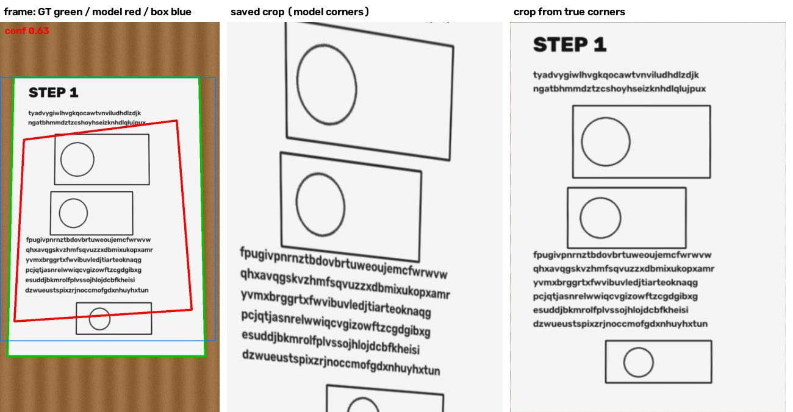
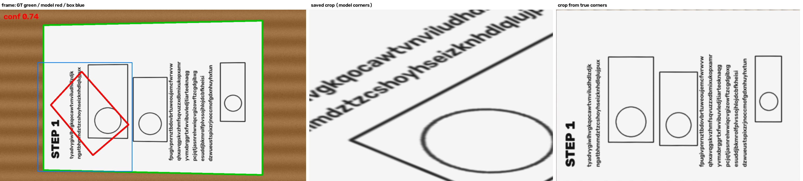
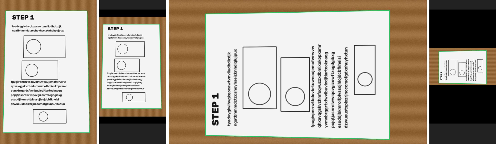

# 撮影画面の枠が紙の輪郭と合わない件の調査（2026-11-01）

## 結論

**原因は角検出モデル（`apps/web/public/models/doc-corners.onnx`、自前学習 12MB）の角の位置の精度。** 画面に描く座標の変換（検出フレーム → video 要素、object-fit: contain の letterbox）は正しく、ずれていない。

- モデルが出す 4 つの角（keypoint）は、紙の内側へ大きく縮んだ位置に出る。同じモデルの box（ch 0–3）は紙をほぼ囲んでいるので、入力の前処理や出力の読み方の誤りではなく、keypoint の回帰そのものが弱い。
- 横長の映像（お試し版でスクショを撮ったときの状態）ではさらに悪い。学習データ（`gen-synthetic.mjs` 等）が 720×1280 の縦長だけのため。
- 撮れた✓で保存される画像は、この 4 点で `rotateAndCropQuad` しているため、紙の一部（縦長で面積の 5 割前後、横長で 1〜2 割）しか写らない。

モデル精度が原因なので、依頼文どおり再学習もコード修正もしていない。直し方の案は下にある。

## 数字

### 正解付き動画（20260412_204840）の手で付けた角との比較

`scripts/dataset/annotations.json`（手で付けた角、4 フレーム）と、`test/fixtures/gt/20260412_204840/frames.jsonl` に残っている検出記録（YOLO、720×1280 のフレーム）の比較。動画そのものはリポに無い（`.gitignore` の `*.mp4`）ため、残っている記録で比べた。記録がどのモデルで作られたかは記録に書かれていないが、時期（モデル 2026-06-06 学習、記録は「yolo2 run」）から同梱モデルとみられる。

| フレーム | conf | 角の平均ずれ |
| -------- | ---- | ------------ |
| t=0.0s   | 0.74 | 304 px       |
| t=0.2s   | 0.76 | 315 px       |
| t=4.2s   | 0.76 | 176 px       |
| t=5.2s   | 0.72 | 181 px       |

フレームの対角は 1469 px なので、ずれは対角の 12〜21%。t=0.0s では正解の上端が y≈170 なのに検出の上端は y≈720 で、ページの下半分しか囲っていない。

### 合成クリップ（正解の角が厳密に分かる）

紙を机に置いた合成クリップ（`scripts/eval/corner-check/synth.py`、A4 が画面幅いっぱい、4 ページ・止めているフレーム 100 枚）で、同梱モデルを `yolo-decode.ts` と同じ前処理・読み方で動かした（`compare.py`）。

| 入力                                 | conf ≥0.5 | 4 点の平均ずれ（中央値） | 正解との IoU（中央値） | 紙のうち枠に入る割合 |
| ------------------------------------ | --------- | ------------------------ | ---------------------- | -------------------- |
| 縦長 720×1280                        | 100/100   | 184 px                   | 0.53                   | 53%                  |
| 横長 1280×720（同じ紙を 90° 回した） | 80/100    | 573 px                   | 0.15                   | 15%                  |

同じフレームでの他の方法（平均ずれの中央値、縦長 / 横長）:

| 方法                                        | 縦長   | 横長   |
| ------------------------------------------- | ------ | ------ |
| モデルの 4 点（今の画面の枠）               | 184 px | 573 px |
| モデルの box（軸平行の四角）                | 57 px  | 239 px |
| OpenCV 旧方式（Otsu + minAreaRect、全画面） | 10 px  | 10 px  |
| OpenCV を モデルの box の中だけで           | 10 px  | 175 px |

合成の紙は机とのコントラストが強く、OpenCV に有利。実映像では OpenCV が紙＋机をまとめて囲む失敗（`doc-detector.ts` の記録: areaFrac 中央値 0.86）が知られているので、この表だけで「OpenCV に戻せばよい」とは言えない。




（左: 緑=正解、赤=モデルの 4 点、青=モデルの box。中: その 4 点で切り出した＝✓で保存される画像。右: 正解の角で切り出した画像）

### 座標変換の確認

Chromium のテスト用カメラ（`--use-file-for-fake-video-capture`）に合成クリップを流し、`index.vue` の `.viewport` と同じ CSS・`renderOverlay()` と同じ変換式で、フレーム上で画素から求めた紙の 4 点を描いた（`harness.html` / `harness.mjs`、390×844 の縦長画面）。左から: 縦長フレームに直接描いたもの、その画面表示、横長フレームに直接描いたもの、その画面表示（中央に小さく letterbox）。どちらも画面の枠が紙の端に乗る。



ついでに分かったこと: Chromium は `width: {ideal: 1920}, height: {ideal: 1080}` に合わせて縦長 720×1280 の映像を 720×1080 に切り詰めて渡す（`resizeMode: crop-and-scale`）。表示と検出は同じ切り詰め後の映像を使うので、ずれの原因ではない。

## 直し方の案（未実施）

1. **角だけ OpenCV で寄せる（再学習なし、すぐ試せる）**: モデルの box（ch 0–3、4 点より精度が良い）を少し広げた範囲だけで、紙の縁（Otsu かエッジ＋直線あてはめ）を探し、4 点をそこに寄せる。範囲を box に絞るので、全画面 OpenCV の「紙＋机」失敗は起きにくい。寄せた結果が凸でない・面積が box の 6 割未満などのときはモデルの 4 点のまま。正解付き動画 2 本で角のずれと ✓の数を測ってから入れる（動画は手元にあるもの）。
2. **横長の映像を回してから入れる**: 横長フレームは 90° 回して縦長にしてからモデルに入れ、出た点を戻す。学習が縦長だけなので、少なくとも横長での崩れ（573 px）は縦長並み（184 px）まで戻るはず。合成クリップでの確認が要る。
3. **再学習（根本）**: keypoint の誤差が大きいまま conf だけ高いので、学習データ・損失の見直しが要る。実映像の角ラベルが 4 枚しかない（`annotations.json`）。正解付き動画から 200〜300 フレームの角を付け、横長・回転の水増し（`degrees` を 10° → 90° 単位の回転も）を入れる。評価は手で付けた角との平均ずれ（px）と IoU を必須にする（今は mAP だけ）。
4. 当面の安全策: 枠の 4 点と box の食い違いが大きい（4 点の面積 / box 面積 < 0.6 など）フレームは✓の対象にしない。

## 再現

```bash
python3 -m pip install onnxruntime opencv-python-headless numpy
python3 -I scripts/eval/corner-check/synth.py /tmp/cc 720 1280 4
python3 -I scripts/eval/corner-check/compare.py apps/web/public/models/doc-corners.onnx /tmp/cc
python3 -I scripts/eval/corner-check/compare.py apps/web/public/models/doc-corners.onnx /tmp/cc --transpose
python3 -I scripts/eval/corner-check/figure.py apps/web/public/models/doc-corners.onnx /tmp/cc 10 out.jpg [--transpose]
# 画面座標の確認（Playwright）
ffmpeg -framerate 10 -i /tmp/cc/frames/%04d.png -pix_fmt yuv420p /tmp/cc/clip.y4m
NODE_PATH=<playwright のある node_modules> node scripts/eval/corner-check/harness.mjs /tmp/cc/clip.y4m /tmp/cc/out
```
