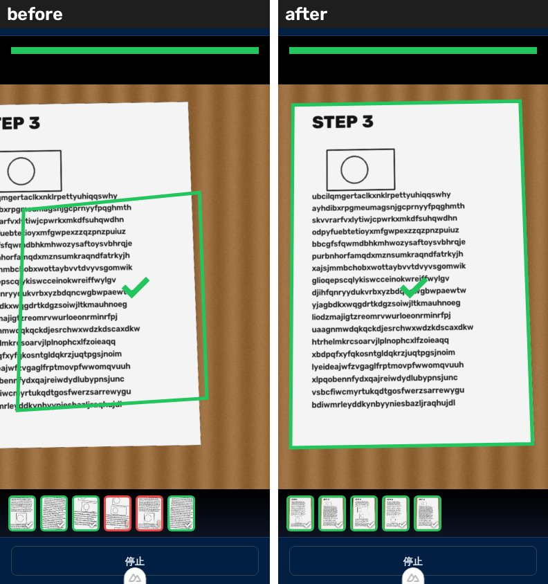
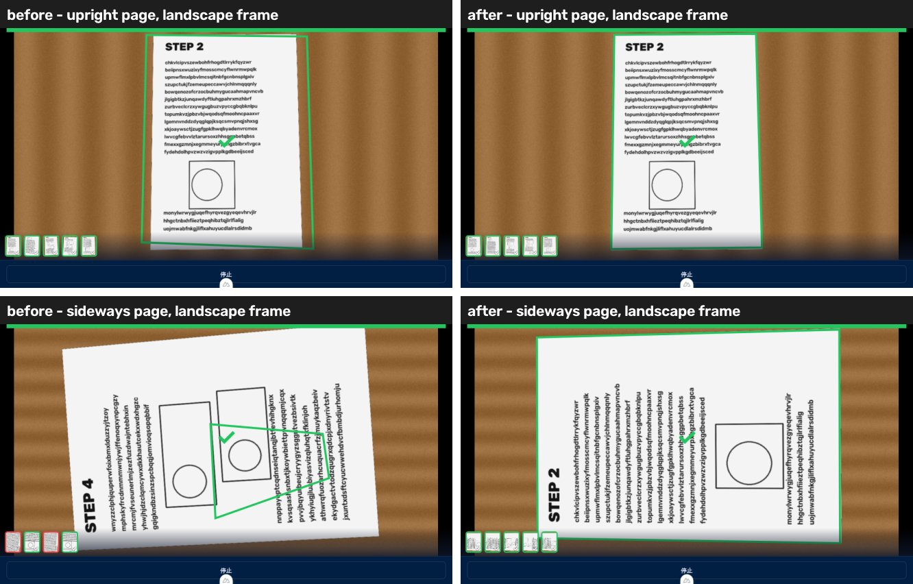
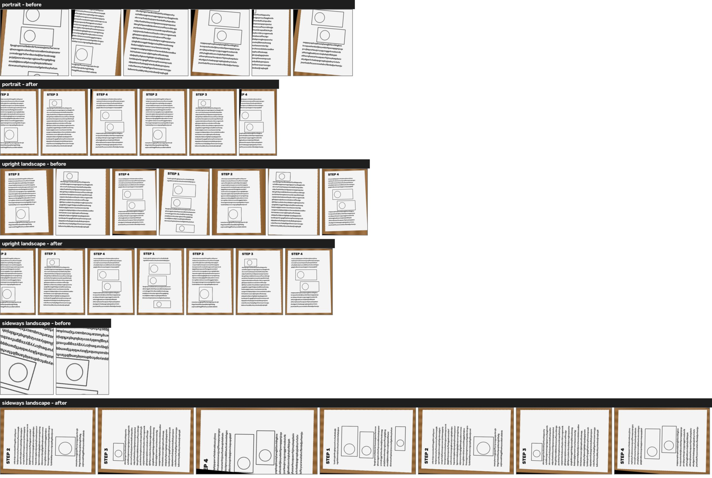

# 枠を紙の輪郭に合わせる（PR #7 の案 1・2・4）の結果（2026-11-01）

原因の調査は [corner-accuracy-investigation.md](corner-accuracy-investigation.md)。ここでは直した内容と、直す前と後の数字を書く。

## 直したこと（`packages/core/src/pipeline/`）

| 案 | 実装 | 場所 |
| --- | --- | --- |
| 1. box の中で紙の縁を探して角を寄せる | モデルの box を長辺の 8% 広げた範囲で Otsu → モルフォロジー → 最大輪郭 → 凸包 → 4 頂点に近似（直線あてはめ。4 点にならなければ minAreaRect）。輪郭が探索範囲の端（画面の端ではない側）に当たったら、その側を広げてやり直す（最大 2 回）。見つからなければ明るい側だけでもう一度 Otsu（明るい机の上の紙）。凸でない・面積が box の 0.6 倍未満か 1.8 倍超・探索範囲の 95% 超・モデルの 4 点の中心を含まない、のどれかならモデルの 4 点のまま | `corner-refine.ts` |
| 2. 横長フレームは回してから入れる | 横長フレームは 90° 回してモデルに入れ、点を元の向きに戻す（`yolo-decode.ts`）。ただし「どちらに回すか」「回さないか」はフレームだけでは決まらない（下の表のとおり、横長画面に縦向きの紙が写っていると回すと悪くなる）。そこで最初のフレームと 30 フレームごとに「回さない・右・左」の 3 通りを試し、寄せた後の紙のうちモデルの 4 点が覆う割合の移動平均がいちばん高い向きを使う。それ以外のフレームは 1 回だけ推論する | `orientation.ts`, `yolo-decode.ts` |
| 4. 4 点が box の 6 割未満なら✓にしない | `LiveCaptureJudge` に `minBoxAgreement: 0.6`。4 点の面積 / box の面積がこれ未満のフレームはページとして数えない（✓・撮り漏れ判定どちらにも使わない）。✓のときの静止画も同じ条件を満たさなければ動画のフレームを使う | `live-capture.ts`, `index.vue`（引数を渡すだけ） |

撮影画面の枠の描画と切り出し（`renderOverlay()` / `rotateAndCropQuad`）は変えていない。

## 4 点のずれ（`scripts/eval/corner-check/refine-eval.mjs`）

PR #7 の合成クリップ（`synth.py`、4 ページ、止めているフレーム 100 枚）で、ブラウザと同じ scan-core のコードを動かした結果。値は中央値。

- before: 今までのモデルの 4 点
- after: この PR（向きの選択 → 寄せる）

| クリップ | before のずれ | after のずれ | before の IoU | after の IoU | ✓の対象（≥0.6）before → after |
| --- | --- | --- | --- | --- | --- |
| 縦長 720×1280 | 184 px | 2.8 px | 0.53 | 0.99 | 35 → 100 |
| 横長 1280×720・紙が横向き（左回し、PR #7 の `--transpose`） | 575 px | 2.9 px | 0.13 | 0.99 | 0 → 100 |
| 横長・紙が横向き（右回し） | 397 px | 2.9 px | 0.20 | 0.99 | 0 → 100 |
| 横長・紙が縦向き（`synth.py --fit`） | 34 px | 1.9 px | 0.87 | 0.99 | 100 → 100 |
| 縦長・明るい机（`synth.py --light`） | 179 px | 3.6 px | 0.53 | 0.99 | 36 → 100 |

参考（単独の効果）: 「いつも右に回すだけ」（案 2 をそのまま）だと、紙が縦向きの横長クリップは 34 px → 403 px と悪くなる。向きを選ぶのはこのため。モデルの信頼度（conf）は逆さまのほうが高いことが多く、向き選びには使えなかった。

## 撮影画面（Playwright のテスト用カメラに合成クリップを流す、`app-e2e.mjs`）

Chromium の `--use-file-for-fake-video-capture` に合成クリップを流し、実際の `index.vue` で撮影した。縦長は Chromium が 720×1080 に切り詰めて渡す。




### ✓・赤い撮り漏れ案内・何も出ず抜けたページ（クリップを 4 周、1 周目はモデルの読み込みを含むので 2〜4 周目の計 12 ページ）

| クリップ | ✓が出たページ before → after | 赤い案内 before → after | 何も出ず抜けた before → after |
| --- | --- | --- | --- |
| 縦長 | 8 → 12 | 4 → 0 | 2 → 0 |
| 横長・紙が縦向き | 11 → 10 | 0 → 2 | 1 → 2 |
| 横長・紙が横向き | 6 → 11 | 3 → 0 | 4 → 1 |

横長・紙が縦向きは before でも 4 点が紙をほぼ囲んでいた（34 px）ので、✓の数は変わらない（11 と 10 の差は回ごとのばらつきの範囲）。このクリップで向きの試行を 10 フレームごとにしていたときは 8 だった。この環境（headless Chromium、WASM の推論）では 1 フレームの処理に 0.5 秒前後かかり、3 回推論するフレームがあると止めている間のサンプルが減る。そのため 30 フレームごとにした。

### ✓で保存されたページ画像



A4 の縦横比（±5%）で保存されたページ（＝紙全体）: 縦長 1/11 → 12/15、横長・紙が縦向き 2/15 → 14/14、横長・紙が横向き 0/8 → 11/13。

after で縦横比が合わない 5 枚は、画像を開いて確かめたものはどれも✓の後に撮る静止画（ImageCapture）で、合成クリップの紙がすでに左へ滑り出し始めていたもの（紙の端が画面外で黒くなる）。合成クリップの止めている時間が 2.5 秒と短く、この環境の処理が遅いため。切り出しの処理は変えていない。

## 分かっていること・未確認のこと

- 実映像では確かめていない（検証動画がリポにも環境にも無い）。合成の紙は机とのコントラストが強い。紙の束・手で押さえた紙・白い机では、寄せる処理が失敗してモデルの 4 点に戻る場面が増えるはず。戻ったときは案 4 で✓が出ないので、悪い切り出しは保存されにくい。
- 0.6 の基準は box（軸平行の四角）の面積と比べるため、紙が画面の中で 20° 以上傾くと正しい 4 点でも 0.6 を下回る（A4 で 20° のとき約 0.6）。
- 横向きの紙は、保存される画像も横向きのまま（今までどおりフレームの向きで切り出す）。
- 合成ページどうしは pHash が近く、撮影後のまとめ処理で全ページが「重複候補」になる。before も同じで、この PR とは関係ない。

## 再現

```bash
python3 -m pip install onnxruntime opencv-python-headless numpy
python3 -I scripts/eval/corner-check/synth.py /tmp/cc-p 720 1280 4
python3 -I scripts/eval/corner-check/synth.py /tmp/cc-l 1280 720 4 --fit
python3 -I scripts/eval/corner-check/synth.py /tmp/cc-g 720 1280 4 --light
M=apps/web/public/models/doc-corners.onnx
bun scripts/eval/corner-check/refine-eval.mjs $M /tmp/cc-p
bun scripts/eval/corner-check/refine-eval.mjs $M /tmp/cc-p --turn ccw   # cw も
bun scripts/eval/corner-check/refine-eval.mjs $M /tmp/cc-l
bun scripts/eval/corner-check/refine-eval.mjs $M /tmp/cc-g
# 撮影画面（dev サーバを起動しておく）
ffmpeg -framerate 10 -i /tmp/cc-p/frames/%04d.png -pix_fmt yuv420p /tmp/cc-p/clip.y4m
node scripts/eval/corner-check/app-e2e.mjs http://127.0.0.1:3000/ /tmp/cc-p/clip.y4m /tmp/cc-p/gt.json /tmp/out --loops 4
```
